### normal — `FvgOb`

| Taraf | İşlem | Günde | Kazanan | Ort. R | Toplam R | PF | Max DD (kasa) | Max DD (R) | Net | Funding (USDT) | Ort. süre (dk) | Ortanca stop | Masraf (R/işlem) |
|---|---|---|---|---|---|---|---|---|---|---|---|---|---|
| toplam | 1011 | 0.92 | 17.5% | -0.946 | -956.4 | 0.37 | 100.0% | 957.1 | -100.0% | 6 | 142 | 0.3% | 0.73 |
| long | 480 | 0.44 | 17.1% | -1.033 | -496.0 | 0.32 | — | 496.0 | -48.7% | -7 | 151 | 0.3% | 0.75 |
| short | 531 | 0.48 | 17.9% | -0.867 | -460.4 | 0.40 | — | 461.1 | -51.3% | 13 | 134 | 0.3% | 0.71 |

(Freqtrade'in hesap düşüşü: 100.0%. Süresi dolan giriş emri: 3850, hedef önce görüldüğü için iptal: 0, yuva dolu olduğu için alınamayan sinyal: 2509.)

| Yıl | Taraf | İşlem | Ort. R | PF | Net (USDT) |
|---|---|---|---|---|---|
| 2022 | toplam | 416 | -0.809 | 0.36 | -9667 |
| 2022 | long | 196 | -0.833 | 0.32 | -4699 |
| 2022 | short | 220 | -0.788 | 0.40 | -4968 |
| 2023 | toplam | 397 | -1.018 | 0.42 | -326 |
| 2023 | long | 191 | -1.184 | 0.31 | -169 |
| 2023 | short | 206 | -0.864 | 0.50 | -157 |
| 2024 | toplam | 198 | -1.089 | 0.28 | -6 |
| 2024 | long | 93 | -1.145 | 0.25 | -3 |
| 2024 | short | 105 | -1.039 | 0.31 | -3 |

| Coin | İşlem | Ort. R | Long ort. R | Short ort. R | Toplam R | Net (USDT) |
|---|---|---|---|---|---|---|
| BTC | 305 | -1.119 | -1.138 | -1.099 | -341.1 | -4744 |
| ETH | 455 | -0.987 | -1.083 | -0.902 | -449.0 | -2785 |
| SOL | 251 | -0.662 | -0.797 | -0.552 | -166.2 | -2470 |

Artıda biten coin: **0/3**.

| Taraf | stop_loss | tp | trailing_stop_loss |
|---|---|---|---|
| long | 398 (83%) | 82 (17%) | 0 (0%) |
| short | 431 (81%) | 95 (18%) | 5 (1%) |

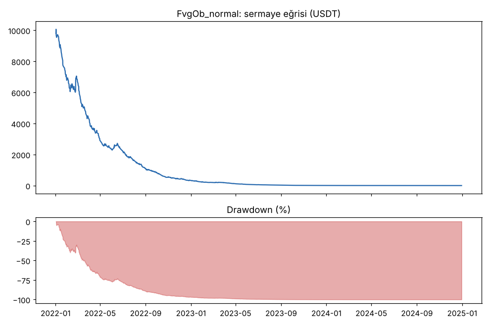
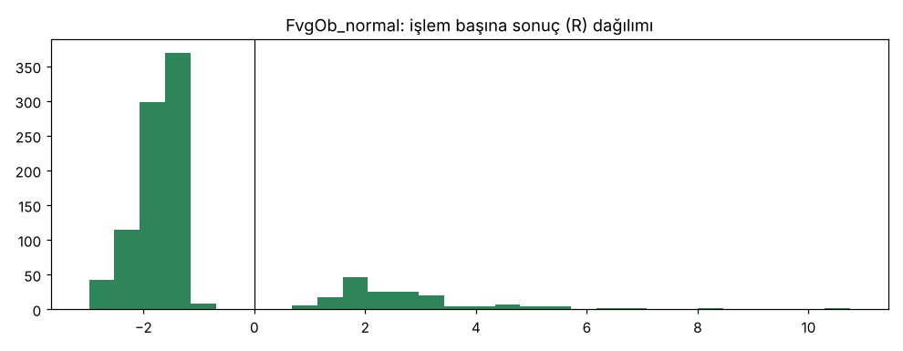

### masraf_x2 — `FvgOb`

| Taraf | İşlem | Günde | Kazanan | Ort. R | Toplam R | PF | Max DD (kasa) | Max DD (R) | Net | Funding (USDT) | Ort. süre (dk) | Ortanca stop | Masraf (R/işlem) |
|---|---|---|---|---|---|---|---|---|---|---|---|---|---|
| toplam | 624 | 0.57 | 16.7% | -1.641 | -1024.1 | 0.22 | 100.0% | 1024.1 | -100.0% | 5 | 155 | 0.3% | 1.42 |
| long | 294 | 0.27 | 17.3% | -1.666 | -489.7 | 0.18 | — | 489.7 | -47.0% | -6 | 171 | 0.3% | 1.41 |
| short | 330 | 0.30 | 16.1% | -1.619 | -534.4 | 0.25 | — | 534.4 | -52.9% | 11 | 141 | 0.3% | 1.43 |

(Freqtrade'in hesap düşüşü: 100.0%. Süresi dolan giriş emri: 2377, hedef önce görüldüğü için iptal: 0, yuva dolu olduğu için alınamayan sinyal: 1693.)

| Yıl | Taraf | İşlem | Ort. R | PF | Net (USDT) |
|---|---|---|---|---|---|
| 2022 | toplam | 415 | -1.390 | 0.22 | -9968 |
| 2022 | long | 196 | -1.423 | 0.18 | -4693 |
| 2022 | short | 219 | -1.361 | 0.25 | -5276 |
| 2023 | toplam | 209 | -2.139 | 0.19 | -31 |
| 2023 | long | 98 | -2.152 | 0.22 | -12 |
| 2023 | short | 111 | -2.128 | 0.18 | -19 |

| Coin | İşlem | Ort. R | Long ort. R | Short ort. R | Toplam R | Net (USDT) |
|---|---|---|---|---|---|---|
| BTC | 197 | -1.842 | -1.850 | -1.834 | -362.8 | -4878 |
| ETH | 257 | -1.875 | -1.854 | -1.894 | -481.9 | -2439 |
| SOL | 170 | -1.055 | -1.158 | -0.966 | -179.4 | -2683 |

Artıda biten coin: **0/3**.

| Taraf | stop_loss | tp | trailing_stop_loss |
|---|---|---|---|
| long | 242 (82%) | 52 (18%) | 0 (0%) |
| short | 270 (82%) | 58 (18%) | 2 (1%) |

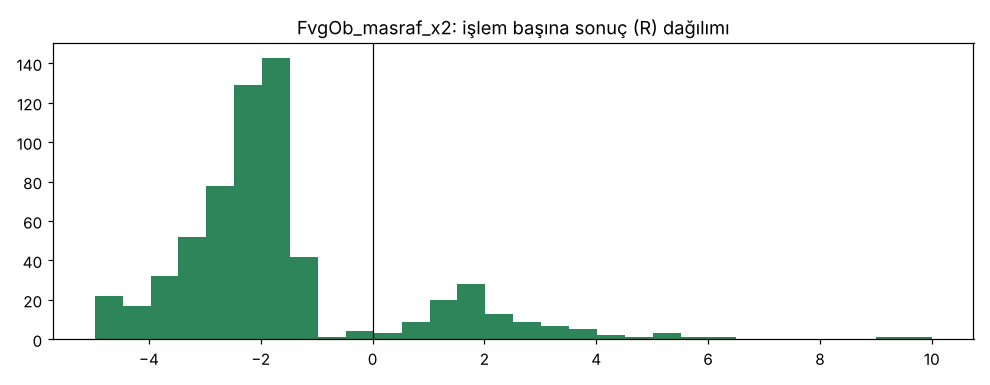

### dusuk_masraf_0.0003 — `FvgOb`

| Taraf | İşlem | Günde | Kazanan | Ort. R | Toplam R | PF | Max DD (kasa) | Max DD (R) | Net | Funding (USDT) | Ort. süre (dk) | Ortanca stop | Masraf (R/işlem) |
|---|---|---|---|---|---|---|---|---|---|---|---|---|---|
| toplam | 1260 | 1.15 | 18.5% | -0.389 | -489.8 | 0.57 | 99.4% | 491.6 | -99.3% | 4 | 156 | 0.3% | 0.21 |
| long | 599 | 0.55 | 19.5% | -0.399 | -239.3 | 0.51 | — | 239.3 | -52.5% | -17 | 161 | 0.3% | 0.21 |
| short | 661 | 0.60 | 17.5% | -0.379 | -250.5 | 0.62 | — | 257.4 | -46.8% | 21 | 151 | 0.3% | 0.20 |

(Freqtrade'in hesap düşüşü: 99.4%. Süresi dolan giriş emri: 4711, hedef önce görüldüğü için iptal: 0, yuva dolu olduğu için alınamayan sinyal: 3210.)

| Yıl | Taraf | İşlem | Ort. R | PF | Net (USDT) |
|---|---|---|---|---|---|
| 2022 | toplam | 416 | -0.400 | 0.55 | -8197 |
| 2022 | long | 196 | -0.421 | 0.51 | -4128 |
| 2022 | short | 220 | -0.382 | 0.58 | -4069 |
| 2023 | toplam | 422 | -0.381 | 0.65 | -1461 |
| 2023 | long | 207 | -0.513 | 0.48 | -1028 |
| 2023 | short | 215 | -0.253 | 0.80 | -434 |
| 2024 | toplam | 422 | -0.385 | 0.56 | -276 |
| 2024 | long | 196 | -0.258 | 0.66 | -95 |
| 2024 | short | 226 | -0.495 | 0.48 | -181 |

| Coin | İşlem | Ort. R | Long ort. R | Short ort. R | Toplam R | Net (USDT) |
|---|---|---|---|---|---|---|
| BTC | 476 | -0.472 | -0.383 | -0.558 | -224.9 | -4658 |
| ETH | 386 | -0.401 | -0.465 | -0.343 | -154.6 | -3007 |
| SOL | 398 | -0.277 | -0.355 | -0.210 | -110.2 | -2269 |

Artıda biten coin: **0/3**.

| Taraf | stop_loss | tp | trailing_stop_loss |
|---|---|---|---|
| long | 482 (80%) | 117 (20%) | 0 (0%) |
| short | 541 (82%) | 116 (18%) | 4 (1%) |

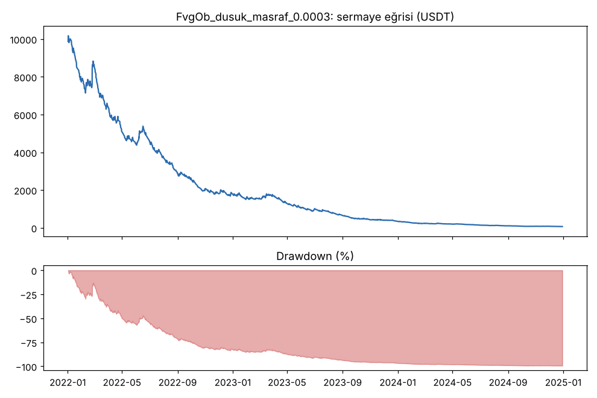
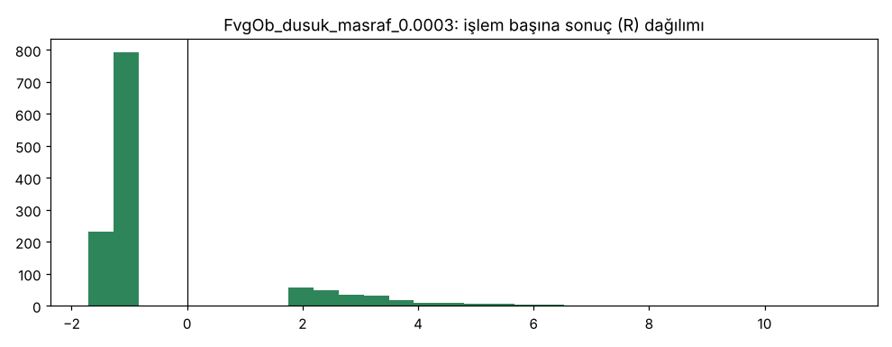

### masrafsiz — `FvgOb`

| Taraf | İşlem | Günde | Kazanan | Ort. R | Toplam R | PF | Max DD (kasa) | Max DD (R) | Net | Funding (USDT) | Ort. süre (dk) | Ortanca stop | Masraf (R/işlem) |
|---|---|---|---|---|---|---|---|---|---|---|---|---|---|
| toplam | 1274 | 1.16 | 18.1% | -0.198 | -252.1 | 0.73 | 93.6% | 260.9 | -93.1% | 1 | 156 | 0.3% | 0.00 |
| long | 600 | 0.55 | 18.8% | -0.217 | -130.1 | 0.67 | — | 130.1 | -54.8% | -55 | 162 | 0.3% | 0.00 |
| short | 674 | 0.61 | 17.5% | -0.181 | -122.0 | 0.79 | — | 141.5 | -38.3% | 56 | 150 | 0.3% | 0.00 |

(Freqtrade'in hesap düşüşü: 93.6%. Süresi dolan giriş emri: 4729, hedef önce görüldüğü için iptal: 0, yuva dolu olduğu için alınamayan sinyal: 3206.)

| Yıl | Taraf | İşlem | Ort. R | PF | Net (USDT) |
|---|---|---|---|---|---|
| 2022 | toplam | 416 | -0.225 | 0.69 | -6282 |
| 2022 | long | 196 | -0.244 | 0.65 | -3308 |
| 2022 | short | 220 | -0.209 | 0.72 | -2974 |
| 2023 | toplam | 422 | -0.141 | 0.83 | -1798 |
| 2023 | long | 207 | -0.265 | 0.64 | -1813 |
| 2023 | short | 215 | -0.022 | 1.00 | 15 |
| 2024 | toplam | 436 | -0.227 | 0.72 | -1230 |
| 2024 | long | 197 | -0.139 | 0.82 | -355 |
| 2024 | short | 239 | -0.299 | 0.64 | -876 |

| Coin | İşlem | Ort. R | Long ort. R | Short ort. R | Toplam R | Net (USDT) |
|---|---|---|---|---|---|---|
| BTC | 471 | -0.259 | -0.176 | -0.339 | -122.2 | -4626 |
| ETH | 382 | -0.167 | -0.238 | -0.105 | -63.9 | -2548 |
| SOL | 421 | -0.157 | -0.246 | -0.081 | -66.0 | -2136 |

Artıda biten coin: **0/3**.

| Taraf | stop_loss | tp | trailing_stop_loss |
|---|---|---|---|
| long | 487 (81%) | 113 (19%) | 0 (0%) |
| short | 552 (82%) | 118 (18%) | 4 (1%) |

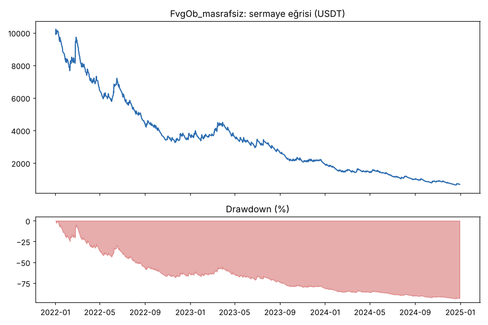
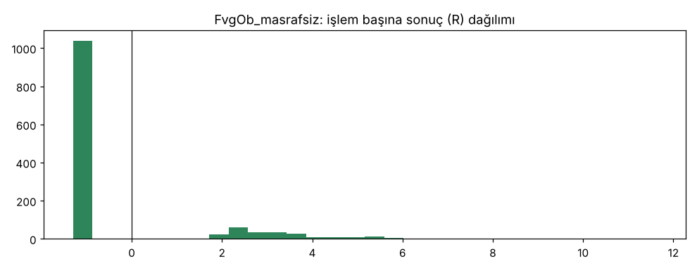

### ters_sira — `FvgOb`

| Taraf | İşlem | Günde | Kazanan | Ort. R | Toplam R | PF | Max DD (kasa) | Max DD (R) | Net | Funding (USDT) | Ort. süre (dk) | Ortanca stop | Masraf (R/işlem) |
|---|---|---|---|---|---|---|---|---|---|---|---|---|---|
| toplam | 1024 | 0.93 | 17.2% | -0.914 | -936.3 | 0.38 | 100.0% | 936.3 | -100.0% | 18 | 137 | 0.3% | 0.68 |
| long | 476 | 0.43 | 15.8% | -1.034 | -492.4 | 0.22 | — | 492.4 | -60.6% | 4 | 143 | 0.3% | 0.69 |
| short | 548 | 0.50 | 18.4% | -0.810 | -443.9 | 0.53 | — | 444.6 | -39.4% | 14 | 131 | 0.3% | 0.67 |

(Freqtrade'in hesap düşüşü: 100.0%. Süresi dolan giriş emri: 3914, hedef önce görüldüğü için iptal: 0, yuva dolu olduğu için alınamayan sinyal: 2521.)

| Yıl | Taraf | İşlem | Ort. R | PF | Net (USDT) |
|---|---|---|---|---|---|
| 2022 | toplam | 427 | -0.723 | 0.38 | -9562 |
| 2022 | long | 201 | -0.915 | 0.21 | -5903 |
| 2022 | short | 226 | -0.552 | 0.54 | -3659 |
| 2023 | toplam | 388 | -1.027 | 0.41 | -429 |
| 2023 | long | 177 | -1.083 | 0.46 | -155 |
| 2023 | short | 211 | -0.980 | 0.38 | -274 |
| 2024 | toplam | 209 | -1.096 | 0.27 | -8 |
| 2024 | long | 98 | -1.192 | 0.17 | -5 |
| 2024 | short | 111 | -1.011 | 0.37 | -3 |

| Coin | İşlem | Ort. R | Long ort. R | Short ort. R | Toplam R | Net (USDT) |
|---|---|---|---|---|---|---|
| BTC | 215 | -0.987 | -1.197 | -0.800 | -212.1 | -2326 |
| ETH | 480 | -1.052 | -1.090 | -1.018 | -504.9 | -4528 |
| SOL | 329 | -0.666 | -0.840 | -0.522 | -219.2 | -3145 |

Artıda biten coin: **0/3**.

| Taraf | stop_loss | tp | trailing_stop_loss |
|---|---|---|---|
| long | 401 (84%) | 75 (16%) | 0 (0%) |
| short | 442 (81%) | 101 (18%) | 5 (1%) |

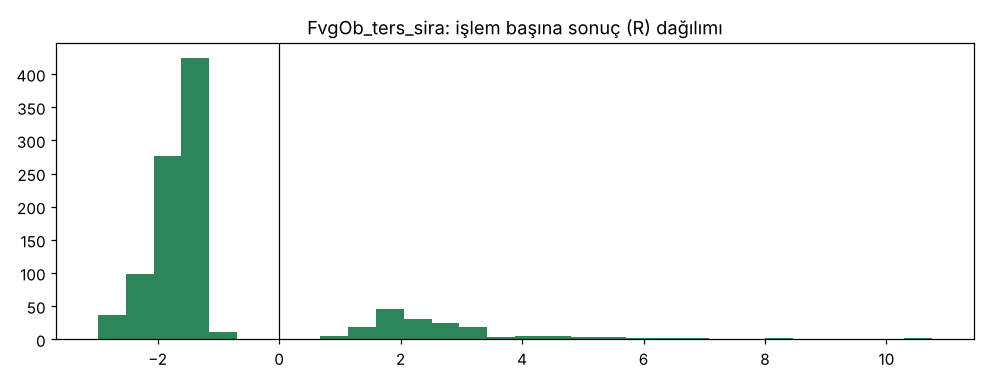

### edge — `FvgObEdge`

| Taraf | İşlem | Günde | Kazanan | Ort. R | Toplam R | PF | Max DD (kasa) | Max DD (R) | Net | Funding (USDT) | Ort. süre (dk) | Ortanca stop | Masraf (R/işlem) |
|---|---|---|---|---|---|---|---|---|---|---|---|---|---|
| toplam | 993 | 0.91 | 19.9% | -0.801 | -795.4 | 0.45 | 100.0% | 798.2 | -100.0% | 18 | 175 | 0.4% | 0.67 |
| long | 473 | 0.43 | 20.7% | -0.797 | -377.0 | 0.38 | — | 379.5 | -53.0% | -7 | 186 | 0.3% | 0.67 |
| short | 520 | 0.47 | 19.2% | -0.804 | -418.3 | 0.51 | — | 422.2 | -46.9% | 24 | 164 | 0.4% | 0.66 |

(Freqtrade'in hesap düşüşü: 100.0%. Süresi dolan giriş emri: 3523, hedef önce görüldüğü için iptal: 0, yuva dolu olduğu için alınamayan sinyal: 1963.)

| Yıl | Taraf | İşlem | Ort. R | PF | Net (USDT) |
|---|---|---|---|---|---|
| 2022 | toplam | 372 | -0.728 | 0.45 | -9366 |
| 2022 | long | 175 | -0.769 | 0.38 | -4986 |
| 2022 | short | 197 | -0.691 | 0.51 | -4380 |
| 2023 | toplam | 386 | -0.839 | 0.46 | -607 |
| 2023 | long | 186 | -0.890 | 0.41 | -307 |
| 2023 | short | 200 | -0.792 | 0.50 | -300 |
| 2024 | toplam | 235 | -0.854 | 0.42 | -22 |
| 2024 | long | 112 | -0.686 | 0.45 | -10 |
| 2024 | short | 123 | -1.007 | 0.38 | -12 |

| Coin | İşlem | Ort. R | Long ort. R | Short ort. R | Toplam R | Net (USDT) |
|---|---|---|---|---|---|---|
| BTC | 330 | -0.878 | -0.819 | -0.933 | -289.7 | -3804 |
| ETH | 403 | -0.903 | -0.922 | -0.883 | -363.8 | -3669 |
| SOL | 260 | -0.545 | -0.541 | -0.549 | -141.8 | -2523 |

Artıda biten coin: **0/3**.

| Taraf | stop_loss | tp | trailing_stop_loss |
|---|---|---|---|
| long | 375 (79%) | 98 (21%) | 0 (0%) |
| short | 418 (80%) | 100 (19%) | 2 (0%) |

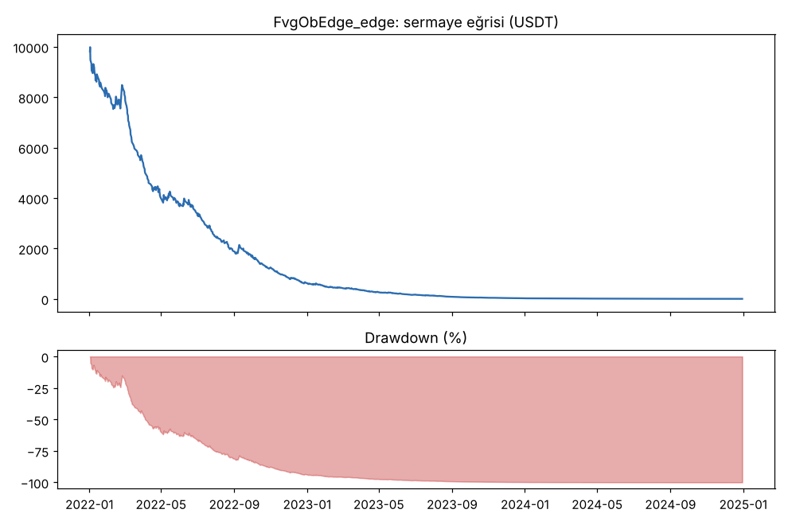
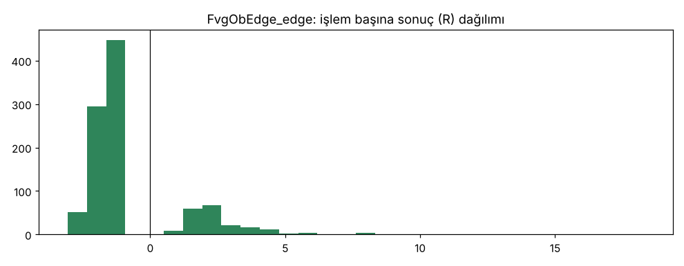

### detay_1m — `FvgOb`

| Taraf | İşlem | Günde | Kazanan | Ort. R | Toplam R | PF | Max DD (kasa) | Max DD (R) | Net | Funding (USDT) | Ort. süre (dk) | Ortanca stop | Masraf (R/işlem) |
|---|---|---|---|---|---|---|---|---|---|---|---|---|---|
| toplam | 1008 | 0.92 | 17.5% | -0.936 | -944.0 | 0.36 | 100.0% | 944.7 | -100.0% | 8 | 139 | 0.3% | 0.72 |
| long | 478 | 0.44 | 17.4% | -0.997 | -476.7 | 0.32 | — | 476.7 | -48.8% | -6 | 149 | 0.3% | 0.73 |
| short | 530 | 0.48 | 17.5% | -0.882 | -467.3 | 0.40 | — | 468.0 | -51.2% | 14 | 131 | 0.3% | 0.71 |

(Freqtrade'in hesap düşüşü: 100.0%. Süresi dolan giriş emri: 3929, hedef önce görüldüğü için iptal: 0, yuva dolu olduğu için alınamayan sinyal: 7987.)

| Yıl | Taraf | İşlem | Ort. R | PF | Net (USDT) |
|---|---|---|---|---|---|
| 2022 | toplam | 416 | -0.811 | 0.36 | -9671 |
| 2022 | long | 197 | -0.838 | 0.32 | -4710 |
| 2022 | short | 219 | -0.787 | 0.40 | -4961 |
| 2023 | toplam | 396 | -0.980 | 0.42 | -321 |
| 2023 | long | 188 | -1.088 | 0.33 | -164 |
| 2023 | short | 208 | -0.882 | 0.49 | -158 |
| 2024 | toplam | 196 | -1.115 | 0.24 | -7 |
| 2024 | long | 93 | -1.150 | 0.20 | -4 |
| 2024 | short | 103 | -1.082 | 0.27 | -3 |

| Coin | İşlem | Ort. R | Long ort. R | Short ort. R | Toplam R | Net (USDT) |
|---|---|---|---|---|---|---|
| BTC | 300 | -1.121 | -1.132 | -1.111 | -336.3 | -4744 |
| ETH | 455 | -0.979 | -1.042 | -0.923 | -445.6 | -2782 |
| SOL | 253 | -0.640 | -0.741 | -0.557 | -162.0 | -2473 |

Artıda biten coin: **0/3**.

| Taraf | stop_loss | tp | trailing_stop_loss |
|---|---|---|---|
| long | 395 (83%) | 83 (17%) | 0 (0%) |
| short | 432 (82%) | 93 (18%) | 5 (1%) |

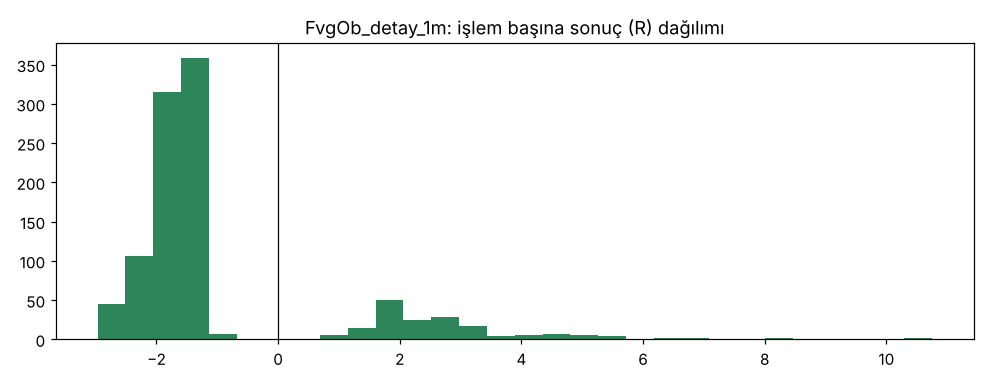

### Al-tut (aynı dönem, aynı coinler)

| Coin | Al-tut getirisi | Al-tut max DD |
|---|---|---|
| BTC | 102.0% | 67.7% |
| ETH | -9.5% | 77.2% |
| SOL | 11.0% | 95.5% |
| **Eşit ağırlık ortalama** | **34.5%** | 80.1% (ortalama) |

Yıllara göre eşit ağırlıklı al-tut: 2022: -75.5%, 2023: 389.1%, 2024: 83.6%
