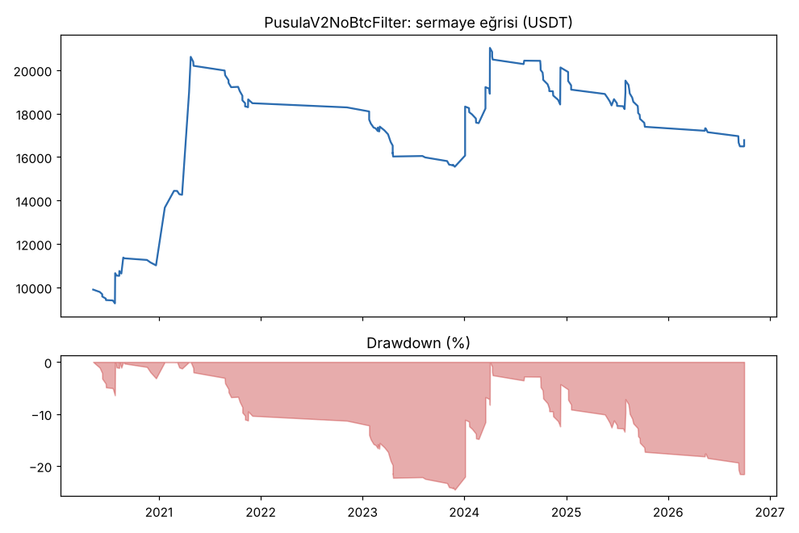
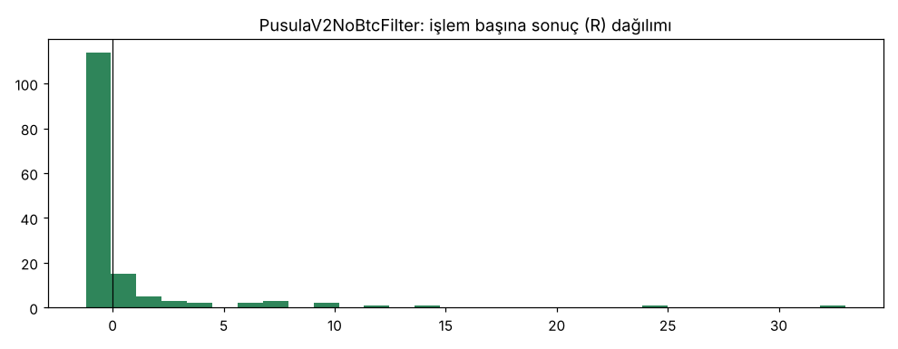
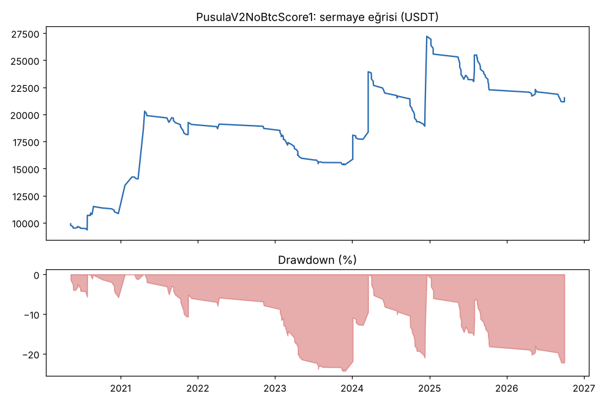

# PusulaV2NoBtcFilter vs PusulaV2NoBtcScore1 — cikarma2_new20 — 2026-10-11

## Özet
- **PusulaV2NoBtcFilter**: 150 işlem, işlem başına ortalama **0.46R** (maliyet ve funding dahil), net getiri 67.8%, en büyük düşüş 24.6%.
- **PusulaV2NoBtcScore1**: 201 işlem, işlem başına ortalama **0.52R** (maliyet ve funding dahil), net getiri 115.3%, en büyük düşüş 22.2%.
- Aynı dönemde coinleri al-tut (eşit ağırlık): getiri 194.7%, ortalama en büyük düşüş 97.6%.

## Ayarlar
- Dönem: 2020-04-11 00:00:00 → 2026-09-30 20:00:00
- Coinler: FIL/USDT:USDT, UNI/USDT:USDT, AAVE/USDT:USDT, NEAR/USDT:USDT, ALGO/USDT:USDT, XTZ/USDT:USDT, THETA/USDT:USDT, VET/USDT:USDT, ICP/USDT:USDT, SAND/USDT:USDT, MANA/USDT:USDT, AXS/USDT:USDT, EGLD/USDT:USDT, HBAR/USDT:USDT, CHZ/USDT:USDT, ENJ/USDT:USDT, ZEC/USDT:USDT, DASH/USDT:USDT, NEO/USDT:USDT, IOTA/USDT:USDT
- Zaman dilimi: 4h
- Yön: long + short
- Mod: futures / isolated
- Kaldıraç: en fazla 3x, likidasyon stop mesafesinin en az 2 katı uzakta (bölüm 7.6)
- Risk: işlem başına sermayenin %1'i (pozisyon büyüklüğü stop mesafesine göre)
- Maliyet: her emir için %0.05 komisyon + %0.05 kayma (= %0.1), funding geçmiş veriden
- Başlangıç sermayesi: 10000 USDT

## Metrikler
| Metrik | PusulaV2NoBtcFilter | PusulaV2NoBtcScore1 | Al-tut |
|---|---|---|---|
| Net getiri | 67.8% | 115.3% | 194.7% |
| Max drawdown | 24.6% | 22.2% | 97.6% |
| Profit factor | 1.41 | 1.47 | — |
| Ortalama R | 0.46 | 0.52 | — |
| İşlem sayısı | 150 | 201 | — |
| Winrate | 19.3% | 20.9% | — |

Winrate tek başına başarı ölçütü değildir; asıl ölçüt ortalama R (expectancy) ve drawdown'dur.

## Long / short ayrımı
| Strateji | Yön | İşlem | Ortalama R | Toplam R | Profit factor |
|---|---|---|---|---|---|
| PusulaV2NoBtcFilter | long | 150 | 0.46 | 68.51 | 1.41 |
| PusulaV2NoBtcFilter | short | 0 | — | 0.00 | — |
| PusulaV2NoBtcScore1 | long | 201 | 0.52 | 104.81 | 1.47 |
| PusulaV2NoBtcScore1 | short | 0 | — | 0.00 | — |

## Sinyal istatistikleri
| Strateji | Stop | BE | TP1 sonrası BE | TP2 | Diğer | İptal (bölgeye gelmedi / önce stop) | Toplam funding (USDT) |
|---|---|---|---|---|---|---|---|
| PusulaV2NoBtcFilter | 49.3% | 13.3% | 0.0% | 0.0% | 37.3% | 5.1% | -3070.58 |
| PusulaV2NoBtcScore1 | 47.8% | 14.4% | 0.0% | 0.0% | 37.8% | 6.1% | -3762.08 |

## Coin bazında
| Strateji | Coin | İşlem | Ortalama R | Toplam R | Al-tut getirisi |
|---|---|---|---|---|---|
| PusulaV2NoBtcFilter | FIL/USDT:USDT | 3 | 10.46 | 31.38 | -97.9% |
| PusulaV2NoBtcFilter | UNI/USDT:USDT | 17 | -0.38 | -6.54 | 62.4% |
| PusulaV2NoBtcFilter | AAVE/USDT:USDT | 15 | -0.59 | -8.91 | 286.5% |
| PusulaV2NoBtcFilter | NEAR/USDT:USDT | 7 | 1.41 | 9.88 | 373.4% |
| PusulaV2NoBtcFilter | ALGO/USDT:USDT | 8 | 0.37 | 3.00 | -47.9% |
| PusulaV2NoBtcFilter | XTZ/USDT:USDT | 13 | 0.01 | 0.14 | -84.3% |
| PusulaV2NoBtcFilter | THETA/USDT:USDT | 10 | 1.71 | 17.07 | -48.0% |
| PusulaV2NoBtcFilter | VET/USDT:USDT | 7 | 2.59 | 18.13 | 139.2% |
| PusulaV2NoBtcFilter | ICP/USDT:USDT | 4 | -0.56 | -2.25 | -99.3% |
| PusulaV2NoBtcFilter | SAND/USDT:USDT | 3 | -0.73 | -2.19 | -54.0% |
| PusulaV2NoBtcFilter | MANA/USDT:USDT | 5 | -0.31 | -1.57 | -91.4% |
| PusulaV2NoBtcFilter | AXS/USDT:USDT | 3 | -1.03 | -3.09 | 136.4% |
| PusulaV2NoBtcFilter | EGLD/USDT:USDT | 5 | -0.16 | -0.80 | -65.7% |
| PusulaV2NoBtcFilter | HBAR/USDT:USDT | 2 | -0.06 | -0.12 | -68.6% |
| PusulaV2NoBtcFilter | CHZ/USDT:USDT | 7 | -0.67 | -4.66 | -26.0% |
| PusulaV2NoBtcFilter | ENJ/USDT:USDT | 2 | 2.32 | 4.65 | -83.5% |
| PusulaV2NoBtcFilter | ZEC/USDT:USDT | 8 | -0.48 | -3.81 | 3815.4% |
| PusulaV2NoBtcFilter | DASH/USDT:USDT | 12 | 0.32 | 3.83 | -19.1% |
| PusulaV2NoBtcFilter | NEO/USDT:USDT | 11 | 0.84 | 9.28 | -65.8% |
| PusulaV2NoBtcFilter | IOTA/USDT:USDT | 8 | 0.64 | 5.10 | -66.9% |
| PusulaV2NoBtcScore1 | FIL/USDT:USDT | 7 | 4.03 | 28.21 | -97.9% |
| PusulaV2NoBtcScore1 | UNI/USDT:USDT | 22 | 0.87 | 19.14 | 62.4% |
| PusulaV2NoBtcScore1 | AAVE/USDT:USDT | 17 | -0.64 | -10.93 | 286.5% |
| PusulaV2NoBtcScore1 | NEAR/USDT:USDT | 11 | -0.21 | -2.28 | 373.4% |
| PusulaV2NoBtcScore1 | ALGO/USDT:USDT | 12 | 2.92 | 35.08 | -47.9% |
| PusulaV2NoBtcScore1 | XTZ/USDT:USDT | 16 | 0.18 | 2.91 | -84.3% |
| PusulaV2NoBtcScore1 | THETA/USDT:USDT | 8 | 2.45 | 19.59 | -48.0% |
| PusulaV2NoBtcScore1 | VET/USDT:USDT | 13 | 1.07 | 13.92 | 139.2% |
| PusulaV2NoBtcScore1 | ICP/USDT:USDT | 4 | -0.30 | -1.20 | -99.3% |
| PusulaV2NoBtcScore1 | SAND/USDT:USDT | 4 | -0.69 | -2.76 | -54.0% |
| PusulaV2NoBtcScore1 | MANA/USDT:USDT | 7 | -0.55 | -3.84 | -91.4% |
| PusulaV2NoBtcScore1 | AXS/USDT:USDT | 2 | -0.49 | -0.98 | 136.4% |
| PusulaV2NoBtcScore1 | EGLD/USDT:USDT | 8 | -0.48 | -3.86 | -65.7% |
| PusulaV2NoBtcScore1 | HBAR/USDT:USDT | 6 | -0.66 | -3.96 | -68.6% |
| PusulaV2NoBtcScore1 | CHZ/USDT:USDT | 6 | -0.68 | -4.10 | -26.0% |
| PusulaV2NoBtcScore1 | ENJ/USDT:USDT | 4 | 0.99 | 3.97 | -83.5% |
| PusulaV2NoBtcScore1 | ZEC/USDT:USDT | 13 | -0.09 | -1.13 | 3815.4% |
| PusulaV2NoBtcScore1 | DASH/USDT:USDT | 17 | 0.32 | 5.46 | -19.1% |
| PusulaV2NoBtcScore1 | NEO/USDT:USDT | 15 | 0.49 | 7.39 | -65.8% |
| PusulaV2NoBtcScore1 | IOTA/USDT:USDT | 9 | 0.46 | 4.16 | -66.9% |

## Grafikler

## Yorum: güçlü yanlar / şüpheli noktalar
_(Claude tarafından rakamlara bakılarak yazılır.)_

## Karar: devam / düzelt / emekli
_(Claude tarafından yazılır, gerekçesiyle.)_
