### normal — `SfpSweep`

| Taraf | İşlem | Günde | Kazanan | Ort. R | Toplam R | PF (USDT) | PF (R) | Max DD (kasa) | Max DD (R) | Net | Funding (USDT) | Ort. süre (dk) |
|---|---|---|---|---|---|---|---|---|---|---|---|---|
| toplam | 1024 | 0.93 | 25.9% | 0.372 | 381.2 | 0.35 | 1.40 | 99.9% | 670.3 | -98.6% | -11 | 1019 |
| long | 465 | 0.42 | 23.2% | 1.593 | 740.7 | 0.29 | 2.72 | — | 305.0 | -43.8% | -33 | 2126 |
| short | 559 | 0.51 | 28.1% | -0.643 | -359.5 | 0.40 | 0.32 | — | 366.6 | -54.8% | 22 | 98 |

Freqtrade'in hesap düşüşü: 99.9%. 3 kayıp → 24 saat duraklaması: **184** kez. Ortalama kaldıraç: 10.0x.

Veri sonunda zorla kapatılan işlem: 1 (ortalama 1045.7R). Bunlar hariç ortalama: toplam **-0.649R**, long -0.657R, short -0.643R.

| Yıl | Taraf | İşlem | Ort. R | PF | Net (USDT) |
|---|---|---|---|---|---|
| 2022 | toplam | 882 | -0.610 | 0.35 | -9953 |
| 2022 | long | 392 | -0.605 | 0.27 | -4493 |
| 2022 | short | 490 | -0.614 | 0.40 | -5460 |
| 2023 | toplam | 141 | -0.896 | 0.22 | -31 |
| 2023 | long | 72 | -0.943 | 0.21 | -16 |
| 2023 | short | 69 | -0.847 | 0.23 | -16 |
| 2024 | toplam | 1 | 1045.655 | ∞ | 126 |
| 2024 | long | 1 | 1045.655 | ∞ | 126 |

| Coin | İşlem | Ort. R | Long ort. R | Short ort. R | Toplam R | Net (USDT) |
|---|---|---|---|---|---|---|
| BTC | 410 | 1.863 | 4.778 | -0.631 | 763.7 | -4424 |
| ETH | 349 | -0.648 | -0.667 | -0.635 | -226.1 | -2961 |
| SOL | 265 | -0.590 | -0.506 | -0.677 | -156.4 | -2473 |

Artıda biten coin: **0/3**.

| Taraf | Sonuç | İşlem | Pay | Ort. R |
|---|---|---|---|---|
| long | Stop | 258 | 55% | -1.539 |
| long | TP1 sonrası BE | 149 | 32% | -0.101 |
| long | TP2 | 57 | 12% | 1.880 |
| long | force_exit | 1 | 0% | 1045.655 |
| short | Stop | 318 | 57% | -1.578 |
| short | TP1 sonrası BE | 152 | 27% | 0.046 |
| short | TP2 | 89 | 16% | 1.522 |

TP1 < 1R olan işlem (veri sonunda zorla kapatılanlar hariç): **401/1023** (39%), ortalama -0.644R; TP1 ≥ 1R olanlar -0.653R. TP1 mesafesi ortancası 1.25R (sinyal kapanışına göre).

Stop mesafesi ortancası: **%0.39** (çeyrekler %0.28 – %0.57). Normal masrafta (%0.1/emir) giriş+çıkış masrafı ortanca **0.51R**.

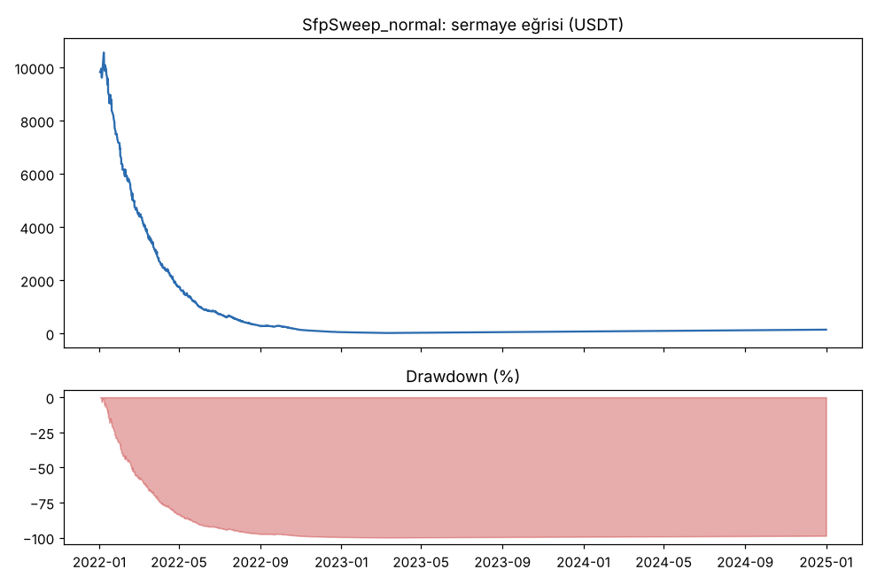
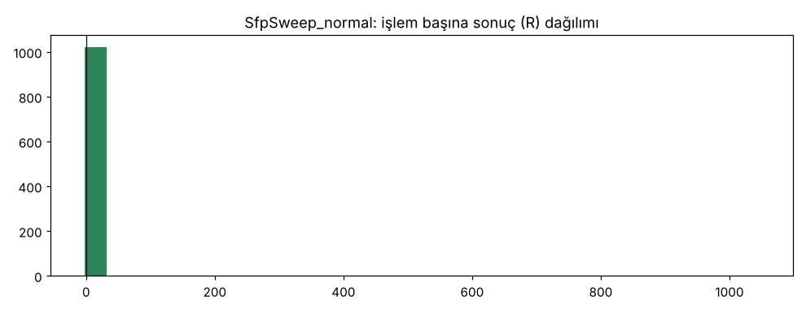

### normal — `SfpSweep1h`

| Taraf | İşlem | Günde | Kazanan | Ort. R | Toplam R | PF (USDT) | PF (R) | Max DD (kasa) | Max DD (R) | Net | Funding (USDT) | Ort. süre (dk) |
|---|---|---|---|---|---|---|---|---|---|---|---|---|
| toplam | 999 | 0.91 | 26.3% | -0.578 | -576.9 | 0.59 | 0.42 | 99.6% | 586.5 | -99.6% | 11 | 393 |
| long | 514 | 0.47 | 28.0% | -0.545 | -280.3 | 0.60 | 0.43 | — | 289.4 | -47.9% | -21 | 329 |
| short | 485 | 0.44 | 24.5% | -0.612 | -296.6 | 0.57 | 0.41 | — | 299.6 | -51.8% | 32 | 462 |

Freqtrade'in hesap düşüşü: 99.6%. 3 kayıp → 24 saat duraklaması: **180** kez. Ortalama kaldıraç: 10.0x.

| Yıl | Taraf | İşlem | Ort. R | PF | Net (USDT) |
|---|---|---|---|---|---|
| 2022 | toplam | 365 | -0.428 | 0.62 | -7982 |
| 2022 | long | 181 | -0.388 | 0.63 | -3934 |
| 2022 | short | 184 | -0.466 | 0.61 | -4048 |
| 2023 | toplam | 412 | -0.531 | 0.34 | -1793 |
| 2023 | long | 210 | -0.465 | 0.42 | -747 |
| 2023 | short | 202 | -0.600 | 0.27 | -1047 |
| 2024 | toplam | 222 | -0.910 | 0.34 | -187 |
| 2024 | long | 123 | -0.913 | 0.32 | -106 |
| 2024 | short | 99 | -0.905 | 0.36 | -81 |

| Coin | İşlem | Ort. R | Long ort. R | Short ort. R | Toplam R | Net (USDT) |
|---|---|---|---|---|---|---|
| BTC | 369 | -0.702 | -0.625 | -0.779 | -258.9 | -5142 |
| ETH | 338 | -0.475 | -0.659 | -0.257 | -160.5 | -3021 |
| SOL | 292 | -0.540 | -0.302 | -0.777 | -157.6 | -1799 |

Artıda biten coin: **0/3**.

| Taraf | Sonuç | İşlem | Pay | Ort. R |
|---|---|---|---|---|
| long | Stop | 331 | 64% | -1.470 |
| long | TP1 sonrası BE | 119 | 23% | 0.300 |
| long | TP2 | 64 | 12% | 2.667 |
| short | Stop | 336 | 69% | -1.459 |
| short | TP1 sonrası BE | 94 | 19% | 0.433 |
| short | TP2 | 55 | 11% | 2.780 |

TP1 < 1R olan işlem (veri sonunda zorla kapatılanlar hariç): **209/999** (21%), ortalama -0.536R; TP1 ≥ 1R olanlar -0.588R. TP1 mesafesi ortancası 1.92R (sinyal kapanışına göre).

Stop mesafesi ortancası: **%0.49** (çeyrekler %0.34 – %0.69). Normal masrafta (%0.1/emir) giriş+çıkış masrafı ortanca **0.41R**.

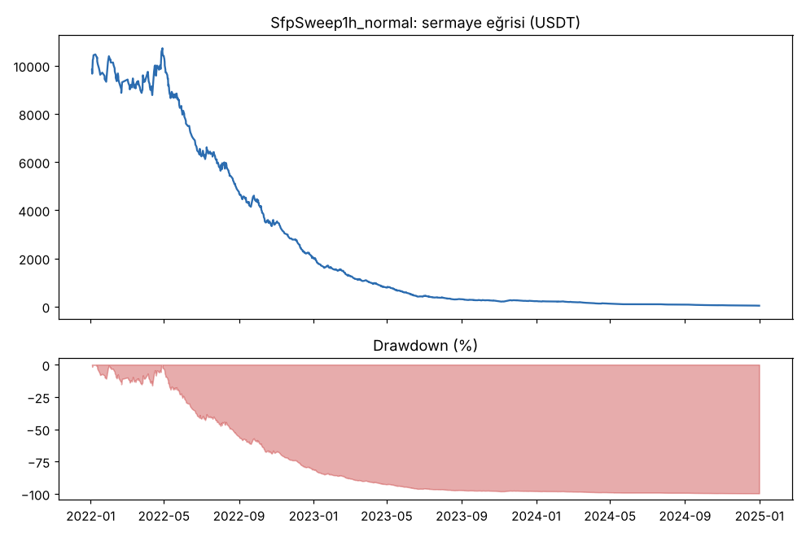
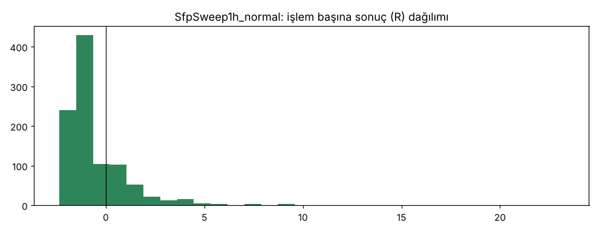

### masraf_x2 — `SfpSweep`

| Taraf | İşlem | Günde | Kazanan | Ort. R | Toplam R | PF (USDT) | PF (R) | Max DD (kasa) | Max DD (R) | Net | Funding (USDT) | Ort. süre (dk) |
|---|---|---|---|---|---|---|---|---|---|---|---|---|
| toplam | 636 | 0.58 | 16.5% | 2.551 | 1622.7 | 0.16 | 2.88 | 99.9% | 747.7 | -98.6% | -12 | 1893 |
| long | 286 | 0.26 | 14.3% | 7.096 | 2029.5 | 0.09 | 6.29 | — | 341.0 | -45.8% | -27 | 3777 |
| short | 350 | 0.32 | 18.3% | -1.162 | -406.7 | 0.21 | 0.15 | — | 409.5 | -52.8% | 15 | 354 |

Freqtrade'in hesap düşüşü: 99.9%. 3 kayıp → 24 saat duraklaması: **142** kez. Ortalama kaldıraç: 10.0x.

Veri sonunda zorla kapatılan işlem: 1 (ortalama 2370.4R). Bunlar hariç ortalama: toplam **-1.178R**, long -1.196R, short -1.162R.

| Yıl | Taraf | İşlem | Ort. R | PF | Net (USDT) |
|---|---|---|---|---|---|
| 2022 | toplam | 632 | -1.172 | 0.15 | -9992 |
| 2022 | long | 285 | -1.196 | 0.07 | -4710 |
| 2022 | short | 347 | -1.152 | 0.21 | -5281 |
| 2023 | toplam | 3 | -2.368 | 0.00 | -0 |
| 2023 | short | 3 | -2.368 | 0.00 | -0 |
| 2024 | toplam | 1 | 2370.447 | ∞ | 132 |
| 2024 | long | 1 | 2370.447 | ∞ | 132 |

| Coin | İşlem | Ort. R | Long ort. R | Short ort. R | Toplam R | Net (USDT) |
|---|---|---|---|---|---|---|
| BTC | 264 | 7.736 | 18.925 | -1.170 | 2042.2 | -4171 |
| ETH | 208 | -1.058 | -1.016 | -1.087 | -220.0 | -2660 |
| SOL | 164 | -1.216 | -1.172 | -1.263 | -199.5 | -3029 |

Artıda biten coin: **0/3**.

| Taraf | Sonuç | İşlem | Pay | Ort. R |
|---|---|---|---|---|
| long | Stop | 164 | 57% | -2.037 |
| long | TP1 sonrası BE | 91 | 32% | -0.448 |
| long | TP2 | 30 | 10% | 1.130 |
| long | force_exit | 1 | 0% | 2370.447 |
| short | Stop | 206 | 59% | -2.105 |
| short | TP1 sonrası BE | 88 | 25% | -0.424 |
| short | TP2 | 56 | 16% | 1.147 |

TP1 < 1R olan işlem (veri sonunda zorla kapatılanlar hariç): **235/635** (37%), ortalama -1.172R; TP1 ≥ 1R olanlar -1.181R. TP1 mesafesi ortancası 1.30R (sinyal kapanışına göre).

Stop mesafesi ortancası: **%0.41** (çeyrekler %0.29 – %0.59). Normal masrafta (%0.1/emir) giriş+çıkış masrafı ortanca **0.49R**.

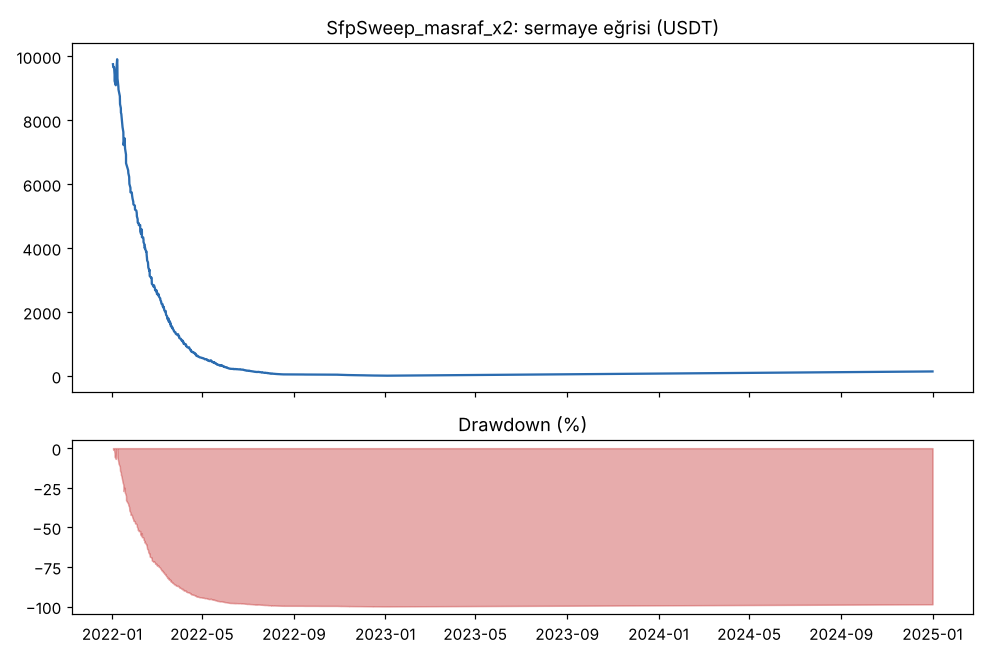
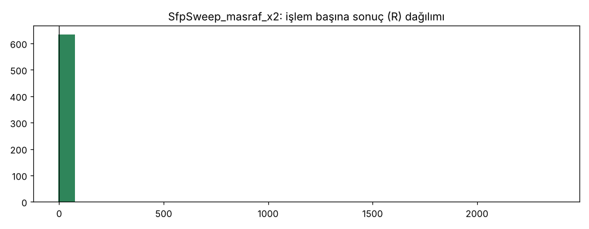

### dusuk_masraf_0.0003 — `SfpSweep`

| Taraf | İşlem | Günde | Kazanan | Ort. R | Toplam R | PF (USDT) | PF (R) | Max DD (kasa) | Max DD (R) | Net | Funding (USDT) | Ort. süre (dk) |
|---|---|---|---|---|---|---|---|---|---|---|---|---|
| toplam | 1993 | 1.82 | 41.3% | -0.187 | -372.7 | 0.57 | 0.70 | 99.3% | 482.7 | -98.7% | -29 | 404 |
| long | 977 | 0.89 | 41.7% | -0.131 | -128.3 | 0.51 | 0.79 | — | 237.7 | -48.1% | -30 | 735 |
| short | 1016 | 0.93 | 41.0% | -0.241 | -244.4 | 0.62 | 0.62 | — | 247.4 | -50.6% | 1 | 86 |

Freqtrade'in hesap düşüşü: 99.3%. 3 kayıp → 24 saat duraklaması: **201** kez. Ortalama kaldıraç: 10.0x.

Veri sonunda zorla kapatılan işlem: 1 (ortalama 107.7R). Bunlar hariç ortalama: toplam **-0.241R**, long -0.242R, short -0.241R.

| Yıl | Taraf | İşlem | Ort. R | PF | Net (USDT) |
|---|---|---|---|---|---|
| 2022 | toplam | 1073 | -0.239 | 0.56 | -9269 |
| 2022 | long | 489 | -0.235 | 0.49 | -4538 |
| 2022 | short | 584 | -0.242 | 0.62 | -4731 |
| 2023 | toplam | 919 | -0.244 | 0.63 | -655 |
| 2023 | long | 487 | -0.248 | 0.63 | -325 |
| 2023 | short | 432 | -0.238 | 0.62 | -329 |
| 2024 | toplam | 1 | 107.701 | ∞ | 53 |
| 2024 | long | 1 | 107.701 | ∞ | 53 |

| Coin | İşlem | Ort. R | Long ort. R | Short ort. R | Toplam R | Net (USDT) |
|---|---|---|---|---|---|---|
| BTC | 776 | -0.152 | -0.037 | -0.270 | -118.3 | -4424 |
| ETH | 685 | -0.241 | -0.248 | -0.236 | -165.4 | -3598 |
| SOL | 532 | -0.167 | -0.132 | -0.204 | -89.0 | -1847 |

Artıda biten coin: **0/3**.

| Taraf | Sonuç | İşlem | Pay | Ort. R |
|---|---|---|---|---|
| long | Stop | 501 | 51% | -1.188 |
| long | TP1 sonrası BE | 327 | 33% | 0.264 |
| long | TP2 | 148 | 15% | 1.842 |
| long | force_exit | 1 | 0% | 107.701 |
| short | Stop | 541 | 53% | -1.187 |
| short | TP1 sonrası BE | 307 | 30% | 0.344 |
| short | TP2 | 168 | 17% | 1.739 |

TP1 < 1R olan işlem (veri sonunda zorla kapatılanlar hariç): **863/1992** (43%), ortalama -0.224R; TP1 ≥ 1R olanlar -0.255R. TP1 mesafesi ortancası 1.13R (sinyal kapanışına göre).

Stop mesafesi ortancası: **%0.35** (çeyrekler %0.25 – %0.52). Normal masrafta (%0.1/emir) giriş+çıkış masrafı ortanca **0.56R**.

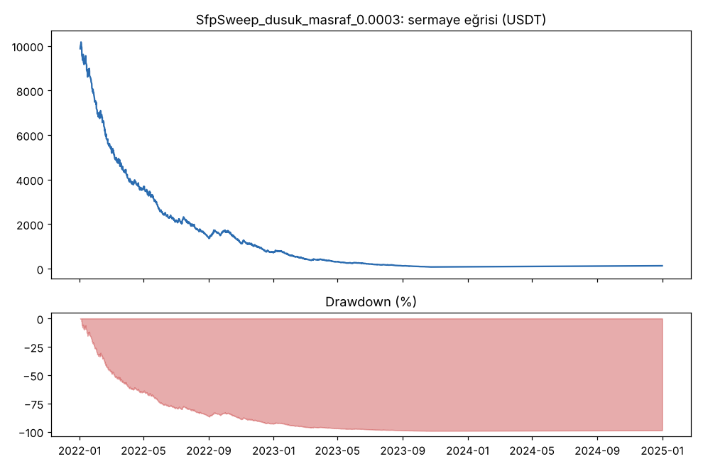
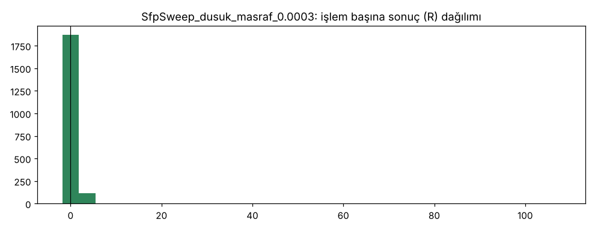

### masrafsiz — `SfpSweep`

| Taraf | İşlem | Günde | Kazanan | Ort. R | Toplam R | PF (USDT) | PF (R) | Max DD (kasa) | Max DD (R) | Net | Funding (USDT) | Ort. süre (dk) |
|---|---|---|---|---|---|---|---|---|---|---|---|---|
| toplam | 3355 | 3.06 | 45.5% | -0.070 | -236.5 | 0.85 | 0.87 | 93.6% | 256.0 | -92.3% | -128 | 84 |
| long | 1704 | 1.55 | 46.1% | -0.082 | -140.2 | 0.81 | 0.85 | — | 155.4 | -54.8% | -124 | 87 |
| short | 1651 | 1.51 | 44.9% | -0.058 | -96.3 | 0.88 | 0.89 | — | 112.9 | -37.5% | -4 | 82 |

Freqtrade'in hesap düşüşü: 93.6%. 3 kayıp → 24 saat duraklaması: **303** kez. Ortalama kaldıraç: 10.0x.

| Yıl | Taraf | İşlem | Ort. R | PF | Net (USDT) |
|---|---|---|---|---|---|
| 2022 | toplam | 1111 | -0.084 | 0.80 | -6311 |
| 2022 | long | 512 | -0.095 | 0.75 | -3567 |
| 2022 | short | 599 | -0.075 | 0.84 | -2744 |
| 2023 | toplam | 1211 | -0.025 | 0.94 | -1170 |
| 2023 | long | 653 | -0.045 | 0.91 | -946 |
| 2023 | short | 558 | -0.002 | 0.98 | -223 |
| 2024 | toplam | 1033 | -0.110 | 0.78 | -1749 |
| 2024 | long | 539 | -0.116 | 0.77 | -962 |
| 2024 | short | 494 | -0.103 | 0.79 | -786 |

| Coin | İşlem | Ort. R | Long ort. R | Short ort. R | Toplam R | Net (USDT) |
|---|---|---|---|---|---|---|
| BTC | 1241 | -0.087 | -0.128 | -0.044 | -107.7 | -4471 |
| ETH | 1179 | -0.058 | -0.052 | -0.064 | -68.5 | -2861 |
| SOL | 935 | -0.064 | -0.059 | -0.070 | -60.3 | -1897 |

Artıda biten coin: **0/3**.

| Taraf | Sonuç | İşlem | Pay | Ort. R |
|---|---|---|---|---|
| long | Stop | 917 | 54% | -1.000 |
| long | TP1 sonrası BE | 531 | 31% | 0.452 |
| long | TP2 | 256 | 15% | 2.096 |
| short | Stop | 909 | 55% | -0.995 |
| short | TP1 sonrası BE | 492 | 30% | 0.549 |
| short | TP2 | 250 | 15% | 2.153 |

TP1 < 1R olan işlem (veri sonunda zorla kapatılanlar hariç): **1382/3355** (41%), ortalama -0.091R; TP1 ≥ 1R olanlar -0.056R. TP1 mesafesi ortancası 1.18R (sinyal kapanışına göre).

Stop mesafesi ortancası: **%0.34** (çeyrekler %0.24 – %0.50). Normal masrafta (%0.1/emir) giriş+çıkış masrafı ortanca **0.59R**.

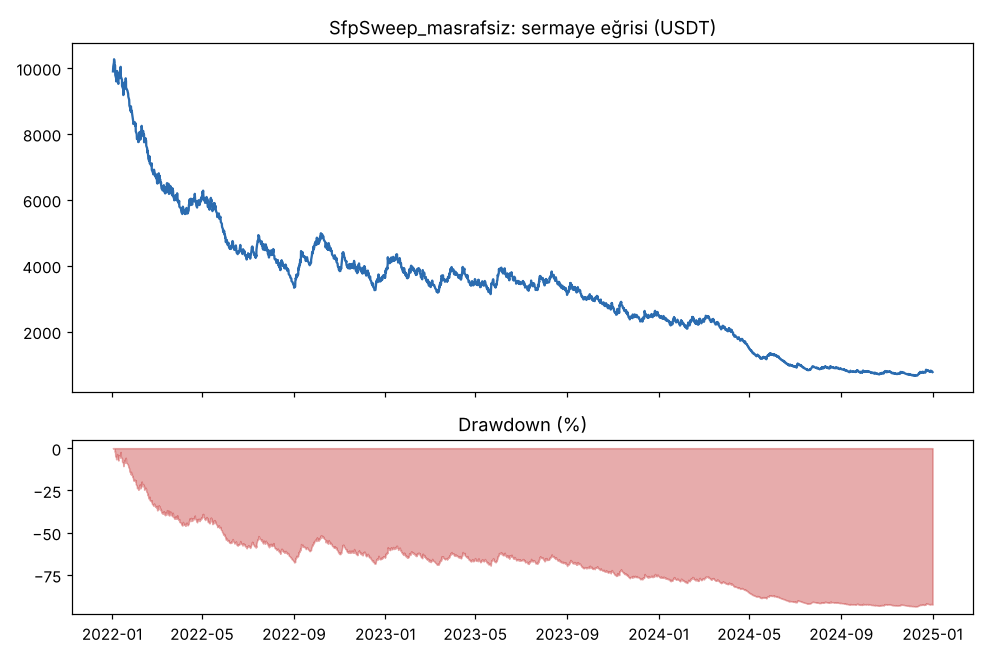
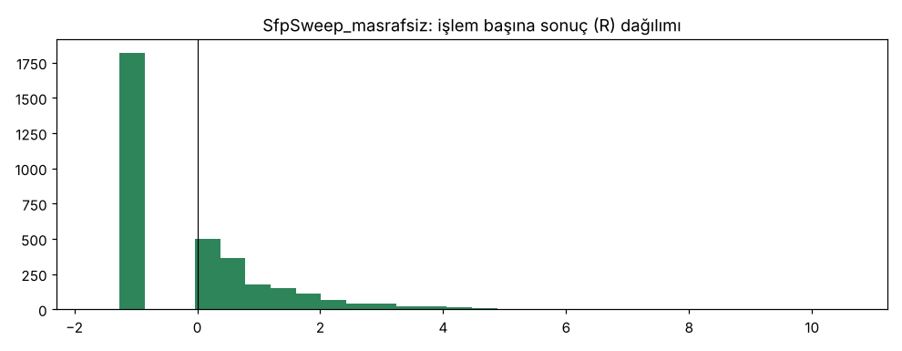

### ters_sira — `SfpSweep`

| Taraf | İşlem | Günde | Kazanan | Ort. R | Toplam R | PF (USDT) | PF (R) | Max DD (kasa) | Max DD (R) | Net | Funding (USDT) | Ort. süre (dk) |
|---|---|---|---|---|---|---|---|---|---|---|---|---|
| toplam | 1374 | 1.25 | 20.9% | -0.689 | -947.3 | 0.34 | 0.37 | 100.0% | 952.3 | -100.0% | 3 | 399 |
| long | 678 | 0.62 | 20.1% | -0.550 | -372.6 | 0.30 | 0.50 | — | 436.0 | -42.6% | -12 | 602 |
| short | 696 | 0.64 | 21.7% | -0.826 | -574.6 | 0.37 | 0.23 | — | 580.5 | -57.4% | 15 | 202 |

Freqtrade'in hesap düşüşü: 100.0%. 3 kayıp → 24 saat duraklaması: **286** kez. Ortalama kaldıraç: 10.0x.

| Yıl | Taraf | İşlem | Ort. R | PF | Net (USDT) |
|---|---|---|---|---|---|
| 2022 | toplam | 872 | -0.604 | 0.34 | -9947 |
| 2022 | long | 406 | -0.571 | 0.30 | -4238 |
| 2022 | short | 466 | -0.633 | 0.37 | -5709 |
| 2023 | toplam | 363 | -1.075 | 0.26 | -51 |
| 2023 | long | 192 | -1.063 | 0.31 | -25 |
| 2023 | short | 171 | -1.087 | 0.22 | -26 |
| 2024 | toplam | 139 | -0.219 | 0.78 | -1 |
| 2024 | long | 80 | 0.792 | 1.30 | 1 |
| 2024 | short | 59 | -1.591 | 0.01 | -2 |

| Coin | İşlem | Ort. R | Long ort. R | Short ort. R | Toplam R | Net (USDT) |
|---|---|---|---|---|---|---|
| BTC | 397 | -0.898 | -0.961 | -0.843 | -356.5 | -4275 |
| ETH | 625 | -0.618 | -0.322 | -0.892 | -386.4 | -3284 |
| SOL | 352 | -0.581 | -0.510 | -0.667 | -204.4 | -2441 |

Artıda biten coin: **0/3**.

| Taraf | Sonuç | İşlem | Pay | Ort. R |
|---|---|---|---|---|
| long | Stop | 430 | 63% | -1.658 |
| long | TP1 sonrası BE | 157 | 23% | -0.133 |
| long | TP2 | 91 | 13% | 3.971 |
| short | Stop | 435 | 62% | -1.630 |
| short | TP1 sonrası BE | 171 | 25% | -0.040 |
| short | TP2 | 90 | 13% | 1.568 |

TP1 < 1R olan işlem (veri sonunda zorla kapatılanlar hariç): **540/1374** (39%), ortalama -0.833R; TP1 ≥ 1R olanlar -0.596R. TP1 mesafesi ortancası 1.24R (sinyal kapanışına göre).

Stop mesafesi ortancası: **%0.36** (çeyrekler %0.25 – %0.53). Normal masrafta (%0.1/emir) giriş+çıkış masrafı ortanca **0.56R**.

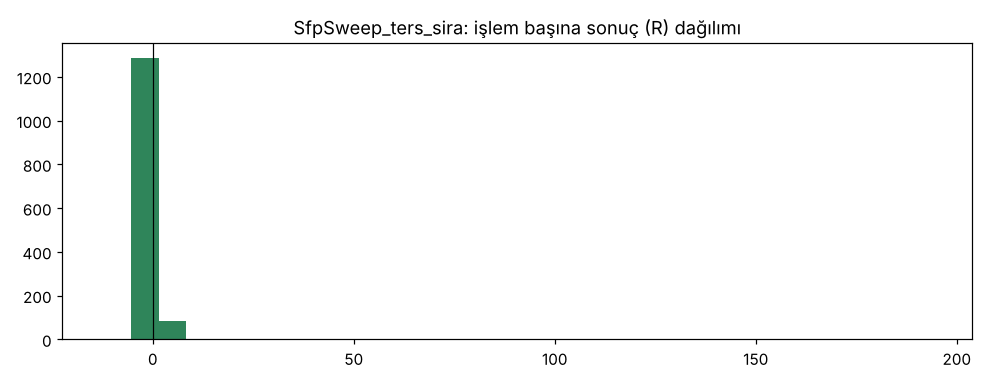

### buyuk_kasa — `SfpSweep`

| Taraf | İşlem | Günde | Kazanan | Ort. R | Toplam R | PF (USDT) | PF (R) | Max DD (kasa) | Max DD (R) | Net | Funding (USDT) | Ort. süre (dk) |
|---|---|---|---|---|---|---|---|---|---|---|---|---|
| toplam | 2213 | 2.02 | 23.3% | -0.646 | -1429.4 | 0.37 | 0.34 | 40468.7% | 1625.2 | -999999.5% | 27730 | 165 |
| long | 1105 | 1.01 | 23.0% | -0.548 | -605.4 | 0.27 | 0.43 | — | 795.5 | -506214.0% | -122563 | 236 |
| short | 1108 | 1.01 | 23.6% | -0.744 | -824.0 | 0.44 | 0.27 | — | 832.5 | -493785.6% | 150294 | 95 |

Freqtrade'in hesap düşüşü: 100.0%. 3 kayıp → 24 saat duraklaması: **425** kez. Ortalama kaldıraç: 9.1x.

Veri sonunda zorla kapatılan işlem: 1 (ortalama 190.2R). Bunlar hariç ortalama: toplam **-0.732R**, long -0.721R, short -0.744R.

| Yıl | Taraf | İşlem | Ort. R | PF | Net (USDT) |
|---|---|---|---|---|---|
| 2022 | toplam | 839 | -0.601 | 0.37 | -99370285 |
| 2022 | long | 381 | -0.594 | 0.27 | -50339562 |
| 2022 | short | 458 | -0.607 | 0.45 | -49030722 |
| 2023 | toplam | 875 | -0.732 | 0.32 | -628688 |
| 2023 | long | 454 | -0.706 | 0.33 | -281342 |
| 2023 | short | 421 | -0.761 | 0.32 | -347346 |
| 2024 | toplam | 499 | -0.570 | 0.24 | -980 |
| 2024 | long | 270 | -0.217 | 0.26 | -493 |
| 2024 | short | 229 | -0.986 | 0.21 | -487 |

| Coin | İşlem | Ort. R | Long ort. R | Short ort. R | Toplam R | Net (USDT) |
|---|---|---|---|---|---|---|
| BTC | 878 | -0.636 | -0.453 | -0.817 | -558.0 | -44538915 |
| ETH | 811 | -0.652 | -0.669 | -0.636 | -528.8 | -40627299 |
| SOL | 524 | -0.654 | -0.525 | -0.793 | -342.6 | -14833739 |

Artıda biten coin: **0/3**.

| Taraf | Sonuç | İşlem | Pay | Ort. R |
|---|---|---|---|---|
| long | Stop | 604 | 55% | -1.603 |
| long | TP1 sonrası BE | 346 | 31% | -0.133 |
| long | TP2 | 154 | 14% | 1.419 |
| long | force_exit | 1 | 0% | 190.169 |
| short | Stop | 636 | 57% | -1.645 |
| short | TP1 sonrası BE | 310 | 28% | -0.066 |
| short | TP2 | 162 | 15% | 1.497 |

TP1 < 1R olan işlem (veri sonunda zorla kapatılanlar hariç): **937/2212** (42%), ortalama -0.723R; TP1 ≥ 1R olanlar -0.739R. TP1 mesafesi ortancası 1.16R (sinyal kapanışına göre).

Stop mesafesi ortancası: **%0.35** (çeyrekler %0.25 – %0.52). Normal masrafta (%0.1/emir) giriş+çıkış masrafı ortanca **0.58R**.

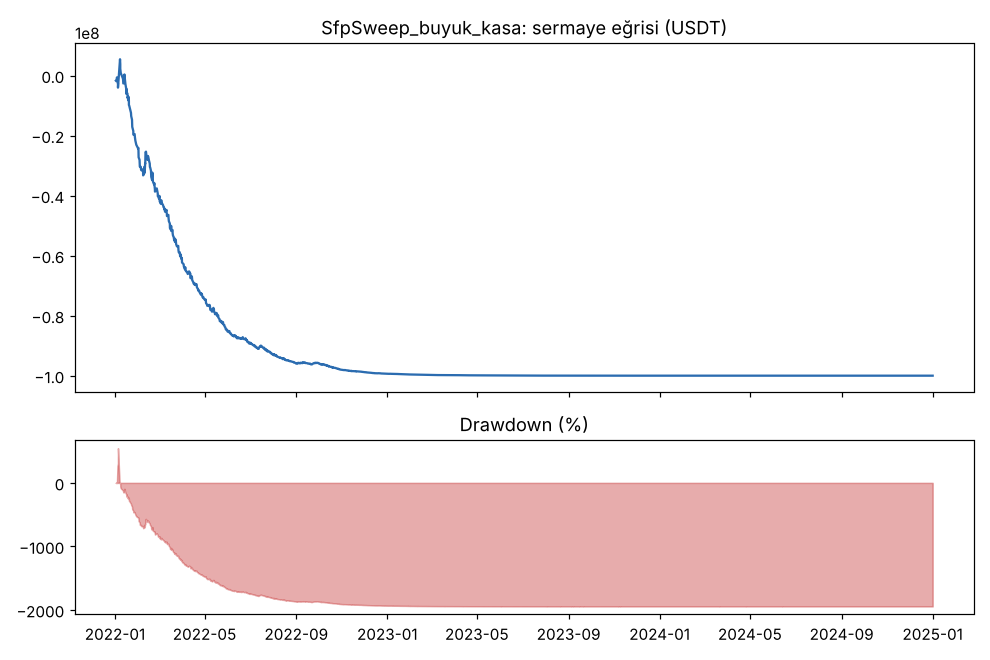
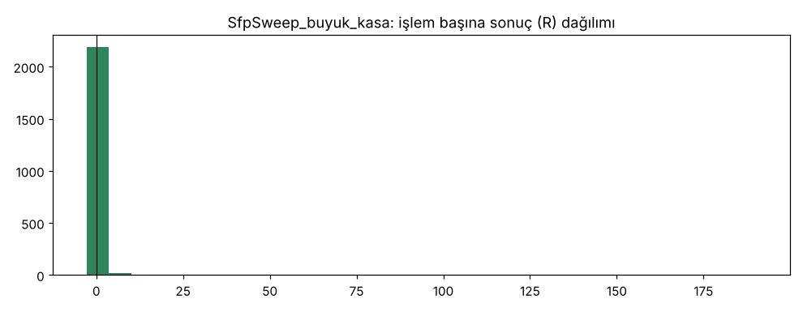

### buyuk_kasa — `SfpSweep1h`

| Taraf | İşlem | Günde | Kazanan | Ort. R | Toplam R | PF (USDT) | PF (R) | Max DD (kasa) | Max DD (R) | Net | Funding (USDT) | Ort. süre (dk) |
|---|---|---|---|---|---|---|---|---|---|---|---|---|
| toplam | 1105 | 1.01 | 27.7% | -0.551 | -608.9 | 0.55 | 0.43 | 16927.8% | 616.1 | -997968.4% | 104638 | 223 |
| long | 557 | 0.51 | 30.0% | -0.506 | -281.9 | 0.55 | 0.45 | — | 287.3 | -499265.2% | -207569 | 212 |
| short | 548 | 0.50 | 25.4% | -0.597 | -327.0 | 0.56 | 0.42 | — | 332.1 | -498703.3% | 312208 | 234 |

Freqtrade'in hesap düşüşü: 99.8%. 3 kayıp → 24 saat duraklaması: **188** kez. Ortalama kaldıraç: 7.8x.

Veri sonunda zorla kapatılan işlem: 1 (ortalama -0.4R). Bunlar hariç ortalama: toplam **-0.551R**, long -0.506R, short -0.597R.

| Yıl | Taraf | İşlem | Ort. R | PF | Net (USDT) |
|---|---|---|---|---|---|
| 2022 | toplam | 324 | -0.398 | 0.60 | -73350312 |
| 2022 | long | 155 | -0.381 | 0.58 | -38232228 |
| 2022 | short | 169 | -0.414 | 0.62 | -35118084 |
| 2023 | toplam | 411 | -0.535 | 0.33 | -23825867 |
| 2023 | long | 211 | -0.486 | 0.38 | -10563233 |
| 2023 | short | 200 | -0.588 | 0.27 | -13262634 |
| 2024 | toplam | 370 | -0.702 | 0.39 | -2620666 |
| 2024 | long | 191 | -0.630 | 0.44 | -1131055 |
| 2024 | short | 179 | -0.780 | 0.34 | -1489611 |

| Coin | İşlem | Ort. R | Long ort. R | Short ort. R | Toplam R | Net (USDT) |
|---|---|---|---|---|---|---|
| BTC | 405 | -0.608 | -0.506 | -0.714 | -246.3 | -53616992 |
| ETH | 385 | -0.544 | -0.701 | -0.375 | -209.3 | -36708819 |
| SOL | 315 | -0.487 | -0.250 | -0.707 | -153.3 | -9471032 |

Artıda biten coin: **0/3**.

| Taraf | Sonuç | İşlem | Pay | Ort. R |
|---|---|---|---|---|
| long | Stop | 343 | 62% | -1.470 |
| long | TP1 sonrası BE | 141 | 25% | 0.263 |
| long | TP2 | 72 | 13% | 2.577 |
| long | force_exit | 1 | 0% | -0.403 |
| short | Stop | 375 | 68% | -1.479 |
| short | TP1 sonrası BE | 110 | 20% | 0.456 |
| short | TP2 | 63 | 11% | 2.818 |

TP1 < 1R olan işlem (veri sonunda zorla kapatılanlar hariç): **232/1104** (21%), ortalama -0.489R; TP1 ≥ 1R olanlar -0.568R. TP1 mesafesi ortancası 1.89R (sinyal kapanışına göre).

Stop mesafesi ortancası: **%0.49** (çeyrekler %0.34 – %0.70). Normal masrafta (%0.1/emir) giriş+çıkış masrafı ortanca **0.41R**.

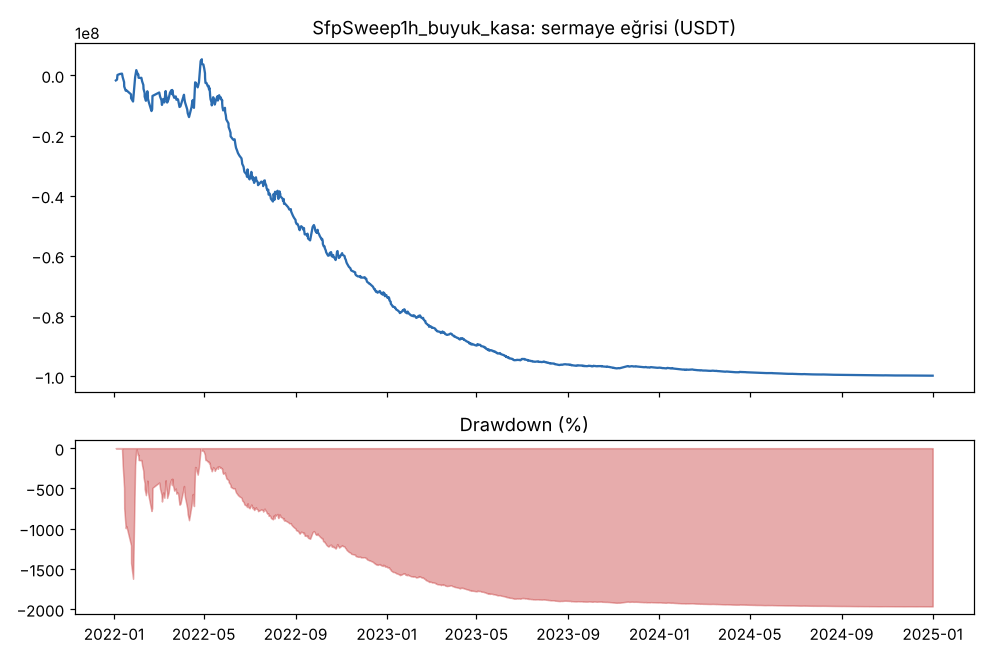
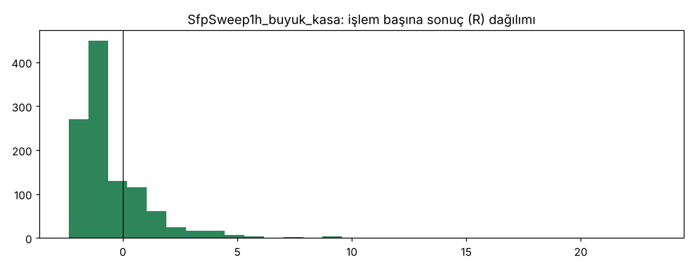

### buyuk_kasa_masrafsiz — `SfpSweep`

| Taraf | İşlem | Günde | Kazanan | Ort. R | Toplam R | PF (USDT) | PF (R) | Max DD (kasa) | Max DD (R) | Net | Funding (USDT) | Ort. süre (dk) |
|---|---|---|---|---|---|---|---|---|---|---|---|---|
| toplam | 2882 | 2.63 | 46.2% | -0.080 | -229.2 | 0.83 | 0.85 | 9899.8% | 255.6 | -916809.3% | -644110 | 90 |
| long | 1491 | 1.36 | 46.9% | -0.091 | -136.1 | 0.80 | 0.83 | — | 153.2 | -540905.7% | -1245337 | 95 |
| short | 1391 | 1.27 | 45.4% | -0.067 | -93.1 | 0.86 | 0.88 | — | 117.1 | -375903.6% | 601228 | 85 |

Freqtrade'in hesap düşüşü: 93.5%. 3 kayıp → 24 saat duraklaması: **261** kez. Ortalama kaldıraç: 5.6x.

| Yıl | Taraf | İşlem | Ort. R | PF | Net (USDT) |
|---|---|---|---|---|---|
| 2022 | toplam | 961 | -0.073 | 0.83 | -53851290 |
| 2022 | long | 450 | -0.082 | 0.80 | -29546004 |
| 2022 | short | 511 | -0.065 | 0.86 | -24305286 |
| 2023 | toplam | 910 | -0.063 | 0.85 | -21479555 |
| 2023 | long | 514 | -0.089 | 0.80 | -15923691 |
| 2023 | short | 396 | -0.029 | 0.91 | -5555864 |
| 2024 | toplam | 1011 | -0.100 | 0.80 | -16350083 |
| 2024 | long | 527 | -0.101 | 0.80 | -8620871 |
| 2024 | short | 484 | -0.100 | 0.80 | -7729212 |

| Coin | İşlem | Ort. R | Long ort. R | Short ort. R | Toplam R | Net (USDT) |
|---|---|---|---|---|---|---|
| BTC | 1151 | -0.073 | -0.129 | -0.014 | -83.9 | -30845020 |
| ETH | 1138 | -0.074 | -0.048 | -0.101 | -83.7 | -38061978 |
| SOL | 593 | -0.104 | -0.102 | -0.107 | -61.6 | -22773931 |

Artıda biten coin: **0/3**.

| Taraf | Sonuç | İşlem | Pay | Ort. R |
|---|---|---|---|---|
| long | Stop | 790 | 53% | -1.001 |
| long | TP1 sonrası BE | 484 | 32% | 0.434 |
| long | TP2 | 217 | 15% | 2.048 |
| short | Stop | 759 | 55% | -0.998 |
| short | TP1 sonrası BE | 431 | 31% | 0.517 |
| short | TP2 | 201 | 14% | 2.196 |

TP1 < 1R olan işlem (veri sonunda zorla kapatılanlar hariç): **1251/2882** (43%), ortalama -0.087R; TP1 ≥ 1R olanlar -0.074R. TP1 mesafesi ortancası 1.13R (sinyal kapanışına göre).

Stop mesafesi ortancası: **%0.36** (çeyrekler %0.27 – %0.55). Normal masrafta (%0.1/emir) giriş+çıkış masrafı ortanca **0.55R**.

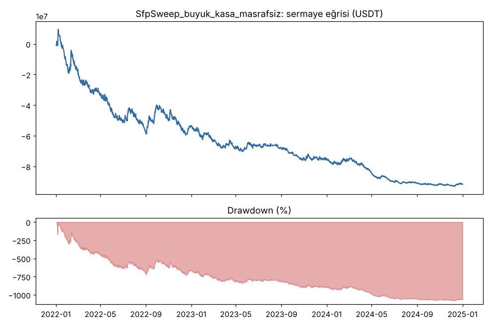
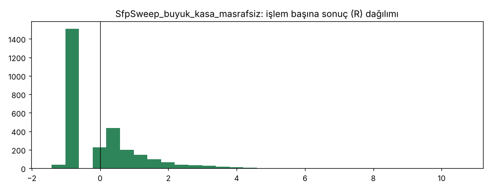

### buyuk_kasa_ters_sira — `SfpSweep`

| Taraf | İşlem | Günde | Kazanan | Ort. R | Toplam R | PF (USDT) | PF (R) | Max DD (kasa) | Max DD (R) | Net | Funding (USDT) | Ort. süre (dk) |
|---|---|---|---|---|---|---|---|---|---|---|---|---|
| toplam | 2333 | 2.13 | 23.3% | -0.744 | -1735.8 | 0.35 | 0.26 | 46176.8% | 1741.4 | -1000000.0% | 32513 | 96 |
| long | 1191 | 1.09 | 23.8% | -0.707 | -842.4 | 0.26 | 0.27 | — | 842.4 | -495569.2% | -102137 | 101 |
| short | 1142 | 1.04 | 22.8% | -0.782 | -893.4 | 0.41 | 0.24 | — | 901.4 | -504430.8% | 134650 | 90 |

Freqtrade'in hesap düşüşü: 100.0%. 3 kayıp → 24 saat duraklaması: **456** kez. Ortalama kaldıraç: 9.2x.

Veri sonunda zorla kapatılan işlem: 1 (ortalama -0.4R). Bunlar hariç ortalama: toplam **-0.744R**, long -0.708R, short -0.782R.

| Yıl | Taraf | İşlem | Ort. R | PF | Net (USDT) |
|---|---|---|---|---|---|
| 2022 | toplam | 836 | -0.595 | 0.35 | -99330013 |
| 2022 | long | 398 | -0.554 | 0.26 | -49259129 |
| 2022 | short | 438 | -0.632 | 0.41 | -50070884 |
| 2023 | toplam | 879 | -0.746 | 0.32 | -669046 |
| 2023 | long | 462 | -0.716 | 0.36 | -297318 |
| 2023 | short | 417 | -0.780 | 0.28 | -371727 |
| 2024 | toplam | 618 | -0.942 | 0.19 | -937 |
| 2024 | long | 331 | -0.879 | 0.21 | -470 |
| 2024 | short | 287 | -1.015 | 0.16 | -467 |

| Coin | İşlem | Ort. R | Long ort. R | Short ort. R | Toplam R | Net (USDT) |
|---|---|---|---|---|---|---|
| BTC | 753 | -0.933 | -0.924 | -0.943 | -702.8 | -50262099 |
| ETH | 976 | -0.678 | -0.675 | -0.681 | -661.8 | -40220473 |
| SOL | 604 | -0.614 | -0.501 | -0.745 | -371.1 | -9517423 |

Artıda biten coin: **0/3**.

| Taraf | Sonuç | İşlem | Pay | Ort. R |
|---|---|---|---|---|
| long | Stop | 667 | 56% | -1.596 |
| long | TP1 sonrası BE | 348 | 29% | -0.124 |
| long | TP2 | 175 | 15% | 1.517 |
| long | force_exit | 1 | 0% | -0.403 |
| short | Stop | 672 | 59% | -1.643 |
| short | TP1 sonrası BE | 315 | 28% | -0.055 |
| short | TP2 | 155 | 14% | 1.473 |

TP1 < 1R olan işlem (veri sonunda zorla kapatılanlar hariç): **949/2332** (41%), ortalama -0.748R; TP1 ≥ 1R olanlar -0.741R. TP1 mesafesi ortancası 1.21R (sinyal kapanışına göre).

Stop mesafesi ortancası: **%0.35** (çeyrekler %0.25 – %0.52). Normal masrafta (%0.1/emir) giriş+çıkış masrafı ortanca **0.57R**.

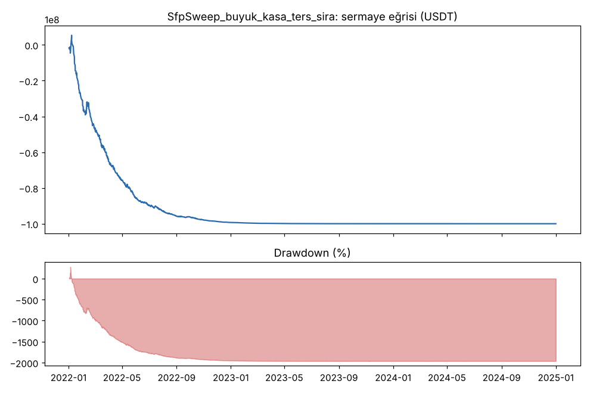
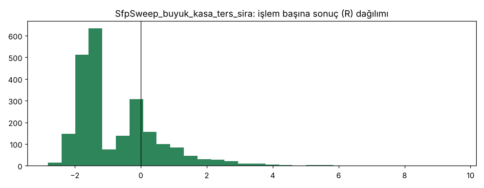

### Al-tut (aynı dönem, aynı coinler)

| Coin | Al-tut getirisi | Al-tut max DD |
|---|---|---|
| BTC | 102.0% | 67.7% |
| ETH | -9.5% | 77.2% |
| SOL | 11.0% | 95.5% |
| **Eşit ağırlık ortalama** | **34.5%** | 80.1% (ortalama) |

Yıllara göre eşit ağırlıklı al-tut: 2022: -75.5%, 2023: 389.1%, 2024: 83.6%
