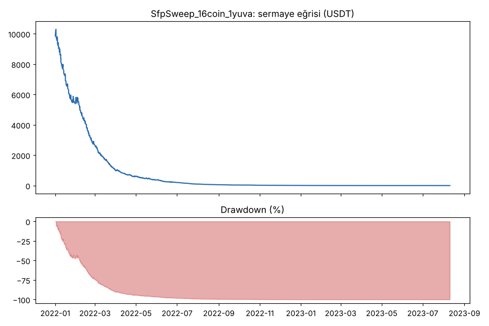
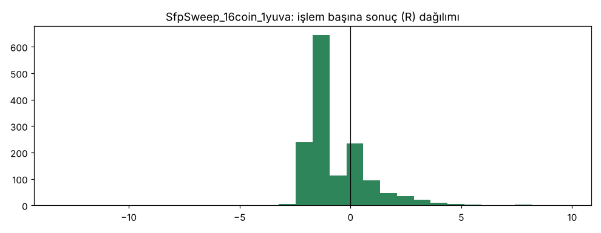
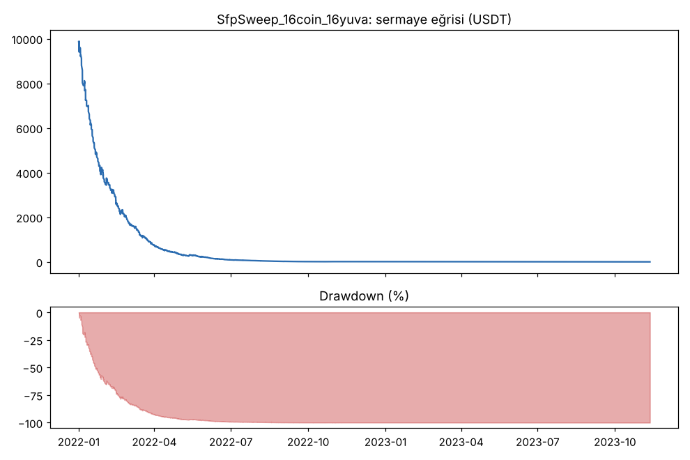
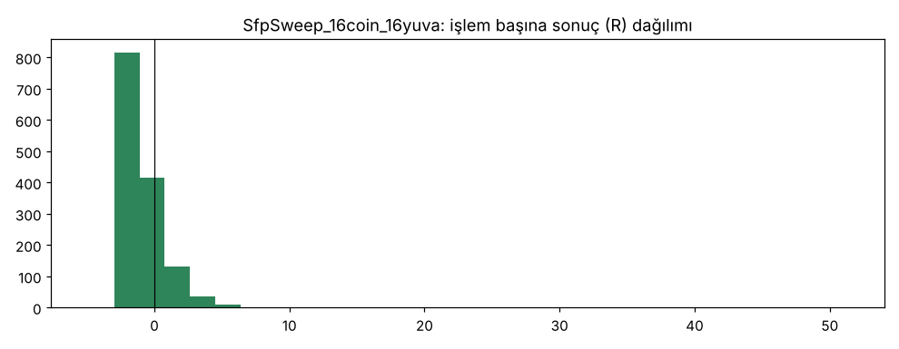

### 16coin_1yuva — `SfpSweep`

| Taraf | İşlem | Günde | Kazanan | Ort. R | Toplam R | PF (USDT) | PF (R) | Max DD (kasa) | Max DD (R) | Net | Funding (USDT) | Ort. süre (dk) |
|---|---|---|---|---|---|---|---|---|---|---|---|---|
| toplam | 1455 | 1.33 | 24.9% | -0.686 | -997.7 | 0.38 | 0.32 | 100.0% | 1000.8 | -100.0% | 2 | 242 |
| long | 675 | 0.62 | 26.1% | -0.637 | -430.2 | 0.45 | 0.34 | — | 434.0 | -39.5% | -9 | 129 |
| short | 780 | 0.71 | 24.0% | -0.728 | -567.5 | 0.32 | 0.30 | — | 567.5 | -60.5% | 11 | 339 |

Freqtrade'in hesap düşüşü: 100.0%. 3 kayıp → 24 saat duraklaması: **266** kez. Ortalama kaldıraç: 10.0x.

| Yıl | Taraf | İşlem | Ort. R | PF | Net (USDT) |
|---|---|---|---|---|---|
| 2022 | toplam | 1255 | -0.565 | 0.38 | -9991 |
| 2022 | long | 580 | -0.531 | 0.45 | -3942 |
| 2022 | short | 675 | -0.594 | 0.32 | -6049 |
| 2023 | toplam | 200 | -1.443 | 0.15 | -9 |
| 2023 | long | 95 | -1.286 | 0.16 | -4 |
| 2023 | short | 105 | -1.584 | 0.14 | -5 |

| Coin | İşlem | Ort. R | Long ort. R | Short ort. R | Toplam R | Net (USDT) |
|---|---|---|---|---|---|---|
| BTC | 145 | -0.714 | -0.763 | -0.675 | -103.5 | -1826 |
| ETH | 140 | -0.816 | -0.751 | -0.869 | -114.2 | -1039 |
| SOL | 85 | -0.707 | -0.541 | -0.895 | -60.1 | -923 |
| XRP | 97 | -0.523 | -0.583 | -0.460 | -50.7 | -547 |
| BNB | 104 | -0.788 | -0.654 | -0.964 | -82.0 | -778 |
| DOGE | 104 | -0.520 | -0.591 | -0.456 | -54.1 | 429 |
| ADA | 89 | -0.688 | -0.532 | -0.897 | -61.2 | -881 |
| LINK | 78 | -0.198 | -0.512 | 0.058 | -15.4 | -285 |
| LTC | 94 | -0.677 | -0.427 | -0.916 | -63.6 | -646 |
| DOT | 82 | -0.638 | -0.670 | -0.616 | -52.3 | -672 |
| AVAX | 71 | -0.811 | -1.003 | -0.679 | -57.6 | -702 |
| TRX | 82 | -0.919 | -0.620 | -1.035 | -75.3 | -660 |
| ATOM | 66 | -0.633 | -0.360 | -0.941 | -41.8 | -507 |
| BCH | 80 | -0.853 | -1.057 | -0.695 | -68.3 | -887 |
| ETC | 58 | -0.523 | -0.176 | -0.804 | -30.3 | 294 |
| XLM | 80 | -0.841 | -0.904 | -0.800 | -67.2 | -369 |

Artıda biten coin: **2/16**.

| Taraf | Sonuç | İşlem | Pay | Ort. R |
|---|---|---|---|---|
| long | Stop | 399 | 59% | -1.561 |
| long | TP1 sonrası BE | 202 | 30% | 0.113 |
| long | TP2 | 74 | 11% | 2.293 |
| short | Stop | 490 | 63% | -1.614 |
| short | TP1 sonrası BE | 191 | 24% | 0.114 |
| short | TP2 | 99 | 13% | 2.033 |

TP1 < 1R olan işlem (veri sonunda zorla kapatılanlar hariç): **439/1455** (30%), ortalama -0.640R; TP1 ≥ 1R olanlar -0.705R. TP1 mesafesi ortancası 1.49R (sinyal kapanışına göre).

Stop mesafesi ortancası: **%0.39** (çeyrekler %0.28 – %0.55). Normal masrafta (%0.1/emir) giriş+çıkış masrafı ortanca **0.51R**.

### 16coin_16yuva — `SfpSweep`

| Taraf | İşlem | Günde | Kazanan | Ort. R | Toplam R | PF (USDT) | PF (R) | Max DD (kasa) | Max DD (R) | Net | Funding (USDT) | Ort. süre (dk) |
|---|---|---|---|---|---|---|---|---|---|---|---|---|
| toplam | 1419 | 1.29 | 28.6% | -0.513 | -727.8 | 0.33 | 0.43 | 100.0% | 727.8 | -100.0% | 26 | 821 |
| long | 693 | 0.63 | 30.3% | -0.413 | -286.2 | 0.36 | 0.52 | — | 327.2 | -38.3% | 15 | 187 |
| short | 726 | 0.66 | 27.0% | -0.608 | -441.6 | 0.32 | 0.35 | — | 441.6 | -61.7% | 11 | 1426 |

Freqtrade'in hesap düşüşü: 100.0%. 3 kayıp → 24 saat duraklaması: **243** kez. Ortalama kaldıraç: 10.0x.

| Yıl | Taraf | İşlem | Ort. R | PF | Net (USDT) |
|---|---|---|---|---|---|
| 2022 | toplam | 1405 | -0.503 | 0.34 | -9992 |
| 2022 | long | 687 | -0.405 | 0.36 | -3832 |
| 2022 | short | 718 | -0.596 | 0.32 | -6160 |
| 2023 | toplam | 14 | -1.544 | 0.00 | -9 |
| 2023 | long | 6 | -1.333 | 0.00 | -1 |
| 2023 | short | 8 | -1.703 | 0.00 | -8 |

| Coin | İşlem | Ort. R | Long ort. R | Short ort. R | Toplam R | Net (USDT) |
|---|---|---|---|---|---|---|
| BTC | 108 | -0.795 | -0.873 | -0.731 | -85.9 | -775 |
| ETH | 104 | -0.422 | -0.665 | -0.271 | -43.9 | -468 |
| SOL | 35 | -0.771 | -0.659 | -0.920 | -27.0 | -563 |
| XRP | 122 | -0.752 | -0.772 | -0.729 | -91.8 | -560 |
| BNB | 93 | -0.771 | -0.666 | -0.898 | -71.7 | -1090 |
| DOGE | 94 | -0.099 | 0.257 | -0.579 | -9.3 | -132 |
| ADA | 97 | -0.588 | -0.627 | -0.530 | -57.0 | -1023 |
| LINK | 91 | -0.053 | 0.411 | -0.487 | -4.8 | -948 |
| LTC | 100 | -0.495 | -0.510 | -0.483 | -49.5 | -879 |
| DOT | 86 | -0.578 | -0.304 | -0.840 | -49.7 | -671 |
| AVAX | 66 | -0.327 | -0.107 | -0.521 | -21.6 | -200 |
| TRX | 73 | -0.692 | -0.551 | -0.774 | -50.5 | -872 |
| ATOM | 92 | -0.417 | -0.362 | -0.472 | -38.4 | -786 |
| BCH | 83 | -0.537 | -0.461 | -0.605 | -44.6 | -511 |
| ETC | 89 | -0.304 | -0.103 | -0.492 | -27.1 | -71 |
| XLM | 86 | -0.640 | -0.558 | -0.708 | -55.0 | -454 |

Artıda biten coin: **0/16**.

| Taraf | Sonuç | İşlem | Pay | Ort. R |
|---|---|---|---|---|
| long | Stop | 389 | 56% | -1.482 |
| long | TP1 sonrası BE | 219 | 32% | 0.137 |
| long | TP2 | 85 | 12% | 3.064 |
| short | Stop | 437 | 60% | -1.505 |
| short | TP1 sonrası BE | 208 | 29% | 0.142 |
| short | TP2 | 81 | 11% | 2.305 |

TP1 < 1R olan işlem (veri sonunda zorla kapatılanlar hariç): **467/1419** (33%), ortalama -0.378R; TP1 ≥ 1R olanlar -0.579R. TP1 mesafesi ortancası 1.36R (sinyal kapanışına göre).

Stop mesafesi ortancası: **%0.44** (çeyrekler %0.32 – %0.64). Normal masrafta (%0.1/emir) giriş+çıkış masrafı ortanca **0.45R**.

### Al-tut (aynı dönem, aynı coinler)

| Coin | Al-tut getirisi | Al-tut max DD |
|---|---|---|
| BTC | 102.0% | 67.7% |
| ETH | -9.5% | 77.2% |
| SOL | 11.0% | 95.5% |
| XRP | 150.2% | 68.2% |
| BNB | 36.9% | 65.4% |
| DOGE | 85.4% | 76.1% |
| ADA | -35.7% | 85.8% |
| LINK | 2.2% | 82.8% |
| LTC | -29.5% | 73.7% |
| DOT | -75.2% | 88.3% |
| AVAX | -67.6% | 92.6% |
| TRX | 237.4% | 50.9% |
| ATOM | -81.1% | 91.8% |
| BCH | 0.6% | 80.6% |
| ETC | -26.6% | 76.0% |
| XLM | 24.9% | 76.2% |
| **Eşit ağırlık ortalama** | **20.3%** | 78.0% (ortalama) |

Yıllara göre eşit ağırlıklı al-tut: 2022: -67.8%, 2023: 148.4%, 2024: 80.1%
