### normal — `VwapReversion` (3 coin, en fazla 1 açık işlem)

| Taraf | İşlem | Günde | Kazanan | Ort. R | Toplam R | PF | Max DD (kasa) | Max DD (R) | Net | Funding (USDT) | Ort. süre (dk) |
|---|---|---|---|---|---|---|---|---|---|---|---|
| toplam | 916 | 0.84 | 28.8% | -0.429 | -392.9 | 0.31 | 99.8% | 626.2 | -99.2% | -6 | 1354 |
| long | 462 | 0.42 | 29.0% | -0.154 | -71.2 | 0.40 | — | 301.6 | -37.2% | -19 | 2143 |
| short | 454 | 0.41 | 28.6% | -0.709 | -321.7 | 0.24 | — | 325.3 | -62.0% | 13 | 550 |

(Freqtrade'in hesap düşüşü: 99.8%. Net %, işlemlerin USDT kâr/zararının başlangıç kasasına (10,000) oranıdır; risk her işlemde güncel kasanın %1'i olduğu için bileşiktir.)

| Yıl | Taraf | İşlem | Ort. R | PF | Net (USDT) |
|---|---|---|---|---|---|
| 2022 | toplam | 840 | -0.665 | 0.30 | -9958 |
| 2022 | long | 423 | -0.624 | 0.39 | -3771 |
| 2022 | short | 417 | -0.706 | 0.24 | -6187 |
| 2023 | toplam | 75 | -0.846 | 0.29 | -18 |
| 2023 | long | 38 | -0.951 | 0.19 | -9 |
| 2023 | short | 37 | -0.739 | 0.36 | -9 |
| 2024 | toplam | 1 | 229.115 | ∞ | 59 |
| 2024 | long | 1 | 229.115 | ∞ | 59 |

| Coin | İşlem | Ort. R | Long ort. R | Short ort. R | Toplam R | Net (USDT) |
|---|---|---|---|---|---|---|
| BTC | 370 | -0.010 | 0.555 | -0.660 | -3.7 | -3115 |
| ETH | 262 | -0.729 | -0.767 | -0.690 | -191.1 | -3521 |
| SOL | 284 | -0.697 | -0.602 | -0.778 | -198.1 | -3281 |

Artıda biten coin (toplam R > 0): **0/3**.

| Taraf | Sonuç | İşlem | Ort. R |
|---|---|---|---|
| long | Stop | 298 | -1.456 |
| long | TP1 sonrası BE | 74 | 0.115 |
| long | TP2 | 89 | 1.404 |
| long | force_exit | 1 | 229.115 |
| short | Stop | 289 | -1.545 |
| short | TP1 sonrası BE | 90 | 0.080 |
| short | TP2 | 75 | 1.568 |

| Dönüş mumu | İşlem | Ort. R |
|---|---|---|
| engulfing_bear | 133 | -0.747 |
| engulfing_bull | 117 | 1.246 |
| evening_star | 24 | -0.430 |
| morning_star | 20 | -0.769 |
| pinbar_bear | 297 | -0.714 |
| pinbar_bull | 325 | -0.620 |

- Stop mesafesi (medyan): 0.5%; giriş+çıkış masrafı medyan **0.44R** (masraf %0.10/emir; kısmi çıkış ayrıca masraf öder).
- 1R risk için 3x'ten fazla kaldıraç gereken işlem: 28.1% (proje kuralı en fazla 3x; GUO kuralı 10x'e kadar).
- 3 kayıp → 24 saat duraklama: 154 kez devreye girdi; duraklama içinde açılan işlem: 0.

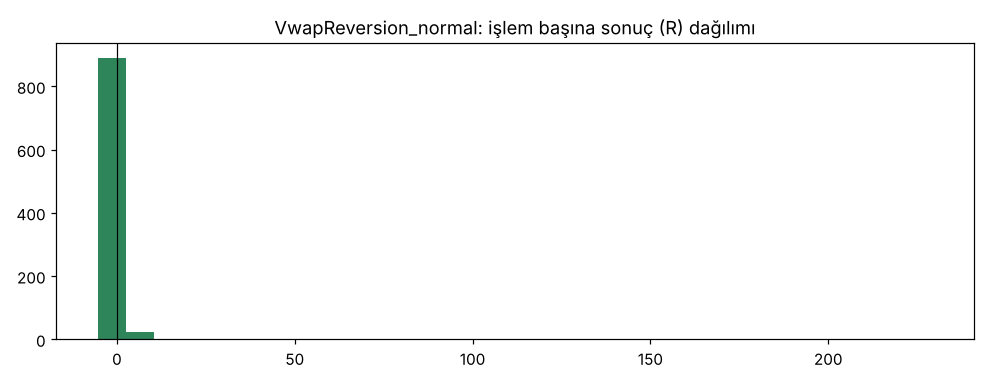

### normal — `VwapReversionTp1R` (3 coin, en fazla 1 açık işlem)

| Taraf | İşlem | Günde | Kazanan | Ort. R | Toplam R | PF | Max DD (kasa) | Max DD (R) | Net | Funding (USDT) | Ort. süre (dk) |
|---|---|---|---|---|---|---|---|---|---|---|---|
| toplam | 1142 | 1.04 | 26.5% | -0.765 | -874.0 | 0.31 | 100.0% | 874.0 | -100.0% | -1 | 917 |
| long | 537 | 0.49 | 26.6% | -0.755 | -405.3 | 0.35 | — | 405.7 | -43.2% | -5 | 166 |
| short | 605 | 0.55 | 26.4% | -0.775 | -468.7 | 0.28 | — | 468.7 | -56.7% | 3 | 1583 |

(Freqtrade'in hesap düşüşü: 100.0%. Net %, işlemlerin USDT kâr/zararının başlangıç kasasına (10,000) oranıdır; risk her işlemde güncel kasanın %1'i olduğu için bileşiktir.)

| Yıl | Taraf | İşlem | Ort. R | PF | Net (USDT) |
|---|---|---|---|---|---|
| 2022 | toplam | 795 | -0.679 | 0.31 | -9951 |
| 2022 | long | 388 | -0.625 | 0.35 | -4308 |
| 2022 | short | 407 | -0.730 | 0.28 | -5643 |
| 2023 | toplam | 107 | -1.262 | 0.14 | -35 |
| 2023 | long | 41 | -1.069 | 0.16 | -9 |
| 2023 | short | 66 | -1.382 | 0.14 | -25 |
| 2024 | toplam | 240 | -0.830 | 0.34 | -12 |
| 2024 | long | 108 | -1.100 | 0.21 | -6 |
| 2024 | short | 132 | -0.609 | 0.45 | -5 |

| Coin | İşlem | Ort. R | Long ort. R | Short ort. R | Toplam R | Net (USDT) |
|---|---|---|---|---|---|---|
| BTC | 347 | -0.829 | -0.802 | -0.859 | -287.8 | -2569 |
| ETH | 544 | -0.702 | -0.770 | -0.647 | -382.0 | -4336 |
| SOL | 251 | -0.814 | -0.645 | -0.948 | -204.2 | -3092 |

Artıda biten coin (toplam R > 0): **0/3**.

| Taraf | Sonuç | İşlem | Ort. R |
|---|---|---|---|
| long | Stop | 377 | -1.538 |
| long | TP1 sonrası BE | 73 | 0.284 |
| long | TP2 | 87 | 1.770 |
| short | Stop | 432 | -1.596 |
| short | TP1 sonrası BE | 83 | 0.262 |
| short | TP2 | 90 | 2.212 |

| Dönüş mumu | İşlem | Ort. R |
|---|---|---|
| engulfing_bear | 114 | -0.751 |
| engulfing_bull | 84 | -0.778 |
| evening_star | 18 | -0.708 |
| morning_star | 14 | -0.723 |
| pinbar_bear | 473 | -0.783 |
| pinbar_bull | 439 | -0.751 |

- Stop mesafesi (medyan): 0.4%; giriş+çıkış masrafı medyan **0.51R** (masraf %0.10/emir; kısmi çıkış ayrıca masraf öder).
- 1R risk için 3x'ten fazla kaldıraç gereken işlem: 37.0% (proje kuralı en fazla 3x; GUO kuralı 10x'e kadar).
- 3 kayıp → 24 saat duraklama: 198 kez devreye girdi; duraklama içinde açılan işlem: 0.

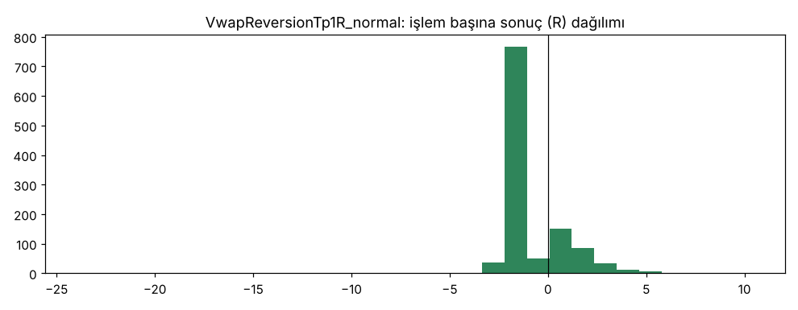

### masraf_x2 — `VwapReversion` (3 coin, en fazla 1 açık işlem)

| Taraf | İşlem | Günde | Kazanan | Ort. R | Toplam R | PF | Max DD (kasa) | Max DD (R) | Net | Funding (USDT) | Ort. süre (dk) |
|---|---|---|---|---|---|---|---|---|---|---|---|
| toplam | 816 | 0.74 | 13.7% | -0.995 | -811.8 | 0.13 | 100.0% | 950.5 | -100.0% | 1 | 1328 |
| long | 389 | 0.35 | 13.9% | -0.453 | -176.0 | 0.21 | — | 459.1 | -33.9% | -7 | 1997 |
| short | 427 | 0.39 | 13.6% | -1.489 | -635.8 | 0.08 | — | 635.8 | -66.1% | 8 | 718 |

(Freqtrade'in hesap düşüşü: 100.0%. Net %, işlemlerin USDT kâr/zararının başlangıç kasasına (10,000) oranıdır; risk her işlemde güncel kasanın %1'i olduğu için bileşiktir.)

| Yıl | Taraf | İşlem | Ort. R | PF | Net (USDT) |
|---|---|---|---|---|---|
| 2022 | toplam | 648 | -1.416 | 0.13 | -9998 |
| 2022 | long | 321 | -1.411 | 0.21 | -3392 |
| 2022 | short | 327 | -1.421 | 0.08 | -6606 |
| 2023 | toplam | 11 | -3.005 | 0.00 | -0 |
| 2023 | long | 2 | -2.946 | 0.00 | -0 |
| 2023 | short | 9 | -3.018 | 0.00 | -0 |
| 2024 | toplam | 157 | 0.883 | 0.98 | -0 |
| 2024 | long | 66 | 4.284 | 1.89 | 3 |
| 2024 | short | 91 | -1.583 | 0.24 | -3 |

| Coin | İşlem | Ort. R | Long ort. R | Short ort. R | Toplam R | Net (USDT) |
|---|---|---|---|---|---|---|
| BTC | 241 | -1.436 | -1.457 | -1.415 | -346.1 | -3254 |
| ETH | 421 | -0.588 | 0.506 | -1.541 | -247.6 | -3446 |
| SOL | 154 | -1.416 | -1.372 | -1.454 | -218.1 | -3299 |

Artıda biten coin (toplam R > 0): **0/3**.

| Taraf | Sonuç | İşlem | Ort. R |
|---|---|---|---|
| long | Stop | 297 | -2.009 |
| long | TP1 sonrası BE | 35 | -0.448 |
| long | TP2 | 57 | 7.653 |
| short | Stop | 321 | -2.124 |
| short | TP1 sonrası BE | 56 | -0.377 |
| short | TP2 | 50 | 1.344 |

| Dönüş mumu | İşlem | Ort. R |
|---|---|---|
| engulfing_bear | 118 | -1.515 |
| engulfing_bull | 87 | -1.504 |
| evening_star | 24 | -1.142 |
| morning_star | 16 | -1.321 |
| pinbar_bear | 285 | -1.507 |
| pinbar_bull | 286 | -0.084 |

- Stop mesafesi (medyan): 0.4%; giriş+çıkış masrafı medyan **0.96R** (masraf %0.20/emir; kısmi çıkış ayrıca masraf öder).
- 1R risk için 3x'ten fazla kaldıraç gereken işlem: 32.8% (proje kuralı en fazla 3x; GUO kuralı 10x'e kadar).
- 3 kayıp → 24 saat duraklama: 201 kez devreye girdi; duraklama içinde açılan işlem: 0.

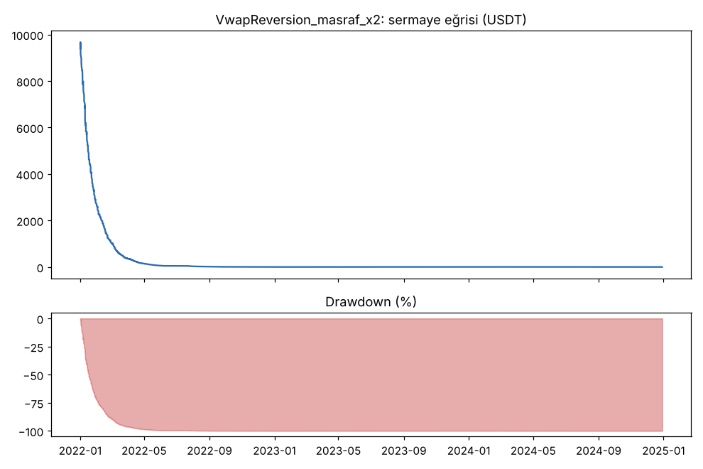
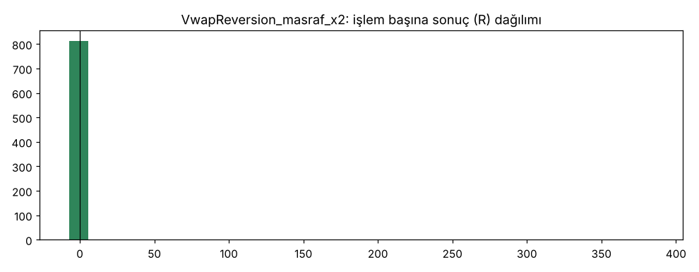

### dusuk_masraf_0.0003 — `VwapReversion` (3 coin, en fazla 1 açık işlem)

| Taraf | İşlem | Günde | Kazanan | Ort. R | Toplam R | PF | Max DD (kasa) | Max DD (R) | Net | Funding (USDT) | Ort. süre (dk) |
|---|---|---|---|---|---|---|---|---|---|---|---|
| toplam | 2044 | 1.86 | 38.8% | -0.122 | -249.3 | 0.58 | 99.7% | 575.8 | -99.1% | -6 | 460 |
| long | 1040 | 0.95 | 39.8% | 0.042 | 43.5 | 0.68 | — | 287.9 | -35.3% | -25 | 803 |
| short | 1004 | 0.92 | 37.7% | -0.292 | -292.9 | 0.49 | — | 294.6 | -63.7% | 20 | 105 |

(Freqtrade'in hesap düşüşü: 99.7%. Net %, işlemlerin USDT kâr/zararının başlangıç kasasına (10,000) oranıdır; risk her işlemde güncel kasanın %1'i olduğu için bileşiktir.)

| Yıl | Taraf | İşlem | Ort. R | PF | Net (USDT) |
|---|---|---|---|---|---|
| 2022 | toplam | 1383 | -0.267 | 0.58 | -9764 |
| 2022 | long | 713 | -0.246 | 0.67 | -3486 |
| 2022 | short | 670 | -0.289 | 0.49 | -6278 |
| 2023 | toplam | 660 | -0.311 | 0.57 | -202 |
| 2023 | long | 326 | -0.324 | 0.52 | -106 |
| 2023 | short | 334 | -0.298 | 0.61 | -96 |
| 2024 | toplam | 1 | 324.270 | ∞ | 58 |
| 2024 | long | 1 | 324.270 | ∞ | 58 |

| Coin | İşlem | Ort. R | Long ort. R | Short ort. R | Toplam R | Net (USDT) |
|---|---|---|---|---|---|---|
| BTC | 774 | 0.165 | 0.605 | -0.288 | 127.9 | -2865 |
| ETH | 602 | -0.329 | -0.315 | -0.343 | -197.9 | -3382 |
| SOL | 668 | -0.269 | -0.288 | -0.248 | -179.4 | -3661 |

Artıda biten coin (toplam R > 0): **1/3**.

| Taraf | Sonuç | İşlem | Ort. R |
|---|---|---|---|
| long | Stop | 614 | -1.146 |
| long | TP1 sonrası BE | 205 | 0.408 |
| long | TP2 | 220 | 1.541 |
| long | force_exit | 1 | 324.270 |
| short | Stop | 615 | -1.167 |
| short | TP1 sonrası BE | 184 | 0.422 |
| short | TP2 | 205 | 1.694 |

| Dönüş mumu | İşlem | Ort. R |
|---|---|---|
| engulfing_bear | 263 | -0.330 |
| engulfing_bull | 250 | -0.279 |
| evening_star | 50 | -0.250 |
| morning_star | 50 | -0.167 |
| pinbar_bear | 691 | -0.280 |
| pinbar_bull | 740 | 0.164 |

- Stop mesafesi (medyan): 0.4%; giriş+çıkış masrafı medyan **0.14R** (masraf %0.03/emir; kısmi çıkış ayrıca masraf öder).
- 1R risk için 3x'ten fazla kaldıraç gereken işlem: 32.3% (proje kuralı en fazla 3x; GUO kuralı 10x'e kadar).
- 3 kayıp → 24 saat duraklama: 254 kez devreye girdi; duraklama içinde açılan işlem: 0.

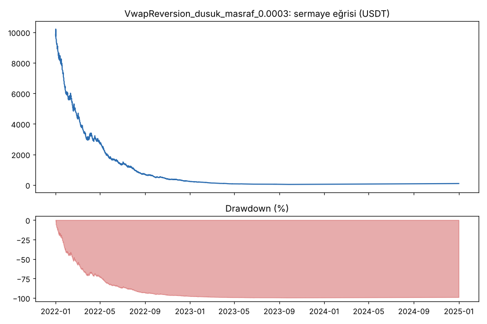
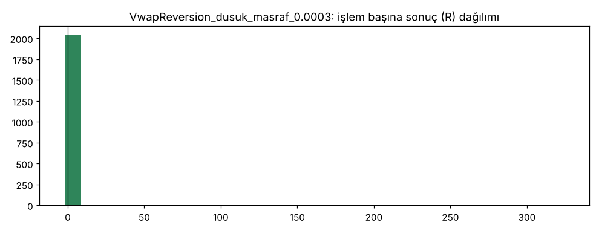

### masrafsiz — `VwapReversion` (3 coin, en fazla 1 açık işlem)

| Taraf | İşlem | Günde | Kazanan | Ort. R | Toplam R | PF | Max DD (kasa) | Max DD (R) | Net | Funding (USDT) | Ort. süre (dk) |
|---|---|---|---|---|---|---|---|---|---|---|---|
| toplam | 3972 | 3.62 | 41.6% | -0.072 | -286.4 | 0.79 | 96.6% | 321.1 | -95.5% | -2 | 109 |
| long | 1947 | 1.78 | 43.2% | -0.081 | -158.5 | 0.84 | — | 181.0 | -35.6% | -59 | 107 |
| short | 2025 | 1.85 | 40.0% | -0.063 | -128.0 | 0.75 | — | 165.1 | -59.9% | 57 | 110 |

(Freqtrade'in hesap düşüşü: 96.6%. Net %, işlemlerin USDT kâr/zararının başlangıç kasasına (10,000) oranıdır; risk her işlemde güncel kasanın %1'i olduğu için bileşiktir.)

| Yıl | Taraf | İşlem | Ort. R | PF | Net (USDT) |
|---|---|---|---|---|---|
| 2022 | toplam | 1385 | -0.123 | 0.77 | -8342 |
| 2022 | long | 713 | -0.105 | 0.84 | -2844 |
| 2022 | short | 672 | -0.143 | 0.70 | -5498 |
| 2023 | toplam | 1417 | -0.090 | 0.83 | -1220 |
| 2023 | long | 680 | -0.100 | 0.80 | -665 |
| 2023 | short | 737 | -0.082 | 0.86 | -556 |
| 2024 | toplam | 1170 | 0.011 | 1.00 | 8 |
| 2024 | long | 554 | -0.029 | 0.96 | -52 |
| 2024 | short | 616 | 0.046 | 1.04 | 60 |

| Coin | İşlem | Ort. R | Long ort. R | Short ort. R | Toplam R | Net (USDT) |
|---|---|---|---|---|---|---|
| BTC | 1510 | -0.080 | -0.069 | -0.090 | -120.4 | -2275 |
| ETH | 1200 | -0.041 | -0.040 | -0.042 | -49.4 | -3280 |
| SOL | 1262 | -0.092 | -0.135 | -0.051 | -116.6 | -3999 |

Artıda biten coin (toplam R > 0): **0/3**.

| Taraf | Sonuç | İşlem | Ort. R |
|---|---|---|---|
| long | Stop | 1106 | -1.001 |
| long | TP1 sonrası BE | 419 | 0.543 |
| long | TP2 | 422 | 1.708 |
| short | Stop | 1214 | -0.995 |
| short | TP1 sonrası BE | 399 | 0.602 |
| short | TP2 | 411 | 1.975 |
| short | force_exit | 1 | 27.344 |

| Dönüş mumu | İşlem | Ort. R |
|---|---|---|
| engulfing_bear | 560 | -0.031 |
| engulfing_bull | 515 | -0.130 |
| evening_star | 105 | -0.182 |
| morning_star | 85 | -0.012 |
| pinbar_bear | 1360 | -0.067 |
| pinbar_bull | 1347 | -0.067 |

- Stop mesafesi (medyan): 0.4%; giriş+çıkış masrafı medyan **0.00R** (masraf %0.00/emir; kısmi çıkış ayrıca masraf öder).
- 1R risk için 3x'ten fazla kaldıraç gereken işlem: 38.8% (proje kuralı en fazla 3x; GUO kuralı 10x'e kadar).
- 3 kayıp → 24 saat duraklama: 442 kez devreye girdi; duraklama içinde açılan işlem: 0.

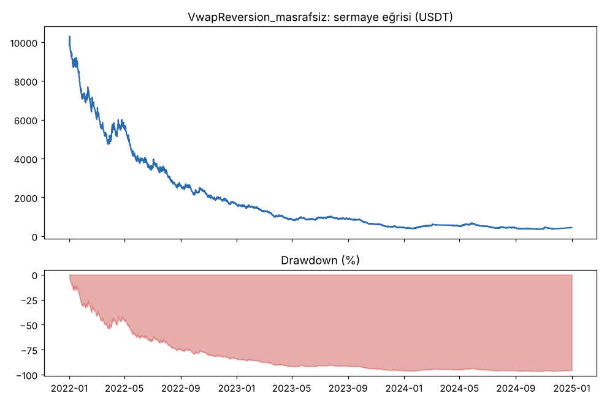
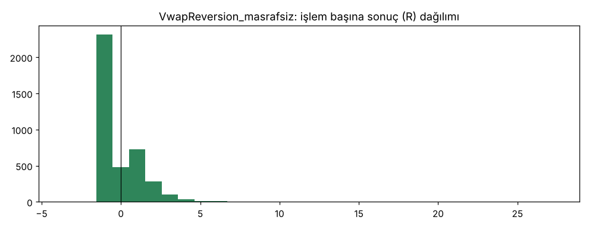

### ters_sira — `VwapReversion` (3 coin, en fazla 1 açık işlem)

| Taraf | İşlem | Günde | Kazanan | Ort. R | Toplam R | PF | Max DD (kasa) | Max DD (R) | Net | Funding (USDT) | Ort. süre (dk) |
|---|---|---|---|---|---|---|---|---|---|---|---|
| toplam | 1274 | 1.16 | 24.3% | -0.797 | -1015.1 | 0.34 | 100.0% | 1015.2 | -100.0% | 6 | 704 |
| long | 620 | 0.57 | 22.9% | -0.811 | -502.6 | 0.43 | — | 503.3 | -36.0% | -9 | 1021 |
| short | 654 | 0.60 | 25.7% | -0.784 | -512.5 | 0.27 | — | 512.5 | -64.0% | 14 | 403 |

(Freqtrade'in hesap düşüşü: 100.0%. Net %, işlemlerin USDT kâr/zararının başlangıç kasasına (10,000) oranıdır; risk her işlemde güncel kasanın %1'i olduğu için bileşiktir.)

| Yıl | Taraf | İşlem | Ort. R | PF | Net (USDT) |
|---|---|---|---|---|---|
| 2022 | toplam | 940 | -0.622 | 0.34 | -9967 |
| 2022 | long | 457 | -0.619 | 0.44 | -3580 |
| 2022 | short | 483 | -0.624 | 0.27 | -6387 |
| 2023 | toplam | 284 | -1.053 | 0.17 | -30 |
| 2023 | long | 140 | -0.970 | 0.15 | -17 |
| 2023 | short | 144 | -1.133 | 0.19 | -13 |
| 2024 | toplam | 50 | -2.639 | 0.01 | -2 |
| 2024 | long | 23 | -3.639 | 0.00 | -1 |
| 2024 | short | 27 | -1.786 | 0.01 | -1 |

| Coin | İşlem | Ort. R | Long ort. R | Short ort. R | Toplam R | Net (USDT) |
|---|---|---|---|---|---|---|
| SOL | 455 | -0.698 | -0.676 | -0.719 | -317.7 | -4258 |
| ETH | 544 | -0.853 | -0.894 | -0.812 | -463.8 | -4077 |
| BTC | 275 | -0.849 | -0.863 | -0.837 | -233.6 | -1664 |

Artıda biten coin (toplam R > 0): **0/3**.

| Taraf | Sonuç | İşlem | Ort. R |
|---|---|---|---|
| long | Stop | 427 | -1.625 |
| long | TP1 sonrası BE | 94 | -0.001 |
| long | TP2 | 99 | 1.934 |
| short | Stop | 436 | -1.556 |
| short | TP1 sonrası BE | 119 | 0.041 |
| short | TP2 | 99 | 1.628 |

| Dönüş mumu | İşlem | Ort. R |
|---|---|---|
| engulfing_bear | 176 | -0.792 |
| engulfing_bull | 160 | -0.820 |
| evening_star | 26 | -0.564 |
| morning_star | 21 | -0.600 |
| pinbar_bear | 452 | -0.793 |
| pinbar_bull | 439 | -0.817 |

- Stop mesafesi (medyan): 0.4%; giriş+çıkış masrafı medyan **0.47R** (masraf %0.10/emir; kısmi çıkış ayrıca masraf öder).
- 1R risk için 3x'ten fazla kaldıraç gereken işlem: 32.4% (proje kuralı en fazla 3x; GUO kuralı 10x'e kadar).
- 3 kayıp → 24 saat duraklama: 247 kez devreye girdi; duraklama içinde açılan işlem: 0.

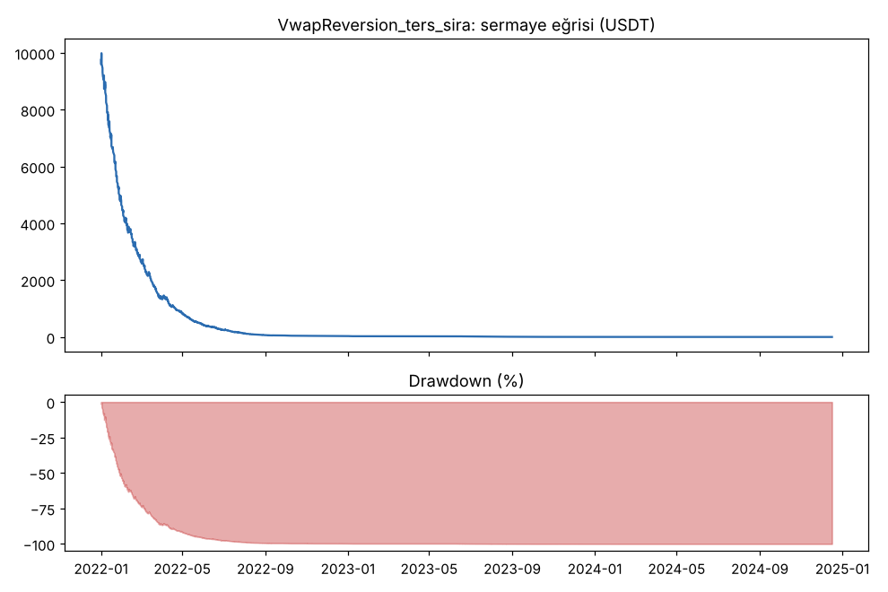
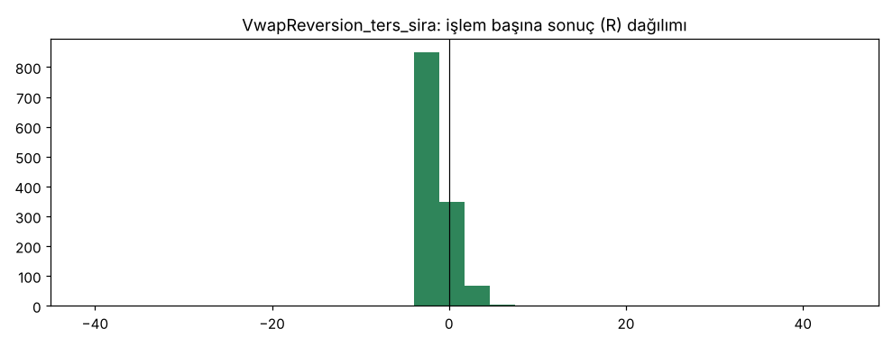

### wide16_1yuva — `VwapReversion` (16 coin, en fazla 1 açık işlem)

| Taraf | İşlem | Günde | Kazanan | Ort. R | Toplam R | PF | Max DD (kasa) | Max DD (R) | Net | Funding (USDT) | Ort. süre (dk) |
|---|---|---|---|---|---|---|---|---|---|---|---|
| toplam | 1401 | 1.28 | 27.0% | -0.249 | -348.4 | 0.40 | 100.0% | 968.4 | -100.0% | -21 | 830 |
| long | 639 | 0.58 | 27.1% | 0.281 | 179.6 | 0.34 | — | 454.9 | -51.6% | -7 | 977 |
| short | 762 | 0.70 | 26.9% | -0.693 | -528.0 | 0.45 | — | 564.2 | -48.4% | -14 | 707 |

(Freqtrade'in hesap düşüşü: 100.0%. Net %, işlemlerin USDT kâr/zararının başlangıç kasasına (10,000) oranıdır; risk her işlemde güncel kasanın %1'i olduğu için bileşiktir.)

| Yıl | Taraf | İşlem | Ort. R | PF | Net (USDT) |
|---|---|---|---|---|---|
| 2022 | toplam | 1224 | -0.636 | 0.40 | -9995 |
| 2022 | long | 571 | -0.665 | 0.34 | -5160 |
| 2022 | short | 653 | -0.610 | 0.45 | -4835 |
| 2023 | toplam | 100 | -1.629 | 0.04 | -4 |
| 2023 | long | 38 | -1.623 | 0.05 | -1 |
| 2023 | short | 62 | -1.632 | 0.03 | -3 |
| 2024 | toplam | 77 | 7.698 | 1.88 | 4 |
| 2024 | long | 30 | 20.700 | 4.42 | 5 |
| 2024 | short | 47 | -0.602 | 0.54 | -1 |

| Coin | İşlem | Ort. R | Long ort. R | Short ort. R | Toplam R | Net (USDT) |
|---|---|---|---|---|---|---|
| BTC | 115 | -0.818 | -0.780 | -0.880 | -94.1 | -552 |
| ETH | 129 | -0.870 | -0.864 | -0.875 | -112.2 | -1381 |
| SOL | 100 | -0.917 | -1.130 | -0.721 | -91.7 | -1401 |
| XRP | 108 | -0.708 | -0.838 | -0.600 | -76.5 | -606 |
| BNB | 100 | -0.818 | -0.633 | -1.010 | -81.8 | -81 |
| DOGE | 77 | -0.170 | -0.818 | 0.495 | -13.1 | 6 |
| ADA | 84 | -0.571 | -0.655 | -0.490 | -47.9 | -409 |
| LINK | 90 | -0.657 | -0.577 | -0.724 | -59.1 | -500 |
| LTC | 80 | -0.563 | -0.502 | -0.606 | -45.1 | -598 |
| DOT | 71 | -0.595 | -0.496 | -0.645 | -42.2 | -374 |
| AVAX | 60 | -0.839 | -0.813 | -0.856 | -50.3 | -762 |
| TRX | 115 | 4.830 | 13.048 | -0.851 | 555.4 | -1306 |
| ATOM | 87 | -0.758 | -0.603 | -0.873 | -66.0 | -992 |
| BCH | 59 | -0.623 | -0.349 | -0.812 | -36.8 | -257 |
| ETC | 58 | -0.366 | -0.393 | -0.346 | -21.2 | -304 |
| XLM | 68 | -0.968 | -1.162 | -0.888 | -65.9 | -480 |

Artıda biten coin (toplam R > 0): **1/16**.

| Taraf | Sonuç | İşlem | Ort. R |
|---|---|---|---|
| long | Stop | 431 | -1.542 |
| long | TP1 sonrası BE | 110 | 0.188 |
| long | TP2 | 98 | 8.402 |
| short | Stop | 503 | -1.584 |
| short | TP1 sonrası BE | 130 | 0.131 |
| short | TP2 | 128 | 1.731 |
| short | force_exit | 1 | 30.431 |

| Dönüş mumu | İşlem | Ort. R |
|---|---|---|
| engulfing_bear | 193 | -0.524 |
| engulfing_bull | 137 | -0.483 |
| evening_star | 39 | -0.839 |
| morning_star | 29 | -0.762 |
| pinbar_bear | 530 | -0.744 |
| pinbar_bull | 473 | 0.566 |

- Stop mesafesi (medyan): 0.4%; giriş+çıkış masrafı medyan **0.47R** (masraf %0.10/emir; kısmi çıkış ayrıca masraf öder).
- 1R risk için 3x'ten fazla kaldıraç gereken işlem: 35.3% (proje kuralı en fazla 3x; GUO kuralı 10x'e kadar).
- 3 kayıp → 24 saat duraklama: 249 kez devreye girdi; duraklama içinde açılan işlem: 0.

### wide16_16yuva — `VwapReversion` (16 coin, en fazla 16 açık işlem)

| Taraf | İşlem | Günde | Kazanan | Ort. R | Toplam R | PF | Max DD (kasa) | Max DD (R) | Net | Funding (USDT) | Ort. süre (dk) |
|---|---|---|---|---|---|---|---|---|---|---|---|
| toplam | 1883 | 1.72 | 28.0% | -0.450 | -847.6 | 0.43 | 100.0% | 853.0 | -100.0% | -2 | 730 |
| long | 907 | 0.83 | 28.9% | -0.216 | -195.9 | 0.35 | — | 390.5 | -58.0% | -4 | 342 |
| short | 976 | 0.89 | 27.3% | -0.668 | -651.7 | 0.52 | — | 660.8 | -42.0% | 2 | 1091 |

(Freqtrade'in hesap düşüşü: 100.0%. Net %, işlemlerin USDT kâr/zararının başlangıç kasasına (10,000) oranıdır; risk her işlemde güncel kasanın %1'i olduğu için bileşiktir.)

| Yıl | Taraf | İşlem | Ort. R | PF | Net (USDT) |
|---|---|---|---|---|---|
| 2022 | toplam | 1737 | -0.439 | 0.43 | -9998 |
| 2022 | long | 840 | -0.284 | 0.35 | -5804 |
| 2022 | short | 897 | -0.584 | 0.52 | -4194 |
| 2023 | toplam | 96 | 0.081 | 0.77 | -1 |
| 2023 | long | 52 | 1.456 | 1.40 | 1 |
| 2023 | short | 44 | -1.543 | 0.00 | -2 |
| 2024 | toplam | 50 | -1.857 | 0.43 | -1 |
| 2024 | long | 15 | -2.182 | 0.00 | -0 |
| 2024 | short | 35 | -1.718 | 0.63 | -0 |

| Coin | İşlem | Ort. R | Long ort. R | Short ort. R | Toplam R | Net (USDT) |
|---|---|---|---|---|---|---|
| BTC | 105 | -0.918 | -0.870 | -0.963 | -96.4 | -665 |
| ETH | 127 | -0.815 | -0.842 | -0.781 | -103.5 | -1140 |
| SOL | 101 | -0.840 | -0.925 | -0.759 | -84.8 | -712 |
| XRP | 129 | -0.608 | -0.393 | -0.832 | -78.4 | -579 |
| BNB | 120 | -0.675 | -0.703 | -0.644 | -81.0 | -406 |
| DOGE | 103 | 1.885 | 3.194 | 0.130 | 194.2 | -393 |
| ADA | 135 | -0.663 | -0.597 | -0.740 | -89.5 | -1179 |
| LINK | 153 | -0.440 | -0.482 | -0.406 | -67.3 | 267 |
| LTC | 111 | -0.545 | -0.575 | -0.524 | -60.5 | -622 |
| DOT | 118 | -0.483 | -0.523 | -0.453 | -57.0 | 125 |
| AVAX | 91 | -0.741 | -0.684 | -0.790 | -67.5 | -469 |
| TRX | 140 | 0.323 | 1.722 | -0.667 | 45.2 | -1106 |
| ATOM | 130 | -0.843 | -0.621 | -1.017 | -109.6 | -1645 |
| BCH | 111 | -0.516 | -0.372 | -0.686 | -57.3 | -13 |
| ETC | 108 | -0.465 | -0.281 | -0.618 | -50.2 | -264 |
| XLM | 101 | -0.831 | -0.798 | -0.854 | -83.9 | -1200 |

Artıda biten coin (toplam R > 0): **2/16**.

| Taraf | Sonuç | İşlem | Ort. R |
|---|---|---|---|
| long | Stop | 602 | -1.482 |
| long | TP1 sonrası BE | 147 | 0.222 |
| long | TP2 | 158 | 4.201 |
| short | Stop | 651 | -1.480 |
| short | TP1 sonrası BE | 181 | 0.153 |
| short | TP2 | 144 | 1.971 |

| Dönüş mumu | İşlem | Ort. R |
|---|---|---|
| engulfing_bear | 286 | -0.605 |
| engulfing_bull | 267 | -0.614 |
| evening_star | 60 | -0.565 |
| morning_star | 58 | -0.653 |
| pinbar_bear | 630 | -0.706 |
| pinbar_bull | 582 | 0.010 |

- Stop mesafesi (medyan): 0.5%; giriş+çıkış masrafı medyan **0.42R** (masraf %0.10/emir; kısmi çıkış ayrıca masraf öder).
- 1R risk için 3x'ten fazla kaldıraç gereken işlem: 26.3% (proje kuralı en fazla 3x; GUO kuralı 10x'e kadar).
- 3 kayıp → 24 saat duraklama: 364 kez devreye girdi; duraklama içinde açılan işlem: 3.

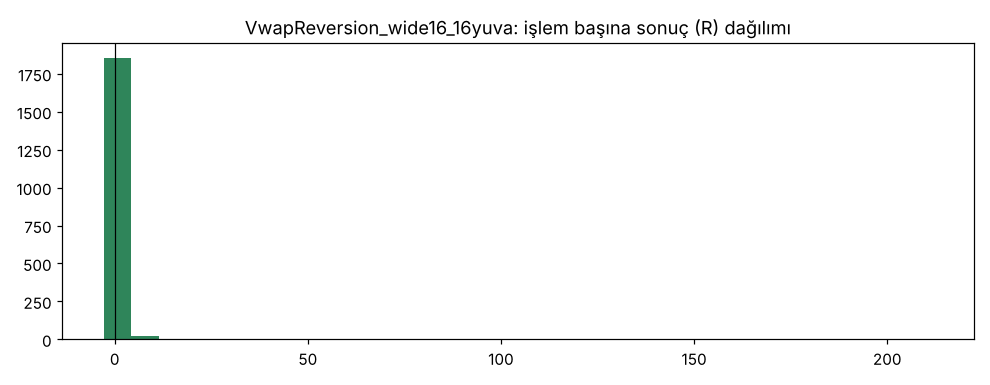

### sabit_risk_normal — `VwapReversionFixed` (3 coin, en fazla 1 açık işlem)

| Taraf | İşlem | Günde | Kazanan | Ort. R | Toplam R | PF | Max DD (kasa) | Max DD (R) | Net | Funding (USDT) | Ort. süre (dk) |
|---|---|---|---|---|---|---|---|---|---|---|---|
| toplam | 3683 | 3.36 | 30.7% | -0.648 | -2388.3 | 0.32 | 23.9% | 2388.3 | -23.9% | 44 | 77 |
| long | 1812 | 1.65 | 31.1% | -0.627 | -1135.9 | 0.33 | — | 1137.9 | -11.3% | -519 | 74 |
| short | 1871 | 1.71 | 30.3% | -0.669 | -1252.4 | 0.32 | — | 1252.4 | -12.5% | 563 | 79 |

(Sabit risk koşusu: her işlemin riski 10000 USDT'nin %1'i = 100 USDT, bileşik değil; kasa dev tutulduğu için hiç bitmez. Bu koşuda Max DD (kasa) ve Net % anlamsızdır, R sütunlarına bakın.)
(Freqtrade'in hesap düşüşü: 23.9%. Net %, işlemlerin USDT kâr/zararının başlangıç kasasına (1,000,000) oranıdır; risk her işlemde güncel kasanın %1'i olduğu için bileşiktir.)

| Yıl | Taraf | İşlem | Ort. R | PF | Net (USDT) |
|---|---|---|---|---|---|
| 2022 | toplam | 1259 | -0.616 | 0.34 | -77476 |
| 2022 | long | 654 | -0.590 | 0.35 | -38531 |
| 2022 | short | 605 | -0.645 | 0.32 | -38945 |
| 2023 | toplam | 1143 | -0.742 | 0.24 | -84734 |
| 2023 | long | 563 | -0.758 | 0.20 | -42645 |
| 2023 | short | 580 | -0.726 | 0.28 | -42089 |
| 2024 | toplam | 1281 | -0.597 | 0.39 | -76369 |
| 2024 | long | 595 | -0.544 | 0.42 | -32308 |
| 2024 | short | 686 | -0.643 | 0.36 | -44061 |

| Coin | İşlem | Ort. R | Long ort. R | Short ort. R | Toplam R | Net (USDT) |
|---|---|---|---|---|---|---|
| BTC | 1405 | -0.730 | -0.661 | -0.799 | -1026.1 | -102533 |
| ETH | 1120 | -0.654 | -0.632 | -0.675 | -732.9 | -73289 |
| SOL | 1158 | -0.543 | -0.580 | -0.507 | -629.3 | -62757 |

Artıda biten coin (toplam R > 0): **0/3**.

| Taraf | Sonuç | İşlem | Ort. R |
|---|---|---|---|
| long | Stop | 1043 | -1.549 |
| long | TP1 sonrası BE | 399 | 0.025 |
| long | TP2 | 370 | 1.269 |
| short | Stop | 1108 | -1.617 |
| short | TP1 sonrası BE | 386 | 0.041 |
| short | TP2 | 377 | 1.388 |

| Dönüş mumu | İşlem | Ort. R |
|---|---|---|
| engulfing_bear | 525 | -0.618 |
| engulfing_bull | 469 | -0.675 |
| evening_star | 92 | -0.621 |
| morning_star | 80 | -0.446 |
| pinbar_bear | 1254 | -0.694 |
| pinbar_bull | 1263 | -0.620 |

- Stop mesafesi (medyan): 0.4%; giriş+çıkış masrafı medyan **0.51R** (masraf %0.10/emir; kısmi çıkış ayrıca masraf öder).
- 1R risk için 3x'ten fazla kaldıraç gereken işlem: 37.9% (proje kuralı en fazla 3x; GUO kuralı 10x'e kadar).
- 3 kayıp → 24 saat duraklama: 569 kez devreye girdi; duraklama içinde açılan işlem: 0.

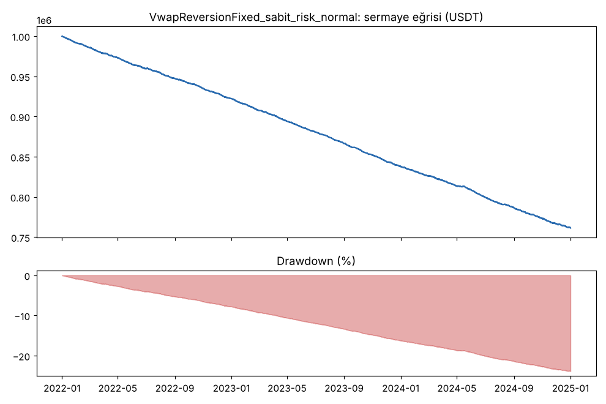
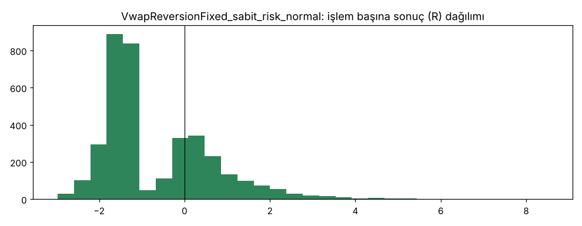

### sabit_risk_normal — `VwapReversionTp1RFixed` (3 coin, en fazla 1 açık işlem)

| Taraf | İşlem | Günde | Kazanan | Ort. R | Toplam R | PF | Max DD (kasa) | Max DD (R) | Net | Funding (USDT) | Ort. süre (dk) |
|---|---|---|---|---|---|---|---|---|---|---|---|
| toplam | 3198 | 2.92 | 30.0% | -0.695 | -2221.7 | 0.35 | 22.2% | 2221.7 | -22.2% | 65 | 75 |
| long | 1519 | 1.39 | 30.7% | -0.668 | -1014.1 | 0.35 | — | 1014.2 | -10.1% | -485 | 77 |
| short | 1679 | 1.53 | 29.3% | -0.719 | -1207.6 | 0.35 | — | 1207.6 | -12.1% | 550 | 74 |

(Sabit risk koşusu: her işlemin riski 10000 USDT'nin %1'i = 100 USDT, bileşik değil; kasa dev tutulduğu için hiç bitmez. Bu koşuda Max DD (kasa) ve Net % anlamsızdır, R sütunlarına bakın.)
(Freqtrade'in hesap düşüşü: 22.2%. Net %, işlemlerin USDT kâr/zararının başlangıç kasasına (1,000,000) oranıdır; risk her işlemde güncel kasanın %1'i olduğu için bileşiktir.)

| Yıl | Taraf | İşlem | Ort. R | PF | Net (USDT) |
|---|---|---|---|---|---|
| 2022 | toplam | 1097 | -0.673 | 0.36 | -73711 |
| 2022 | long | 549 | -0.622 | 0.38 | -34113 |
| 2022 | short | 548 | -0.724 | 0.34 | -39597 |
| 2023 | toplam | 949 | -0.777 | 0.29 | -73703 |
| 2023 | long | 433 | -0.780 | 0.27 | -33731 |
| 2023 | short | 516 | -0.775 | 0.31 | -39972 |
| 2024 | toplam | 1152 | -0.648 | 0.40 | -74483 |
| 2024 | long | 537 | -0.624 | 0.40 | -33457 |
| 2024 | short | 615 | -0.668 | 0.40 | -41026 |

| Coin | İşlem | Ort. R | Long ort. R | Short ort. R | Toplam R | Net (USDT) |
|---|---|---|---|---|---|---|
| BTC | 1063 | -0.793 | -0.732 | -0.847 | -842.9 | -84231 |
| ETH | 982 | -0.680 | -0.615 | -0.739 | -668.0 | -66798 |
| SOL | 1153 | -0.616 | -0.655 | -0.580 | -710.7 | -70868 |

Artıda biten coin (toplam R > 0): **0/3**.

| Taraf | Sonuç | İşlem | Ort. R |
|---|---|---|---|
| long | Stop | 987 | -1.569 |
| long | TP1 sonrası BE | 236 | 0.232 |
| long | TP2 | 296 | 1.621 |
| short | Stop | 1132 | -1.638 |
| short | TP1 sonrası BE | 240 | 0.256 |
| short | TP2 | 307 | 1.908 |

| Dönüş mumu | İşlem | Ort. R |
|---|---|---|
| engulfing_bear | 302 | -0.608 |
| engulfing_bull | 247 | -0.654 |
| evening_star | 53 | -0.818 |
| morning_star | 28 | -0.578 |
| pinbar_bear | 1324 | -0.741 |
| pinbar_bull | 1244 | -0.672 |

- Stop mesafesi (medyan): 0.4%; giriş+çıkış masrafı medyan **0.54R** (masraf %0.10/emir; kısmi çıkış ayrıca masraf öder).
- 1R risk için 3x'ten fazla kaldıraç gereken işlem: 42.9% (proje kuralı en fazla 3x; GUO kuralı 10x'e kadar).
- 3 kayıp → 24 saat duraklama: 501 kez devreye girdi; duraklama içinde açılan işlem: 0.

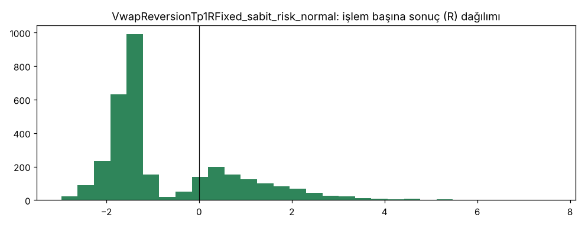

### sabit_risk_masraf_x2 — `VwapReversionFixed` (3 coin, en fazla 1 açık işlem)

| Taraf | İşlem | Günde | Kazanan | Ort. R | Toplam R | PF | Max DD (kasa) | Max DD (R) | Net | Funding (USDT) | Ort. süre (dk) |
|---|---|---|---|---|---|---|---|---|---|---|---|
| toplam | 3070 | 2.80 | 20.4% | -1.207 | -3707.0 | 0.14 | 37.0% | 3707.0 | -37.0% | 50 | 76 |
| long | 1529 | 1.40 | 21.4% | -1.144 | -1749.1 | 0.14 | — | 1754.4 | -17.5% | -407 | 73 |
| short | 1541 | 1.41 | 19.4% | -1.271 | -1957.9 | 0.14 | — | 1957.9 | -19.6% | 457 | 78 |

(Sabit risk koşusu: her işlemin riski 10000 USDT'nin %1'i = 100 USDT, bileşik değil; kasa dev tutulduğu için hiç bitmez. Bu koşuda Max DD (kasa) ve Net % anlamsızdır, R sütunlarına bakın.)
(Freqtrade'in hesap düşüşü: 37.0%. Net %, işlemlerin USDT kâr/zararının başlangıç kasasına (1,000,000) oranıdır; risk her işlemde güncel kasanın %1'i olduğu için bileşiktir.)

| Yıl | Taraf | İşlem | Ort. R | PF | Net (USDT) |
|---|---|---|---|---|---|
| 2022 | toplam | 1064 | -1.131 | 0.15 | -120234 |
| 2022 | long | 552 | -1.039 | 0.17 | -57298 |
| 2022 | short | 512 | -1.231 | 0.13 | -62937 |
| 2023 | toplam | 932 | -1.333 | 0.10 | -124215 |
| 2023 | long | 478 | -1.316 | 0.07 | -62873 |
| 2023 | short | 454 | -1.352 | 0.13 | -61342 |
| 2024 | toplam | 1074 | -1.174 | 0.17 | -125907 |
| 2024 | long | 499 | -1.096 | 0.19 | -54594 |
| 2024 | short | 575 | -1.242 | 0.16 | -71314 |

| Coin | İşlem | Ort. R | Long ort. R | Short ort. R | Toplam R | Net (USDT) |
|---|---|---|---|---|---|---|
| BTC | 1175 | -1.341 | -1.241 | -1.441 | -1575.7 | -157457 |
| ETH | 954 | -1.289 | -1.210 | -1.364 | -1229.3 | -122920 |
| SOL | 941 | -0.959 | -0.957 | -0.960 | -902.0 | -89980 |

Artıda biten coin (toplam R > 0): **0/3**.

| Taraf | Sonuç | İşlem | Ort. R |
|---|---|---|---|
| long | Stop | 857 | -2.091 |
| long | TP1 sonrası BE | 333 | -0.549 |
| long | TP2 | 339 | 0.665 |
| short | Stop | 921 | -2.230 |
| short | TP1 sonrası BE | 314 | -0.508 |
| short | TP2 | 306 | 0.834 |

| Dönüş mumu | İşlem | Ort. R |
|---|---|---|
| engulfing_bear | 419 | -1.171 |
| engulfing_bull | 419 | -1.150 |
| evening_star | 87 | -1.062 |
| morning_star | 72 | -1.090 |
| pinbar_bear | 1035 | -1.328 |
| pinbar_bull | 1038 | -1.145 |

- Stop mesafesi (medyan): 0.4%; giriş+çıkış masrafı medyan **1.00R** (masraf %0.20/emir; kısmi çıkış ayrıca masraf öder).
- 1R risk için 3x'ten fazla kaldıraç gereken işlem: 37.2% (proje kuralı en fazla 3x; GUO kuralı 10x'e kadar).
- 3 kayıp → 24 saat duraklama: 646 kez devreye girdi; duraklama içinde açılan işlem: 0.

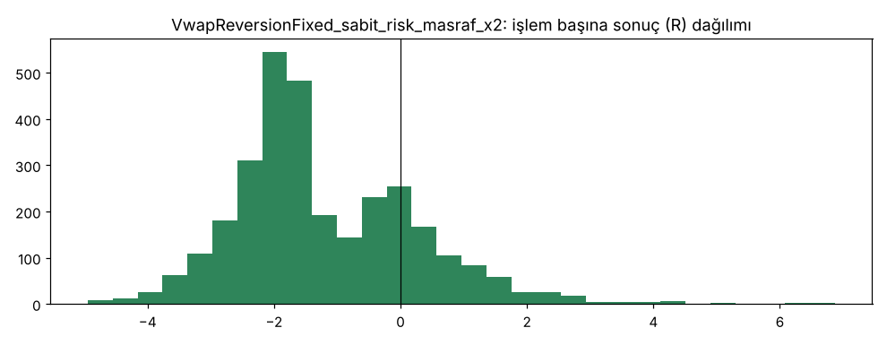

### sabit_risk_dusuk_masraf — `VwapReversionFixed` (3 coin, en fazla 1 açık işlem)

| Taraf | İşlem | Günde | Kazanan | Ort. R | Toplam R | PF | Max DD (kasa) | Max DD (R) | Net | Funding (USDT) | Ort. süre (dk) |
|---|---|---|---|---|---|---|---|---|---|---|---|
| toplam | 4251 | 3.88 | 40.2% | -0.247 | -1048.8 | 0.64 | 10.5% | 1051.1 | -10.5% | 108 | 77 |
| long | 2095 | 1.91 | 41.6% | -0.241 | -505.5 | 0.64 | — | 515.9 | -5.1% | -557 | 76 |
| short | 2156 | 1.97 | 38.9% | -0.252 | -543.3 | 0.65 | — | 546.5 | -5.4% | 664 | 77 |

(Sabit risk koşusu: her işlemin riski 10000 USDT'nin %1'i = 100 USDT, bileşik değil; kasa dev tutulduğu için hiç bitmez. Bu koşuda Max DD (kasa) ve Net % anlamsızdır, R sütunlarına bakın.)
(Freqtrade'in hesap düşüşü: 10.5%. Net %, işlemlerin USDT kâr/zararının başlangıç kasasına (1,000,000) oranıdır; risk her işlemde güncel kasanın %1'i olduğu için bileşiktir.)

| Yıl | Taraf | İşlem | Ort. R | PF | Net (USDT) |
|---|---|---|---|---|---|
| 2022 | toplam | 1384 | -0.271 | 0.61 | -37461 |
| 2022 | long | 714 | -0.243 | 0.64 | -17342 |
| 2022 | short | 670 | -0.301 | 0.59 | -20120 |
| 2023 | toplam | 1377 | -0.284 | 0.57 | -39063 |
| 2023 | long | 659 | -0.286 | 0.54 | -18830 |
| 2023 | short | 718 | -0.282 | 0.59 | -20234 |
| 2024 | toplam | 1490 | -0.190 | 0.73 | -28202 |
| 2024 | long | 722 | -0.199 | 0.71 | -14334 |
| 2024 | short | 768 | -0.181 | 0.75 | -13868 |

| Coin | İşlem | Ort. R | Long ort. R | Short ort. R | Toplam R | Net (USDT) |
|---|---|---|---|---|---|---|
| BTC | 1608 | -0.298 | -0.265 | -0.330 | -479.7 | -47927 |
| ETH | 1293 | -0.210 | -0.217 | -0.204 | -271.8 | -27178 |
| SOL | 1350 | -0.220 | -0.236 | -0.205 | -297.3 | -29623 |

Artıda biten coin (toplam R > 0): **0/3**.

| Taraf | Sonuç | İşlem | Ort. R |
|---|---|---|---|
| long | Stop | 1195 | -1.168 |
| long | TP1 sonrası BE | 456 | 0.392 |
| long | TP2 | 444 | 1.601 |
| short | Stop | 1294 | -1.182 |
| short | TP1 sonrası BE | 424 | 0.430 |
| short | TP2 | 438 | 1.836 |

| Dönüş mumu | İşlem | Ort. R |
|---|---|---|
| engulfing_bear | 598 | -0.266 |
| engulfing_bull | 547 | -0.284 |
| evening_star | 118 | -0.324 |
| morning_star | 93 | -0.179 |
| pinbar_bear | 1440 | -0.240 |
| pinbar_bull | 1455 | -0.229 |

- Stop mesafesi (medyan): 0.4%; giriş+çıkış masrafı medyan **0.15R** (masraf %0.03/emir; kısmi çıkış ayrıca masraf öder).
- 1R risk için 3x'ten fazla kaldıraç gereken işlem: 38.8% (proje kuralı en fazla 3x; GUO kuralı 10x'e kadar).
- 3 kayıp → 24 saat duraklama: 495 kez devreye girdi; duraklama içinde açılan işlem: 0.

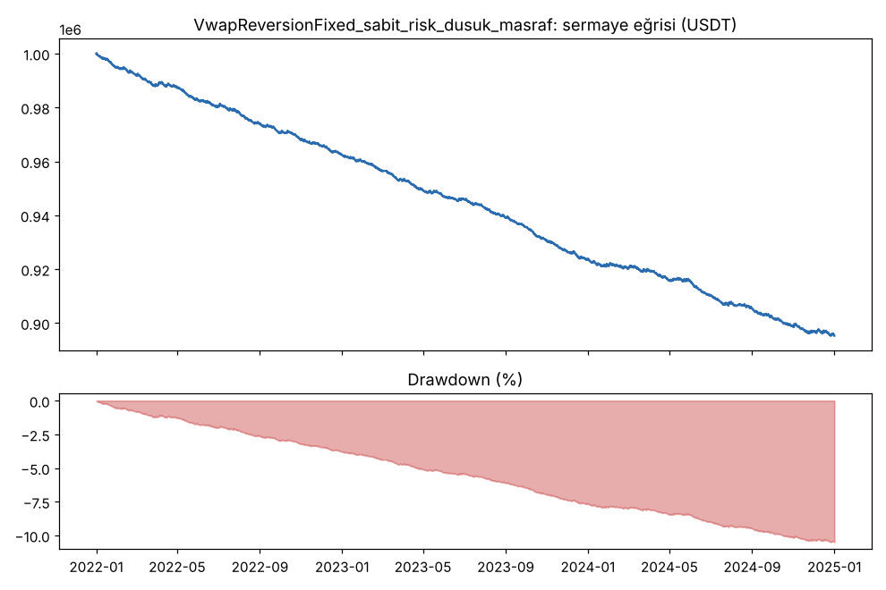
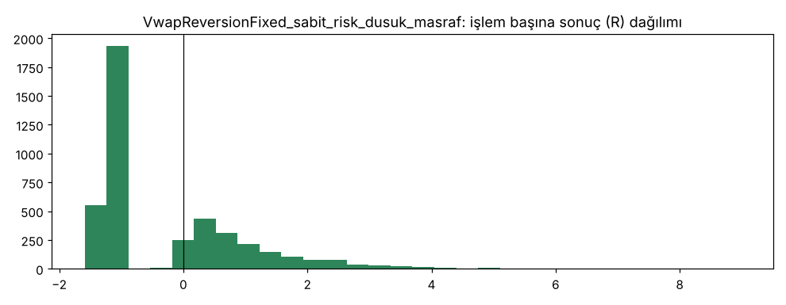

### sabit_risk_masrafsiz — `VwapReversionFixed` (3 coin, en fazla 1 açık işlem)

| Taraf | İşlem | Günde | Kazanan | Ort. R | Toplam R | PF | Max DD (kasa) | Max DD (R) | Net | Funding (USDT) | Ort. süre (dk) |
|---|---|---|---|---|---|---|---|---|---|---|---|
| toplam | 4314 | 3.94 | 41.6% | -0.069 | -296.7 | 0.88 | 3.2% | 324.7 | -3.0% | 102 | 77 |
| long | 2122 | 1.94 | 43.1% | -0.073 | -154.5 | 0.87 | — | 177.0 | -1.5% | -586 | 76 |
| short | 2192 | 2.00 | 40.1% | -0.065 | -142.2 | 0.89 | — | 170.2 | -1.4% | 688 | 77 |

(Sabit risk koşusu: her işlemin riski 10000 USDT'nin %1'i = 100 USDT, bileşik değil; kasa dev tutulduğu için hiç bitmez. Bu koşuda Max DD (kasa) ve Net % anlamsızdır, R sütunlarına bakın.)
(Freqtrade'in hesap düşüşü: 3.2%. Net %, işlemlerin USDT kâr/zararının başlangıç kasasına (1,000,000) oranıdır; risk her işlemde güncel kasanın %1'i olduğu için bileşiktir.)

| Yıl | Taraf | İşlem | Ort. R | PF | Net (USDT) |
|---|---|---|---|---|---|
| 2022 | toplam | 1385 | -0.123 | 0.80 | -17064 |
| 2022 | long | 713 | -0.105 | 0.82 | -7494 |
| 2022 | short | 672 | -0.143 | 0.77 | -9570 |
| 2023 | toplam | 1416 | -0.091 | 0.84 | -12899 |
| 2023 | long | 681 | -0.101 | 0.81 | -6847 |
| 2023 | short | 735 | -0.083 | 0.86 | -6052 |
| 2024 | toplam | 1513 | 0.002 | 1.00 | 382 |
| 2024 | long | 728 | -0.015 | 0.97 | -1090 |
| 2024 | short | 785 | 0.019 | 1.03 | 1472 |

| Coin | İşlem | Ort. R | Long ort. R | Short ort. R | Toplam R | Net (USDT) |
|---|---|---|---|---|---|---|
| BTC | 1636 | -0.096 | -0.083 | -0.109 | -157.3 | -15711 |
| ETH | 1310 | -0.020 | -0.036 | -0.004 | -25.6 | -2560 |
| SOL | 1368 | -0.083 | -0.096 | -0.071 | -113.8 | -11310 |

Artıda biten coin (toplam R > 0): **0/3**.

| Taraf | Sonuç | İşlem | Ort. R |
|---|---|---|---|
| long | Stop | 1208 | -0.999 |
| long | TP1 sonrası BE | 463 | 0.554 |
| long | TP2 | 451 | 1.764 |
| short | Stop | 1312 | -0.995 |
| short | TP1 sonrası BE | 438 | 0.610 |
| short | TP2 | 442 | 2.026 |

| Dönüş mumu | İşlem | Ort. R |
|---|---|---|
| engulfing_bear | 611 | -0.077 |
| engulfing_bull | 561 | -0.120 |
| evening_star | 120 | -0.180 |
| morning_star | 95 | -0.039 |
| pinbar_bear | 1461 | -0.051 |
| pinbar_bull | 1466 | -0.057 |

- Stop mesafesi (medyan): 0.4%; giriş+çıkış masrafı medyan **0.00R** (masraf %0.00/emir; kısmi çıkış ayrıca masraf öder).
- 1R risk için 3x'ten fazla kaldıraç gereken işlem: 39.0% (proje kuralı en fazla 3x; GUO kuralı 10x'e kadar).
- 3 kayıp → 24 saat duraklama: 485 kez devreye girdi; duraklama içinde açılan işlem: 0.

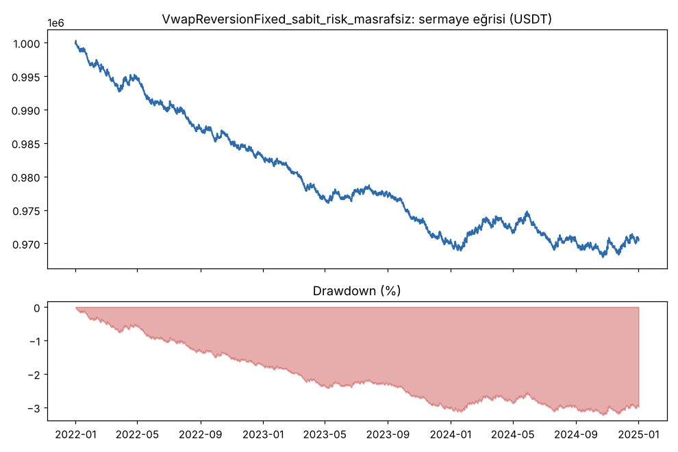
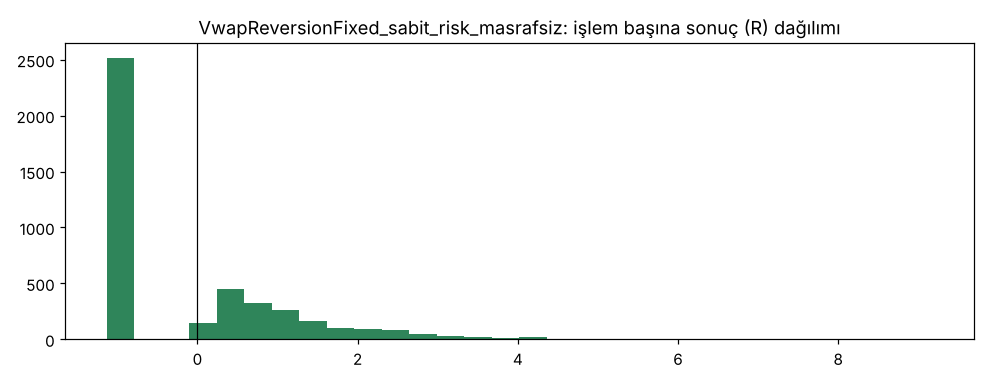

### sabit_risk_ters_sira — `VwapReversionFixed` (3 coin, en fazla 1 açık işlem)

| Taraf | İşlem | Günde | Kazanan | Ort. R | Toplam R | PF | Max DD (kasa) | Max DD (R) | Net | Funding (USDT) | Ort. süre (dk) |
|---|---|---|---|---|---|---|---|---|---|---|---|
| toplam | 3715 | 3.39 | 31.1% | -0.625 | -2320.9 | 0.34 | 23.2% | 2321.1 | -23.2% | 120 | 72 |
| long | 1787 | 1.63 | 31.8% | -0.606 | -1082.1 | 0.35 | — | 1089.0 | -10.8% | -354 | 76 |
| short | 1928 | 1.76 | 30.5% | -0.643 | -1238.8 | 0.34 | — | 1238.8 | -12.4% | 474 | 69 |

(Sabit risk koşusu: her işlemin riski 10000 USDT'nin %1'i = 100 USDT, bileşik değil; kasa dev tutulduğu için hiç bitmez. Bu koşuda Max DD (kasa) ve Net % anlamsızdır, R sütunlarına bakın.)
(Freqtrade'in hesap düşüşü: 23.2%. Net %, işlemlerin USDT kâr/zararının başlangıç kasasına (1,000,000) oranıdır; risk her işlemde güncel kasanın %1'i olduğu için bileşiktir.)

| Yıl | Taraf | İşlem | Ort. R | PF | Net (USDT) |
|---|---|---|---|---|---|
| 2022 | toplam | 1251 | -0.584 | 0.37 | -72935 |
| 2022 | long | 623 | -0.564 | 0.38 | -35116 |
| 2022 | short | 628 | -0.604 | 0.36 | -37820 |
| 2023 | toplam | 1176 | -0.696 | 0.27 | -81832 |
| 2023 | long | 570 | -0.680 | 0.25 | -38755 |
| 2023 | short | 606 | -0.711 | 0.29 | -43077 |
| 2024 | toplam | 1288 | -0.599 | 0.39 | -77044 |
| 2024 | long | 594 | -0.577 | 0.40 | -34231 |
| 2024 | short | 694 | -0.618 | 0.38 | -42813 |

| Coin | İşlem | Ort. R | Long ort. R | Short ort. R | Toplam R | Net (USDT) |
|---|---|---|---|---|---|---|
| SOL | 1585 | -0.494 | -0.480 | -0.508 | -782.9 | -78069 |
| ETH | 1231 | -0.659 | -0.638 | -0.679 | -811.3 | -81126 |
| BTC | 899 | -0.808 | -0.807 | -0.809 | -726.7 | -72616 |

Artıda biten coin (toplam R > 0): **0/3**.

| Taraf | Sonuç | İşlem | Ort. R |
|---|---|---|---|
| long | Stop | 1044 | -1.530 |
| long | TP1 sonrası BE | 360 | 0.041 |
| long | TP2 | 382 | 1.312 |
| long | force_exit | 1 | -0.787 |
| short | Stop | 1146 | -1.601 |
| short | TP1 sonrası BE | 397 | 0.058 |
| short | TP2 | 385 | 1.488 |

| Dönüş mumu | İşlem | Ort. R |
|---|---|---|
| engulfing_bear | 533 | -0.599 |
| engulfing_bull | 470 | -0.631 |
| evening_star | 93 | -0.633 |
| morning_star | 84 | -0.652 |
| pinbar_bear | 1302 | -0.661 |
| pinbar_bull | 1233 | -0.593 |

- Stop mesafesi (medyan): 0.4%; giriş+çıkış masrafı medyan **0.48R** (masraf %0.10/emir; kısmi çıkış ayrıca masraf öder).
- 1R risk için 3x'ten fazla kaldıraç gereken işlem: 35.5% (proje kuralı en fazla 3x; GUO kuralı 10x'e kadar).
- 3 kayıp → 24 saat duraklama: 575 kez devreye girdi; duraklama içinde açılan işlem: 0.

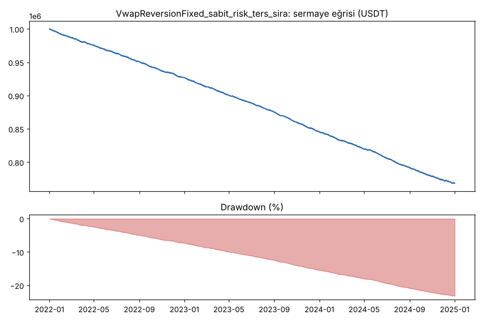
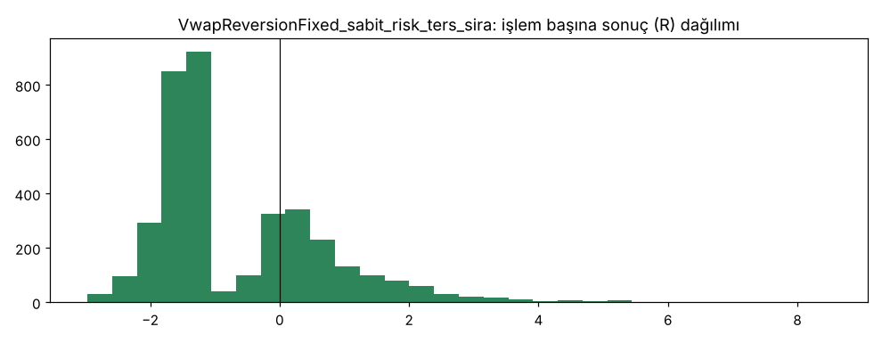

### sabit_risk_wide16_1yuva — `VwapReversionFixed` (16 coin, en fazla 1 açık işlem)

| Taraf | İşlem | Günde | Kazanan | Ort. R | Toplam R | PF | Max DD (kasa) | Max DD (R) | Net | Funding (USDT) | Ort. süre (dk) |
|---|---|---|---|---|---|---|---|---|---|---|---|
| toplam | 4625 | 4.22 | 30.0% | -0.650 | -3007.3 | 0.33 | 30.0% | 3007.3 | -30.0% | 41 | 64 |
| long | 2139 | 1.95 | 29.9% | -0.676 | -1445.2 | 0.30 | — | 1446.7 | -14.4% | -342 | 63 |
| short | 2486 | 2.27 | 30.0% | -0.628 | -1562.1 | 0.36 | — | 1563.7 | -15.6% | 383 | 64 |

(Sabit risk koşusu: her işlemin riski 10000 USDT'nin %1'i = 100 USDT, bileşik değil; kasa dev tutulduğu için hiç bitmez. Bu koşuda Max DD (kasa) ve Net % anlamsızdır, R sütunlarına bakın.)
(Freqtrade'in hesap düşüşü: 30.0%. Net %, işlemlerin USDT kâr/zararının başlangıç kasasına (1,000,000) oranıdır; risk her işlemde güncel kasanın %1'i olduğu için bileşiktir.)

| Yıl | Taraf | İşlem | Ort. R | PF | Net (USDT) |
|---|---|---|---|---|---|
| 2022 | toplam | 1661 | -0.539 | 0.41 | -89302 |
| 2022 | long | 781 | -0.516 | 0.42 | -40210 |
| 2022 | short | 880 | -0.559 | 0.40 | -49092 |
| 2023 | toplam | 1445 | -0.701 | 0.27 | -101214 |
| 2023 | long | 662 | -0.710 | 0.26 | -46961 |
| 2023 | short | 783 | -0.694 | 0.29 | -54253 |
| 2024 | toplam | 1519 | -0.724 | 0.31 | -109802 |
| 2024 | long | 696 | -0.823 | 0.24 | -57165 |
| 2024 | short | 823 | -0.641 | 0.38 | -52637 |

| Coin | İşlem | Ort. R | Long ort. R | Short ort. R | Toplam R | Net (USDT) |
|---|---|---|---|---|---|---|
| BTC | 458 | -0.771 | -0.815 | -0.727 | -353.3 | -35308 |
| ETH | 395 | -0.739 | -0.680 | -0.807 | -292.0 | -29202 |
| SOL | 469 | -0.593 | -0.632 | -0.558 | -278.2 | -27749 |
| XRP | 419 | -0.611 | -0.576 | -0.651 | -256.2 | -25543 |
| BNB | 351 | -0.843 | -0.861 | -0.828 | -296.0 | -29585 |
| DOGE | 313 | -0.533 | -0.667 | -0.419 | -166.7 | -16667 |
| ADA | 315 | -0.782 | -0.830 | -0.737 | -246.4 | -24593 |
| LINK | 274 | -0.646 | -0.703 | -0.603 | -177.0 | -17686 |
| LTC | 257 | -0.516 | -0.481 | -0.546 | -132.7 | -13254 |
| DOT | 200 | -0.728 | -0.714 | -0.740 | -145.6 | -14541 |
| AVAX | 192 | -0.359 | -0.313 | -0.386 | -68.8 | -6866 |
| TRX | 189 | -0.684 | -0.660 | -0.699 | -129.2 | -12917 |
| ATOM | 228 | -0.567 | -0.622 | -0.524 | -129.3 | -12887 |
| BCH | 237 | -0.613 | -0.709 | -0.547 | -145.4 | -14511 |
| ETC | 162 | -0.535 | -0.568 | -0.515 | -86.7 | -8662 |
| XLM | 166 | -0.625 | -0.657 | -0.604 | -103.8 | -10348 |

Artıda biten coin (toplam R > 0): **0/16**.

| Taraf | Sonuç | İşlem | Ort. R |
|---|---|---|---|
| long | Stop | 1281 | -1.571 |
| long | TP1 sonrası BE | 475 | 0.063 |
| long | TP2 | 383 | 1.401 |
| short | Stop | 1499 | -1.575 |
| short | TP1 sonrası BE | 534 | 0.089 |
| short | TP2 | 453 | 1.659 |

| Dönüş mumu | İşlem | Ort. R |
|---|---|---|
| engulfing_bear | 685 | -0.583 |
| engulfing_bull | 530 | -0.583 |
| evening_star | 150 | -0.616 |
| morning_star | 95 | -0.619 |
| pinbar_bear | 1651 | -0.648 |
| pinbar_bull | 1514 | -0.712 |

- Stop mesafesi (medyan): 0.4%; giriş+çıkış masrafı medyan **0.50R** (masraf %0.10/emir; kısmi çıkış ayrıca masraf öder).
- 1R risk için 3x'ten fazla kaldıraç gereken işlem: 37.8% (proje kuralı en fazla 3x; GUO kuralı 10x'e kadar).
- 3 kayıp → 24 saat duraklama: 770 kez devreye girdi; duraklama içinde açılan işlem: 0.

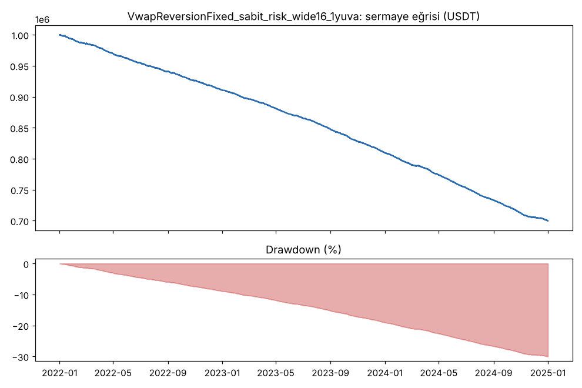
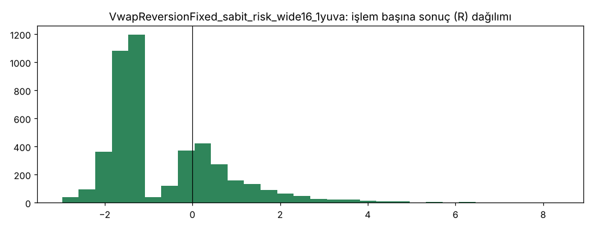

### Sinyal sayıları (BTC/ETH/SOL, 2022-2024)

| Coin | Taraf | Ham sinyal (uzama + dönüş mumu) | Hedefler ≥ 0.3R (ana sürüm) | TP1 ≥ 1R (varyant) | TP1 = VWAP (sıra değişti) | Stop < %0.101 (10x'e sığmaz) |
|---|---|---|---|---|---|---|
| BTC | long | 3701 | 3330 | 1867 | 506 | 28 |
| BTC | short | 3826 | 3493 | 2132 | 426 | 28 |
| ETH | long | 4112 | 3729 | 2168 | 582 | 7 |
| ETH | short | 4008 | 3740 | 2399 | 465 | 17 |
| SOL | long | 3959 | 3651 | 2392 | 454 | 0 |
| SOL | short | 3903 | 3665 | 2507 | 426 | 3 |
| **Toplam** | | **23509** | **21608** | **13465** | 2859 | 83 |

TP1 ≥ 1R kuralı, ana sürümün geçerli sinyallerinin **37.7%**'ini (8143 sinyal) eler. (Sinyal sayıları 1 açık işlem sınırı ve duraklamalardan önce.)

### Al-tut (aynı dönem, BTC/ETH/SOL)

| Coin | Al-tut getirisi | Al-tut max DD |
|---|---|---|
| BTC | 102.0% | 67.7% |
| ETH | -9.5% | 77.2% |
| SOL | 11.0% | 95.5% |
| **Eşit ağırlık ortalama** | **34.5%** | 80.1% (ortalama) |

Yıllara göre eşit ağırlıklı al-tut: 2022: -75.5%, 2023: 389.1%, 2024: 83.6%

### Al-tut (aynı dönem, 16 coin)

| Coin | Al-tut getirisi | Al-tut max DD |
|---|---|---|
| BTC | 102.0% | 67.7% |
| ETH | -9.5% | 77.2% |
| SOL | 11.0% | 95.5% |
| XRP | 150.2% | 68.2% |
| BNB | 36.9% | 65.4% |
| DOGE | 85.4% | 76.1% |
| ADA | -35.7% | 85.8% |
| LINK | 2.2% | 82.8% |
| LTC | -29.5% | 73.7% |
| DOT | -75.2% | 88.3% |
| AVAX | -67.6% | 92.6% |
| TRX | 237.4% | 50.9% |
| ATOM | -81.1% | 91.8% |
| BCH | 0.6% | 80.6% |
| ETC | -26.6% | 76.0% |
| XLM | 24.9% | 76.2% |
| **Eşit ağırlık ortalama** | **20.3%** | 78.0% (ortalama) |

Yıllara göre eşit ağırlıklı al-tut: 2022: -67.8%, 2023: 148.4%, 2024: 80.1%
