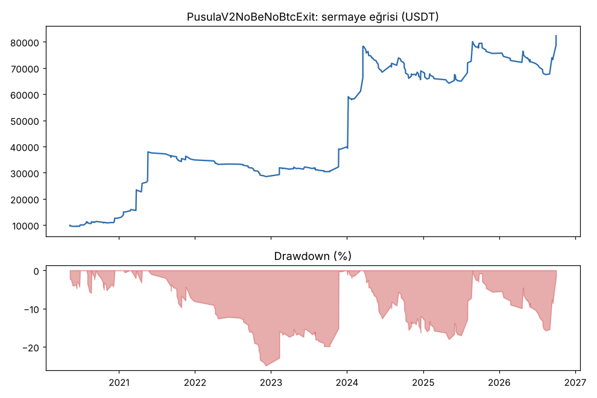
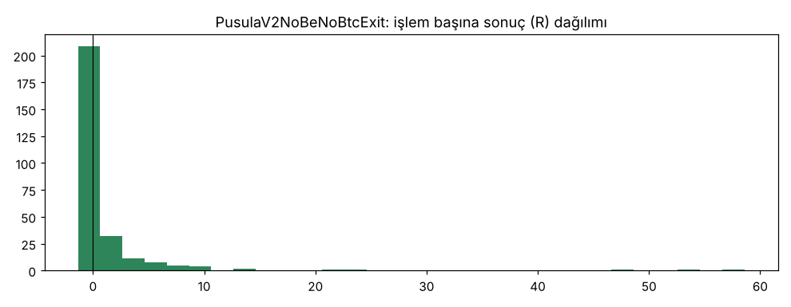

# PusulaV2NoBe vs PusulaV2NoBeNoBtcExit — cikarma5_wide16 — 2026-10-13

## Özet
- **PusulaV2NoBe**: 230 işlem, işlem başına ortalama **1.35R** (maliyet ve funding dahil), net getiri 827.3%, en büyük düşüş 23.7%.
- **PusulaV2NoBeNoBtcExit**: 276 işlem, işlem başına ortalama **1.01R** (maliyet ve funding dahil), net getiri 723.4%, en büyük düşüş 18.0%.
- Aynı dönemde coinleri al-tut (eşit ağırlık): getiri 931.5%, ortalama en büyük düşüş 89.2%.

## Ayarlar
- Dönem: 2020-03-07 16:00:00 → 2026-10-01 00:00:00
- Coinler: BTC/USDT:USDT, ETH/USDT:USDT, SOL/USDT:USDT, XRP/USDT:USDT, BNB/USDT:USDT, DOGE/USDT:USDT, ADA/USDT:USDT, LINK/USDT:USDT, LTC/USDT:USDT, DOT/USDT:USDT, AVAX/USDT:USDT, TRX/USDT:USDT, ATOM/USDT:USDT, BCH/USDT:USDT, ETC/USDT:USDT, XLM/USDT:USDT
- Zaman dilimi: 4h
- Yön: long + short
- Mod: futures / isolated
- Kaldıraç: en fazla 3x, likidasyon stop mesafesinin en az 2 katı uzakta (bölüm 7.6)
- Risk: işlem başına sermayenin %1'i (pozisyon büyüklüğü stop mesafesine göre)
- Maliyet: her emir için %0.05 komisyon + %0.05 kayma (= %0.1), funding geçmiş veriden
- Başlangıç sermayesi: 10000 USDT

## Metrikler
| Metrik | PusulaV2NoBe | PusulaV2NoBeNoBtcExit | Al-tut |
|---|---|---|---|
| Net getiri | 827.3% | 723.4% | 931.5% |
| Max drawdown | 23.7% | 18.0% | 89.2% |
| Profit factor | 2.06 | 1.95 | — |
| Ortalama R | 1.35 | 1.01 | — |
| İşlem sayısı | 230 | 276 | — |
| Winrate | 32.2% | 31.5% | — |

Winrate tek başına başarı ölçütü değildir; asıl ölçüt ortalama R (expectancy) ve drawdown'dur.

## Long / short ayrımı
| Strateji | Yön | İşlem | Ortalama R | Toplam R | Profit factor |
|---|---|---|---|---|---|
| PusulaV2NoBe | long | 230 | 1.35 | 311.26 | 2.06 |
| PusulaV2NoBe | short | 0 | — | 0.00 | — |
| PusulaV2NoBeNoBtcExit | long | 276 | 1.01 | 278.99 | 1.95 |
| PusulaV2NoBeNoBtcExit | short | 0 | — | 0.00 | — |

## Sinyal istatistikleri
| Strateji | Stop | BE | TP1 sonrası BE | TP2 | Diğer | İptal (bölgeye gelmedi / önce stop) | Toplam funding (USDT) |
|---|---|---|---|---|---|---|---|
| PusulaV2NoBe | 41.7% | 0.0% | 0.0% | 0.0% | 58.3% | 5.7% | -14077.15 |
| PusulaV2NoBeNoBtcExit | 41.7% | 0.0% | 0.0% | 0.0% | 58.3% | 5.2% | -11331.64 |

## Coin bazında
| Strateji | Coin | İşlem | Ortalama R | Toplam R | Al-tut getirisi |
|---|---|---|---|---|---|
| PusulaV2NoBe | BTC/USDT:USDT | 42 | 1.39 | 58.58 | 841.1% |
| PusulaV2NoBe | ETH/USDT:USDT | 32 | 0.58 | 18.52 | 1027.8% |
| PusulaV2NoBe | SOL/USDT:USDT | 12 | 4.96 | 59.49 | 3424.0% |
| PusulaV2NoBe | XRP/USDT:USDT | 11 | 1.00 | 10.98 | 531.4% |
| PusulaV2NoBe | BNB/USDT:USDT | 37 | 1.02 | 37.62 | 3739.0% |
| PusulaV2NoBe | DOGE/USDT:USDT | 2 | -1.05 | -2.10 | 2460.3% |
| PusulaV2NoBe | ADA/USDT:USDT | 7 | 1.04 | 7.29 | 409.9% |
| PusulaV2NoBe | LINK/USDT:USDT | 9 | 0.14 | 1.28 | 224.4% |
| PusulaV2NoBe | LTC/USDT:USDT | 13 | -0.19 | -2.53 | 11.3% |
| PusulaV2NoBe | DOT/USDT:USDT | 2 | -1.07 | -2.15 | -63.4% |
| PusulaV2NoBe | AVAX/USDT:USDT | 4 | 0.42 | 1.67 | 171.8% |
| PusulaV2NoBe | TRX/USDT:USDT | 33 | 0.86 | 28.32 | 1881.6% |
| PusulaV2NoBe | ATOM/USDT:USDT | 5 | -0.02 | -0.11 | -51.5% |
| PusulaV2NoBe | BCH/USDT:USDT | 11 | -0.00 | -0.04 | -7.2% |
| PusulaV2NoBe | ETC/USDT:USDT | 5 | 19.42 | 97.11 | 14.6% |
| PusulaV2NoBe | XLM/USDT:USDT | 5 | -0.53 | -2.66 | 289.8% |
| PusulaV2NoBeNoBtcExit | BTC/USDT:USDT | 40 | 1.51 | 60.22 | 841.1% |
| PusulaV2NoBeNoBtcExit | ETH/USDT:USDT | 38 | 0.44 | 16.55 | 1027.8% |
| PusulaV2NoBeNoBtcExit | SOL/USDT:USDT | 14 | 4.50 | 62.95 | 3424.0% |
| PusulaV2NoBeNoBtcExit | XRP/USDT:USDT | 15 | 0.41 | 6.19 | 531.4% |
| PusulaV2NoBeNoBtcExit | BNB/USDT:USDT | 46 | 0.86 | 39.76 | 3739.0% |
| PusulaV2NoBeNoBtcExit | DOGE/USDT:USDT | 3 | -0.94 | -2.82 | 2460.3% |
| PusulaV2NoBeNoBtcExit | ADA/USDT:USDT | 8 | 0.88 | 7.01 | 409.9% |
| PusulaV2NoBeNoBtcExit | LINK/USDT:USDT | 14 | 0.60 | 8.45 | 224.4% |
| PusulaV2NoBeNoBtcExit | LTC/USDT:USDT | 13 | 0.10 | 1.28 | 11.3% |
| PusulaV2NoBeNoBtcExit | DOT/USDT:USDT | 1 | -1.05 | -1.05 | -63.4% |
| PusulaV2NoBeNoBtcExit | AVAX/USDT:USDT | 4 | 1.24 | 4.96 | 171.8% |
| PusulaV2NoBeNoBtcExit | TRX/USDT:USDT | 46 | 0.77 | 35.39 | 1881.6% |
| PusulaV2NoBeNoBtcExit | ATOM/USDT:USDT | 7 | -0.15 | -1.06 | -51.5% |
| PusulaV2NoBeNoBtcExit | BCH/USDT:USDT | 15 | -0.24 | -3.53 | -7.2% |
| PusulaV2NoBeNoBtcExit | ETC/USDT:USDT | 3 | 17.04 | 51.13 | 14.6% |
| PusulaV2NoBeNoBtcExit | XLM/USDT:USDT | 9 | -0.71 | -6.42 | 289.8% |

## Grafikler

## Yorum: güçlü yanlar / şüpheli noktalar
_(Claude tarafından rakamlara bakılarak yazılır.)_

## Karar: devam / düzelt / emekli
_(Claude tarafından yazılır, gerekçesiyle.)_
