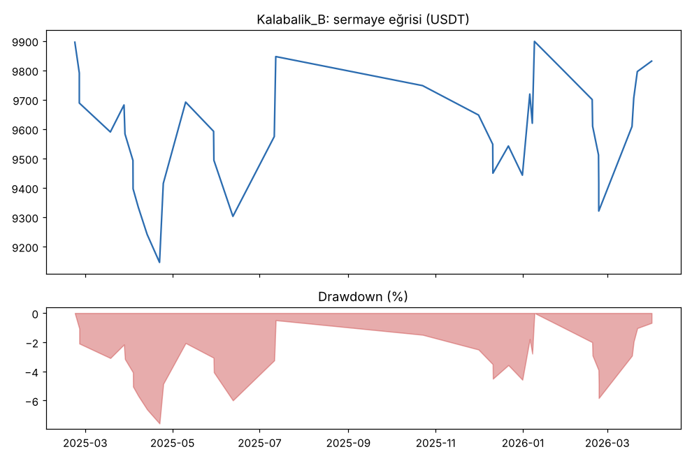
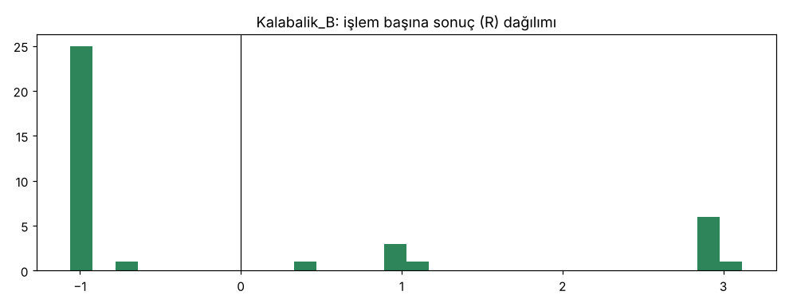

# Kalabalik_B — dogrulama_new20 — 2026-10-15

## Özet
- **Kalabalik_B**: 38 işlem, işlem başına ortalama **-0.03R** (maliyet ve funding dahil), net getiri -1.7%, en büyük düşüş 8.5%.
- Aynı dönemde coinleri al-tut (eşit ağırlık): getiri -54.0%, ortalama en büyük düşüş 83.8%.

## Ayarlar
- Dönem: 2025-01-01 00:00:00 → 2026-04-01 00:00:00
- Coinler: FIL/USDT:USDT, UNI/USDT:USDT, AAVE/USDT:USDT, NEAR/USDT:USDT, ALGO/USDT:USDT, XTZ/USDT:USDT, THETA/USDT:USDT, VET/USDT:USDT, ICP/USDT:USDT, SAND/USDT:USDT, MANA/USDT:USDT, AXS/USDT:USDT, EGLD/USDT:USDT, HBAR/USDT:USDT, CHZ/USDT:USDT, ENJ/USDT:USDT, ZEC/USDT:USDT, DASH/USDT:USDT, NEO/USDT:USDT, IOTA/USDT:USDT
- Zaman dilimi: 4h
- Yön: long + short
- Mod: futures / isolated
- Kaldıraç: en fazla 3x, likidasyon stop mesafesinin en az 2 katı uzakta (bölüm 7.6)
- Risk: işlem başına sermayenin %1'i (pozisyon büyüklüğü stop mesafesine göre)
- Maliyet: her emir için %0.05 komisyon + %0.05 kayma (= %0.1), funding geçmiş veriden
- Başlangıç sermayesi: 10000 USDT

## Metrikler
| Metrik | Kalabalik_B | Al-tut |
|---|---|---|
| Net getiri | -1.7% | -54.0% |
| Max drawdown | 8.5% | 83.8% |
| Profit factor | 0.93 | — |
| Ortalama R | -0.03 | — |
| İşlem sayısı | 38 | — |
| Winrate | 31.6% | — |

Winrate tek başına başarı ölçütü değildir; asıl ölçüt ortalama R (expectancy) ve drawdown'dur.

## Long / short ayrımı
| Strateji | Yön | İşlem | Ortalama R | Toplam R | Profit factor |
|---|---|---|---|---|---|
| Kalabalik_B | long | 38 | -0.03 | -1.04 | 0.93 |
| Kalabalik_B | short | 0 | — | 0.00 | — |

## Sinyal istatistikleri
| Strateji | Stop | BE | TP1 sonrası BE | TP2 | Diğer | İptal (bölgeye gelmedi / önce stop) | Toplam funding (USDT) |
|---|---|---|---|---|---|---|---|
| Kalabalik_B | 68.4% | 0.0% | 10.5% | 18.4% | 2.6% | 9.5% | 66.10 |

## Coin bazında
| Strateji | Coin | İşlem | Ortalama R | Toplam R | Al-tut getirisi |
|---|---|---|---|---|---|
| Kalabalik_B | FIL/USDT:USDT | 1 | -1.02 | -1.02 | -83.2% |
| Kalabalik_B | UNI/USDT:USDT | 1 | -1.03 | -1.03 | -73.1% |
| Kalabalik_B | AAVE/USDT:USDT | 1 | 0.96 | 0.96 | -68.7% |
| Kalabalik_B | NEAR/USDT:USDT | 2 | -1.03 | -2.06 | -75.8% |
| Kalabalik_B | ALGO/USDT:USDT | 4 | 1.46 | 5.86 | -70.5% |
| Kalabalik_B | XTZ/USDT:USDT | 4 | 0.98 | 3.90 | -72.8% |
| Kalabalik_B | THETA/USDT:USDT | 3 | 0.32 | 0.96 | -93.3% |
| Kalabalik_B | VET/USDT:USDT | 1 | -1.04 | -1.04 | -84.4% |
| Kalabalik_B | ICP/USDT:USDT | 1 | -0.94 | -0.94 | -77.1% |
| Kalabalik_B | SAND/USDT:USDT | 3 | -0.33 | -0.99 | -86.0% |
| Kalabalik_B | MANA/USDT:USDT | 2 | -1.03 | -2.06 | -81.6% |
| Kalabalik_B | AXS/USDT:USDT | 0 | — | 0.00 | -81.4% |
| Kalabalik_B | EGLD/USDT:USDT | 2 | -1.04 | -2.07 | -88.7% |
| Kalabalik_B | HBAR/USDT:USDT | 0 | — | 0.00 | -67.0% |
| Kalabalik_B | CHZ/USDT:USDT | 0 | — | 0.00 | -49.8% |
| Kalabalik_B | ENJ/USDT:USDT | 1 | 3.12 | 3.12 | -90.4% |
| Kalabalik_B | ZEC/USDT:USDT | 3 | -0.90 | -2.70 | 338.4% |
| Kalabalik_B | DASH/USDT:USDT | 1 | -1.06 | -1.06 | -13.7% |
| Kalabalik_B | NEO/USDT:USDT | 1 | 0.37 | 0.37 | -80.2% |
| Kalabalik_B | IOTA/USDT:USDT | 7 | -0.18 | -1.23 | -80.8% |

## Grafikler

## Yorum: güçlü yanlar / şüpheli noktalar
_(Claude tarafından rakamlara bakılarak yazılır.)_

## Karar: devam / düzelt / emekli
_(Claude tarafından yazılır, gerekçesiyle.)_
