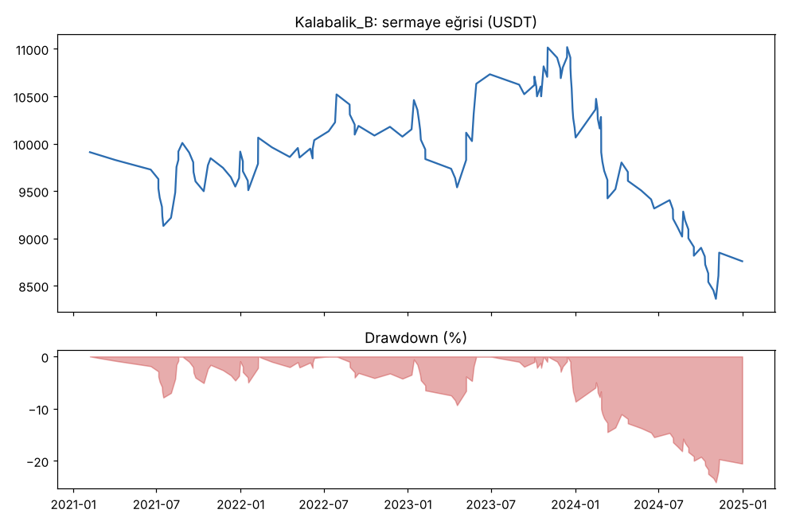
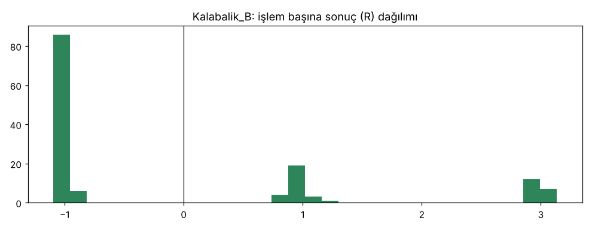

# Kalabalik_B — gelistirme_new20 — 2026-10-15

## Özet
- **Kalabalik_B**: 138 işlem, işlem başına ortalama **-0.08R** (maliyet ve funding dahil), net getiri -12.4%, en büyük düşüş 24.1%.
- Aynı dönemde coinleri al-tut (eşit ağırlık): getiri 231.1%, ortalama en büyük düşüş 95.7%.

## Ayarlar
- Dönem: 2020-04-11 00:00:00 → 2025-01-01 00:00:00
- Coinler: FIL/USDT:USDT, UNI/USDT:USDT, AAVE/USDT:USDT, NEAR/USDT:USDT, ALGO/USDT:USDT, XTZ/USDT:USDT, THETA/USDT:USDT, VET/USDT:USDT, ICP/USDT:USDT, SAND/USDT:USDT, MANA/USDT:USDT, AXS/USDT:USDT, EGLD/USDT:USDT, HBAR/USDT:USDT, CHZ/USDT:USDT, ENJ/USDT:USDT, ZEC/USDT:USDT, DASH/USDT:USDT, NEO/USDT:USDT, IOTA/USDT:USDT
- Zaman dilimi: 4h
- Yön: long + short
- Mod: futures / isolated
- Kaldıraç: en fazla 3x, likidasyon stop mesafesinin en az 2 katı uzakta (bölüm 7.6)
- Risk: işlem başına sermayenin %1'i (pozisyon büyüklüğü stop mesafesine göre)
- Maliyet: her emir için %0.05 komisyon + %0.05 kayma (= %0.1), funding geçmiş veriden
- Başlangıç sermayesi: 10000 USDT

## Metrikler
| Metrik | Kalabalik_B | Al-tut |
|---|---|---|
| Net getiri | -12.4% | 231.1% |
| Max drawdown | 24.1% | 95.7% |
| Profit factor | 0.86 | — |
| Ortalama R | -0.08 | — |
| İşlem sayısı | 138 | — |
| Winrate | 33.3% | — |

Winrate tek başına başarı ölçütü değildir; asıl ölçüt ortalama R (expectancy) ve drawdown'dur.

## Long / short ayrımı
| Strateji | Yön | İşlem | Ortalama R | Toplam R | Profit factor |
|---|---|---|---|---|---|
| Kalabalik_B | long | 91 | 0.04 | 3.43 | 1.06 |
| Kalabalik_B | short | 47 | -0.32 | -14.85 | 0.56 |

## Sinyal istatistikleri
| Strateji | Stop | BE | TP1 sonrası BE | TP2 | Diğer | İptal (bölgeye gelmedi / önce stop) | Toplam funding (USDT) |
|---|---|---|---|---|---|---|---|
| Kalabalik_B | 66.7% | 0.0% | 19.6% | 13.8% | 0.0% | 10.4% | 93.98 |

## Coin bazında
| Strateji | Coin | İşlem | Ortalama R | Toplam R | Al-tut getirisi |
|---|---|---|---|---|---|
| Kalabalik_B | FIL/USDT:USDT | 1 | -1.00 | -1.00 | -89.8% |
| Kalabalik_B | UNI/USDT:USDT | 7 | -0.13 | -0.91 | 142.2% |
| Kalabalik_B | AAVE/USDT:USDT | 4 | -1.03 | -4.10 | 657.1% |
| Kalabalik_B | NEAR/USDT:USDT | 5 | -0.60 | -3.01 | 337.5% |
| Kalabalik_B | ALGO/USDT:USDT | 19 | 0.22 | 4.09 | 41.1% |
| Kalabalik_B | XTZ/USDT:USDT | 7 | 0.40 | 2.80 | -35.8% |
| Kalabalik_B | THETA/USDT:USDT | 5 | 0.18 | 0.88 | 415.1% |
| Kalabalik_B | VET/USDT:USDT | 9 | 0.34 | 3.05 | 1072.1% |
| Kalabalik_B | ICP/USDT:USDT | 3 | -1.04 | -3.13 | -97.9% |
| Kalabalik_B | SAND/USDT:USDT | 2 | -1.02 | -2.03 | 472.0% |
| Kalabalik_B | MANA/USDT:USDT | 3 | 1.69 | 5.08 | -55.1% |
| Kalabalik_B | AXS/USDT:USDT | 8 | -0.55 | -4.40 | 1173.3% |
| Kalabalik_B | EGLD/USDT:USDT | 6 | 0.63 | 3.78 | 156.3% |
| Kalabalik_B | HBAR/USDT:USDT | 5 | -0.21 | -1.04 | -19.4% |
| Kalabalik_B | CHZ/USDT:USDT | 4 | 0.49 | 1.94 | 273.9% |
| Kalabalik_B | ENJ/USDT:USDT | 5 | -0.60 | -2.98 | 17.4% |
| Kalabalik_B | ZEC/USDT:USDT | 15 | -0.24 | -3.66 | 52.2% |
| Kalabalik_B | DASH/USDT:USDT | 18 | -0.16 | -2.92 | -49.2% |
| Kalabalik_B | NEO/USDT:USDT | 5 | -0.61 | -3.04 | 82.4% |
| Kalabalik_B | IOTA/USDT:USDT | 7 | -0.12 | -0.83 | 76.4% |

## Grafikler

## Yorum: güçlü yanlar / şüpheli noktalar
_(Claude tarafından rakamlara bakılarak yazılır.)_

## Karar: devam / düzelt / emekli
_(Claude tarafından yazılır, gerekçesiyle.)_
