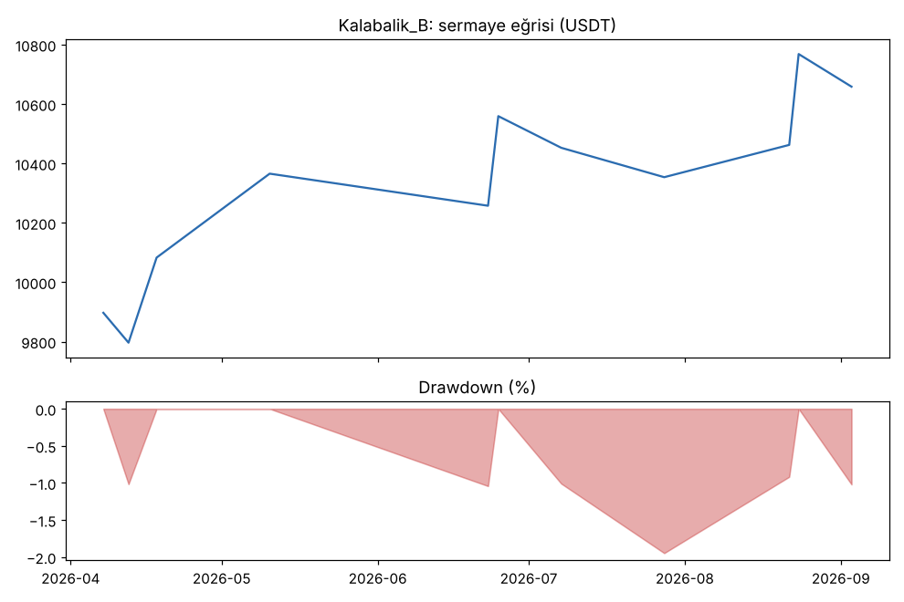
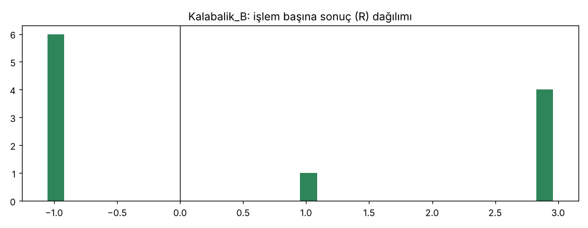

# Kalabalik_B — kasa_new20 — 2026-10-15

## Özet
- **Kalabalik_B**: 11 işlem, işlem başına ortalama **0.61R** (maliyet ve funding dahil), net getiri 6.6%, en büyük düşüş 1.9%.
- Aynı dönemde coinleri al-tut (eşit ağırlık): getiri 63.8%, ortalama en büyük düşüş 51.2%.

## Ayarlar
- Dönem: 2026-04-01 00:00:00 → 2026-09-30 20:00:00
- Coinler: FIL/USDT:USDT, UNI/USDT:USDT, AAVE/USDT:USDT, NEAR/USDT:USDT, ALGO/USDT:USDT, XTZ/USDT:USDT, THETA/USDT:USDT, VET/USDT:USDT, ICP/USDT:USDT, SAND/USDT:USDT, MANA/USDT:USDT, AXS/USDT:USDT, EGLD/USDT:USDT, HBAR/USDT:USDT, CHZ/USDT:USDT, ENJ/USDT:USDT, ZEC/USDT:USDT, DASH/USDT:USDT, NEO/USDT:USDT, IOTA/USDT:USDT
- Zaman dilimi: 4h
- Yön: long + short
- Mod: futures / isolated
- Kaldıraç: en fazla 3x, likidasyon stop mesafesinin en az 2 katı uzakta (bölüm 7.6)
- Risk: işlem başına sermayenin %1'i (pozisyon büyüklüğü stop mesafesine göre)
- Maliyet: her emir için %0.05 komisyon + %0.05 kayma (= %0.1), funding geçmiş veriden
- Başlangıç sermayesi: 10000 USDT

## Metrikler
| Metrik | Kalabalik_B | Al-tut |
|---|---|---|
| Net getiri | 6.6% | 63.8% |
| Max drawdown | 1.9% | 51.2% |
| Profit factor | 2.05 | — |
| Ortalama R | 0.61 | — |
| İşlem sayısı | 11 | — |
| Winrate | 45.5% | — |

Winrate tek başına başarı ölçütü değildir; asıl ölçüt ortalama R (expectancy) ve drawdown'dur.

## Long / short ayrımı
| Strateji | Yön | İşlem | Ortalama R | Toplam R | Profit factor |
|---|---|---|---|---|---|
| Kalabalik_B | long | 8 | 0.96 | 7.70 | 2.87 |
| Kalabalik_B | short | 3 | -0.33 | -1.00 | 0.50 |

## Sinyal istatistikleri
| Strateji | Stop | BE | TP1 sonrası BE | TP2 | Diğer | İptal (bölgeye gelmedi / önce stop) | Toplam funding (USDT) |
|---|---|---|---|---|---|---|---|
| Kalabalik_B | 54.5% | 0.0% | 9.1% | 36.4% | 0.0% | 0.0% | 6.37 |

## Coin bazında
| Strateji | Coin | İşlem | Ortalama R | Toplam R | Al-tut getirisi |
|---|---|---|---|---|---|
| Kalabalik_B | FIL/USDT:USDT | 0 | — | 0.00 | 25.3% |
| Kalabalik_B | UNI/USDT:USDT | 2 | 0.94 | 1.88 | 149.0% |
| Kalabalik_B | AAVE/USDT:USDT | 1 | 2.95 | 2.95 | 62.8% |
| Kalabalik_B | NEAR/USDT:USDT | 0 | — | 0.00 | 347.9% |
| Kalabalik_B | ALGO/USDT:USDT | 0 | — | 0.00 | 25.0% |
| Kalabalik_B | XTZ/USDT:USDT | 0 | — | 0.00 | -9.9% |
| Kalabalik_B | THETA/USDT:USDT | 1 | 2.95 | 2.95 | 50.0% |
| Kalabalik_B | VET/USDT:USDT | 0 | — | 0.00 | 30.7% |
| Kalabalik_B | ICP/USDT:USDT | 0 | — | 0.00 | 46.8% |
| Kalabalik_B | SAND/USDT:USDT | 0 | — | 0.00 | -42.7% |
| Kalabalik_B | MANA/USDT:USDT | 0 | — | 0.00 | 4.7% |
| Kalabalik_B | AXS/USDT:USDT | 0 | — | 0.00 | 0.0% |
| Kalabalik_B | EGLD/USDT:USDT | 1 | 2.96 | 2.96 | 18.7% |
| Kalabalik_B | HBAR/USDT:USDT | 2 | -1.03 | -2.06 | 17.9% |
| Kalabalik_B | CHZ/USDT:USDT | 0 | — | 0.00 | -60.6% |
| Kalabalik_B | ENJ/USDT:USDT | 2 | 0.01 | 0.03 | 46.4% |
| Kalabalik_B | ZEC/USDT:USDT | 0 | — | 0.00 | 486.8% |
| Kalabalik_B | DASH/USDT:USDT | 0 | — | 0.00 | 84.5% |
| Kalabalik_B | NEO/USDT:USDT | 1 | -0.96 | -0.96 | -5.5% |
| Kalabalik_B | IOTA/USDT:USDT | 1 | -1.05 | -1.05 | -2.4% |

## Grafikler

## Yorum: güçlü yanlar / şüpheli noktalar
_(Claude tarafından rakamlara bakılarak yazılır.)_

## Karar: devam / düzelt / emekli
_(Claude tarafından yazılır, gerekçesiyle.)_
