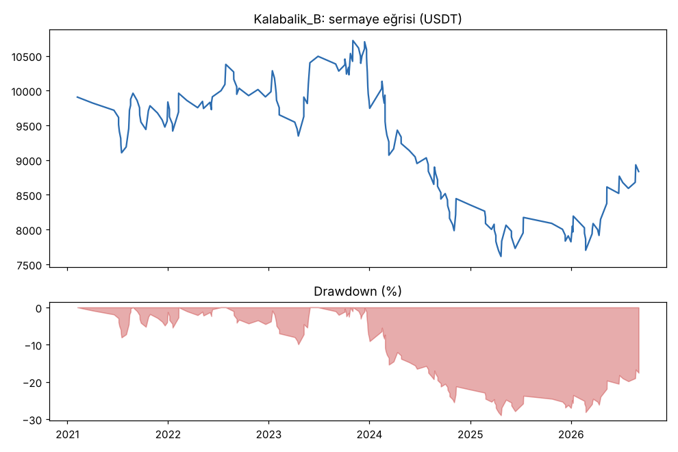
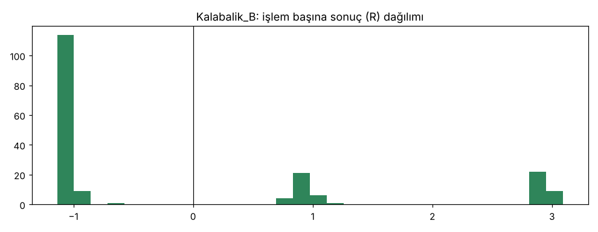

# Kalabalik_B — tam_donem_masraf_x2_new20 — 2026-10-15

## Özet
- **Kalabalik_B**: 187 işlem, işlem başına ortalama **-0.05R** (maliyet ve funding dahil), net getiri -11.6%, en büyük düşüş 29.0%.
- Aynı dönemde coinleri al-tut (eşit ağırlık): getiri 194.7%, ortalama en büyük düşüş 97.6%.

## Ayarlar
- Dönem: 2020-04-11 00:00:00 → 2026-09-30 20:00:00
- Coinler: FIL/USDT:USDT, UNI/USDT:USDT, AAVE/USDT:USDT, NEAR/USDT:USDT, ALGO/USDT:USDT, XTZ/USDT:USDT, THETA/USDT:USDT, VET/USDT:USDT, ICP/USDT:USDT, SAND/USDT:USDT, MANA/USDT:USDT, AXS/USDT:USDT, EGLD/USDT:USDT, HBAR/USDT:USDT, CHZ/USDT:USDT, ENJ/USDT:USDT, ZEC/USDT:USDT, DASH/USDT:USDT, NEO/USDT:USDT, IOTA/USDT:USDT
- Zaman dilimi: 4h
- Yön: long + short
- Mod: futures / isolated
- Kaldıraç: en fazla 3x, likidasyon stop mesafesinin en az 2 katı uzakta (bölüm 7.6)
- Risk: işlem başına sermayenin %1'i (pozisyon büyüklüğü stop mesafesine göre)
- Maliyet: her emir için %0.05 komisyon + %0.05 kayma (= %0.1), funding geçmiş veriden
- Başlangıç sermayesi: 10000 USDT

## Metrikler
| Metrik | Kalabalik_B | Al-tut |
|---|---|---|
| Net getiri | -11.6% | 194.7% |
| Max drawdown | 29.0% | 97.6% |
| Profit factor | 0.90 | — |
| Ortalama R | -0.05 | — |
| İşlem sayısı | 187 | — |
| Winrate | 33.7% | — |

Winrate tek başına başarı ölçütü değildir; asıl ölçüt ortalama R (expectancy) ve drawdown'dur.

## Long / short ayrımı
| Strateji | Yön | İşlem | Ortalama R | Toplam R | Profit factor |
|---|---|---|---|---|---|
| Kalabalik_B | long | 137 | 0.06 | 8.11 | 1.08 |
| Kalabalik_B | short | 50 | -0.35 | -17.66 | 0.53 |

## Sinyal istatistikleri
| Strateji | Stop | BE | TP1 sonrası BE | TP2 | Diğer | İptal (bölgeye gelmedi / önce stop) | Toplam funding (USDT) |
|---|---|---|---|---|---|---|---|
| Kalabalik_B | 66.3% | 0.0% | 17.1% | 16.6% | 0.0% | 9.7% | 153.55 |

## Coin bazında
| Strateji | Coin | İşlem | Ortalama R | Toplam R | Al-tut getirisi |
|---|---|---|---|---|---|
| Kalabalik_B | FIL/USDT:USDT | 2 | -1.04 | -2.09 | -97.9% |
| Kalabalik_B | UNI/USDT:USDT | 10 | -0.04 | -0.39 | 62.4% |
| Kalabalik_B | AAVE/USDT:USDT | 6 | -0.06 | -0.37 | 286.5% |
| Kalabalik_B | NEAR/USDT:USDT | 7 | -0.75 | -5.28 | 373.4% |
| Kalabalik_B | ALGO/USDT:USDT | 23 | 0.40 | 9.19 | -47.9% |
| Kalabalik_B | XTZ/USDT:USDT | 11 | 0.57 | 6.26 | -84.3% |
| Kalabalik_B | THETA/USDT:USDT | 9 | 0.50 | 4.51 | -48.0% |
| Kalabalik_B | VET/USDT:USDT | 10 | 0.17 | 1.66 | 139.2% |
| Kalabalik_B | ICP/USDT:USDT | 4 | -1.05 | -4.21 | -99.3% |
| Kalabalik_B | SAND/USDT:USDT | 5 | -0.63 | -3.17 | -54.0% |
| Kalabalik_B | MANA/USDT:USDT | 5 | 0.57 | 2.83 | -91.4% |
| Kalabalik_B | AXS/USDT:USDT | 8 | -0.58 | -4.65 | 136.4% |
| Kalabalik_B | EGLD/USDT:USDT | 9 | 0.48 | 4.32 | -65.7% |
| Kalabalik_B | HBAR/USDT:USDT | 7 | -0.48 | -3.35 | -68.6% |
| Kalabalik_B | CHZ/USDT:USDT | 4 | 0.45 | 1.82 | -26.0% |
| Kalabalik_B | ENJ/USDT:USDT | 8 | -0.02 | -0.15 | -83.5% |
| Kalabalik_B | ZEC/USDT:USDT | 18 | -0.38 | -6.93 | 3815.4% |
| Kalabalik_B | DASH/USDT:USDT | 19 | -0.24 | -4.55 | -19.1% |
| Kalabalik_B | NEO/USDT:USDT | 7 | -0.18 | -1.25 | -65.8% |
| Kalabalik_B | IOTA/USDT:USDT | 15 | -0.25 | -3.75 | -66.9% |

## Grafikler

## Yorum: güçlü yanlar / şüpheli noktalar
_(Claude tarafından rakamlara bakılarak yazılır.)_

## Karar: devam / düzelt / emekli
_(Claude tarafından yazılır, gerekçesiyle.)_
