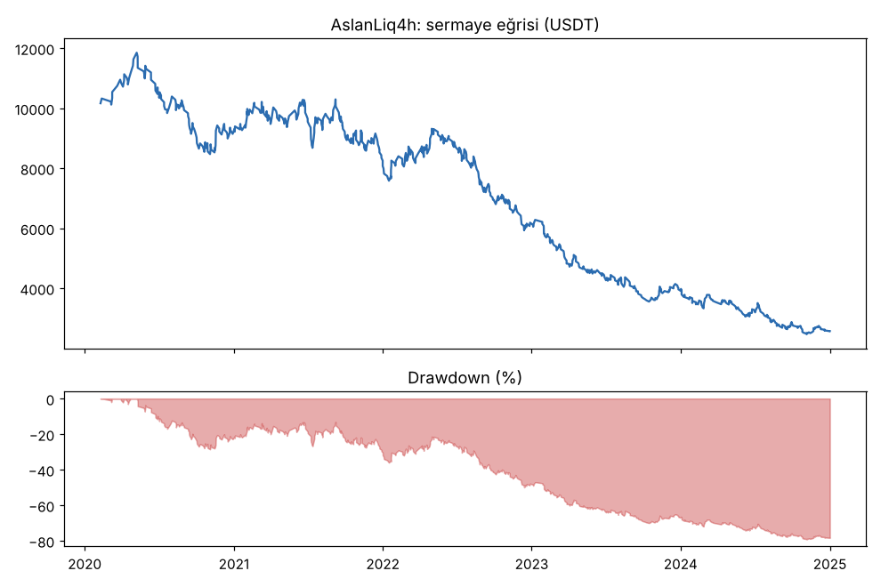
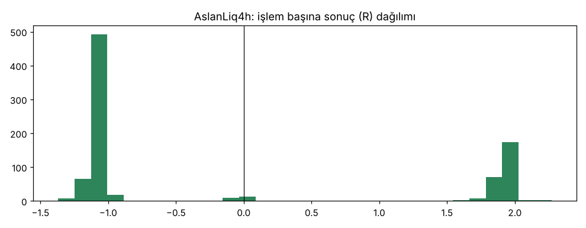
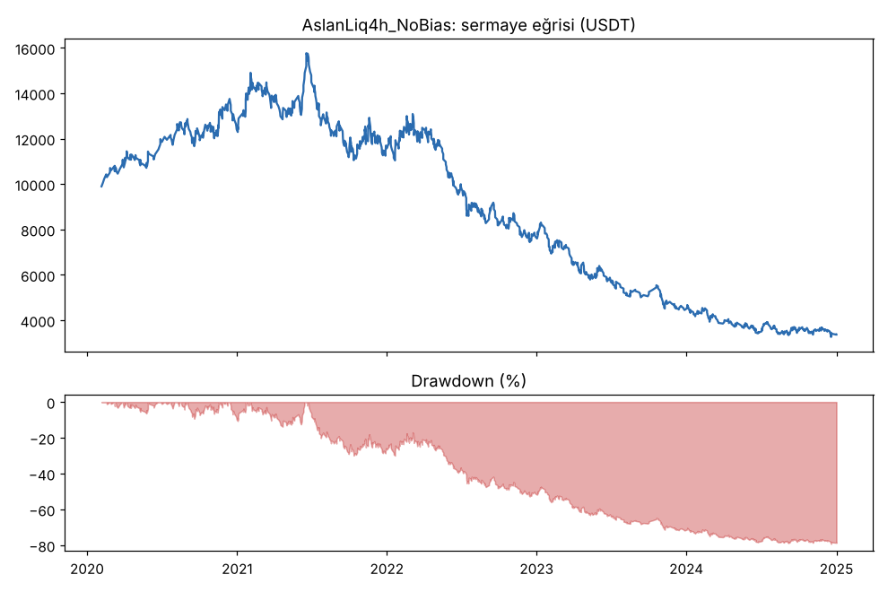
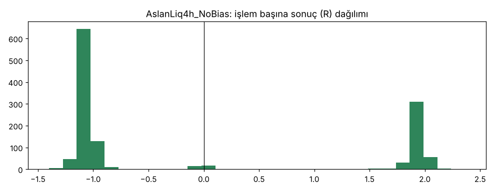

# AslanLiq4h vs AslanLiq4h_NoBias — aslan_4h_gelistirme — 2026-10-16

## Özet
- **AslanLiq4h**: 868 işlem, işlem başına ortalama **-0.15R** (maliyet ve funding dahil), net getiri -74.3%, en büyük düşüş 79.2%.
- **AslanLiq4h_NoBias**: 1279 işlem, işlem başına ortalama **-0.08R** (maliyet ve funding dahil), net getiri -66.3%, en büyük düşüş 79.3%.
- Aynı dönemde coinleri al-tut (eşit ağırlık): getiri 2048.6%, ortalama en büyük düşüş 86.3%.

## Ayarlar
- Dönem: 2020-02-03 08:00:00 → 2025-01-01 00:00:00
- Coinler: BTC/USDT:USDT, ETH/USDT:USDT, ADA/USDT:USDT, SOL/USDT:USDT, XRP/USDT:USDT
- Zaman dilimi: 4h
- Yön: long + short
- Mod: futures / isolated
- Kaldıraç: en fazla 20x, likidasyon stop mesafesinin en az 2 katı uzakta (bölüm 7.6)
- Risk: işlem başına sermayenin %1'i (pozisyon büyüklüğü stop mesafesine göre)
- Maliyet: her emir için %0.05 komisyon + %0.05 kayma (= %0.1), funding geçmiş veriden
- Başlangıç sermayesi: 10000 USDT

## Metrikler
| Metrik | AslanLiq4h | AslanLiq4h_NoBias | Al-tut |
|---|---|---|---|
| Net getiri | -74.3% | -66.3% | 2048.6% |
| Max drawdown | 79.2% | 79.3% | 86.3% |
| Profit factor | 0.82 | 0.91 | — |
| Ortalama R | -0.15 | -0.08 | — |
| İşlem sayısı | 868 | 1279 | — |
| Winrate | 30.3% | 32.4% | — |

Winrate tek başına başarı ölçütü değildir; asıl ölçüt ortalama R (expectancy) ve drawdown'dur.

## Long / short ayrımı
| Strateji | Yön | İşlem | Ortalama R | Toplam R | Profit factor |
|---|---|---|---|---|---|
| AslanLiq4h | long | 458 | -0.11 | -50.18 | 0.87 |
| AslanLiq4h | short | 410 | -0.19 | -77.19 | 0.76 |
| AslanLiq4h_NoBias | long | 637 | -0.06 | -39.63 | 0.92 |
| AslanLiq4h_NoBias | short | 642 | -0.09 | -59.75 | 0.91 |

## Sinyal istatistikleri
| Strateji | Stop | BE | TP1 sonrası BE | TP2 | Diğer | İptal (bölgeye gelmedi / önce stop) | Toplam funding (USDT) |
|---|---|---|---|---|---|---|---|
| AslanLiq4h | 67.3% | 2.5% | 0.0% | 30.0% | 0.2% | 0.5% | -670.86 |
| AslanLiq4h_NoBias | 65.6% | 2.4% | 0.0% | 31.7% | 0.2% | 0.5% | -65.18 |

## Coin bazında
| Strateji | Coin | İşlem | Ortalama R | Toplam R | Al-tut getirisi |
|---|---|---|---|---|---|
| AslanLiq4h | BTC/USDT:USDT | 190 | -0.14 | -27.17 | 902.6% |
| AslanLiq4h | ETH/USDT:USDT | 192 | -0.10 | -18.88 | 1665.9% |
| AslanLiq4h | ADA/USDT:USDT | 173 | -0.21 | -36.75 | 1408.3% |
| AslanLiq4h | SOL/USDT:USDT | 155 | -0.09 | -14.25 | 5530.6% |
| AslanLiq4h | XRP/USDT:USDT | 158 | -0.19 | -30.32 | 735.4% |
| AslanLiq4h_NoBias | BTC/USDT:USDT | 253 | -0.09 | -21.86 | 902.6% |
| AslanLiq4h_NoBias | ETH/USDT:USDT | 265 | -0.06 | -14.65 | 1665.9% |
| AslanLiq4h_NoBias | ADA/USDT:USDT | 267 | -0.16 | -42.13 | 1408.3% |
| AslanLiq4h_NoBias | SOL/USDT:USDT | 254 | -0.13 | -32.81 | 5530.6% |
| AslanLiq4h_NoBias | XRP/USDT:USDT | 240 | 0.05 | 12.08 | 735.4% |

## Grafikler

## Yorum: güçlü yanlar / şüpheli noktalar
- Neden test edildi: Gemini önerisi (2026-10-16): "Aslan'ın fikrini 4 saatliğe taşı, hedef %3-5 olunca komisyon kârı eritmez."
- Komisyon gerçekten küçüldü, ama sonuç düzelmedi. Kazanma oranı %30-32; 2R hedefte başa baş için %33.3 lazım. Yani **maliyetsiz bile eksi** (yaklaşık -0.05 ile -0.09R).
- 1h (-0.14/-0.16R), 15m (-0.16/-0.20R) ve 4h (-0.08/-0.15R) aynı tabloyu veriyor: likidite alımı + MSS/iFVG girişinin bu coinlerde avantajı yok. Sorun komisyon değil.
- Yön filtresini kapatmak yine biraz daha iyi; 1h'deki bulguyla aynı (günlük yön tanımı işe yaramıyor).
- 5 coinin 4'ünde eksi; tek artı (XRP, yön filtresiz) tek başına anlamlı değil.

## Karar: devam / düzelt / emekli
**Geçemedi.** Ortalama R < 0, PF < 1, düşüş %79. Doğrulama ve kasa dönemine bakılmadı. Aslan ailesi 28 versiyon + 2 (4h) = 30 versiyon, hepsi eksi.
