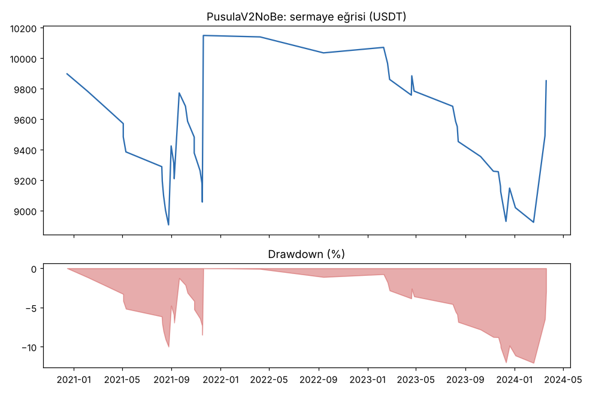
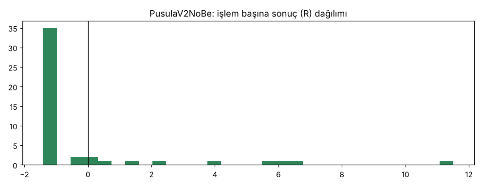
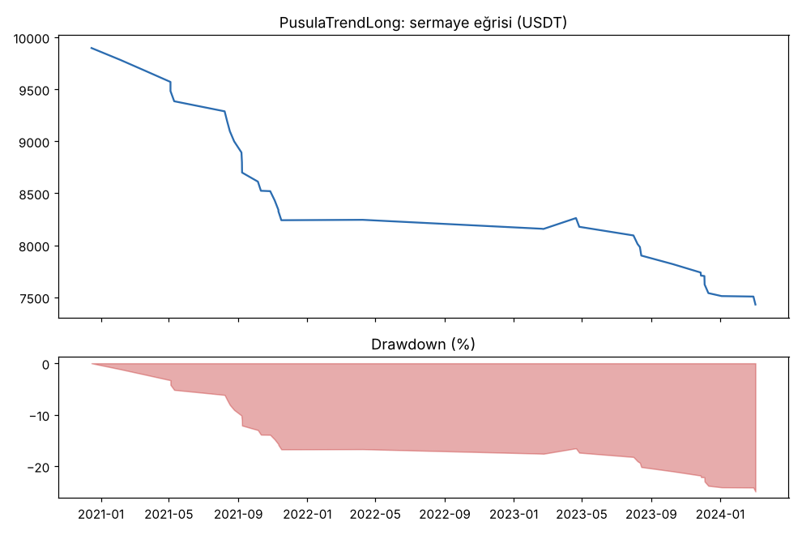
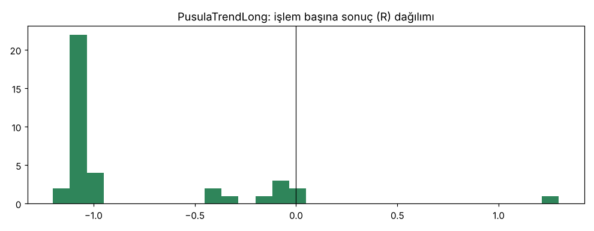

# PusulaV2NoBe vs PusulaTrendLong — batik_delisted — 2026-10-16

## Özet
- **PusulaV2NoBe**: 47 işlem, işlem başına ortalama **-0.02R** (maliyet ve funding dahil), net getiri -1.5%, en büyük düşüş 12.1%.
- **PusulaTrendLong**: 38 işlem, işlem başına ortalama **-0.79R** (maliyet ve funding dahil), net getiri -25.7%, en büyük düşüş 25.7%.
- Aynı dönemde coinleri al-tut (eşit ağırlık): getiri -23.5%, ortalama en büyük düşüş 90.5%.

## Ayarlar
- Dönem: 2020-10-17 20:00:00 → 2024-06-11 08:00:00
- Coinler: LUNA/USDT:USDT, FTT/USDT:USDT, SRM/USDT:USDT, HNT/USDT:USDT, BTS/USDT:USDT, TOMO/USDT:USDT, BTT/USDT:USDT, BZRX/USDT:USDT, KEEP/USDT:USDT, YFII/USDT:USDT, WAVES/USDT:USDT, AUDIO/USDT:USDT
- Zaman dilimi: 4h
- Yön: long + short
- Mod: futures / isolated
- Kaldıraç: en fazla 3x, likidasyon stop mesafesinin en az 2 katı uzakta (bölüm 7.6)
- Risk: işlem başına sermayenin %1'i (pozisyon büyüklüğü stop mesafesine göre)
- Maliyet: her emir için %0.05 komisyon + %0.05 kayma (= %0.1), funding geçmiş veriden
- Başlangıç sermayesi: 10000 USDT

## Metrikler
| Metrik | PusulaV2NoBe | PusulaTrendLong | Al-tut |
|---|---|---|---|
| Net getiri | -1.5% | -25.7% | -23.5% |
| Max drawdown | 12.1% | 25.7% | 90.5% |
| Profit factor | 0.96 | 0.04 | — |
| Ortalama R | -0.02 | -0.79 | — |
| İşlem sayısı | 47 | 38 | — |
| Winrate | 17.0% | 5.3% | — |

Winrate tek başına başarı ölçütü değildir; asıl ölçüt ortalama R (expectancy) ve drawdown'dur.

## Long / short ayrımı
| Strateji | Yön | İşlem | Ortalama R | Toplam R | Profit factor |
|---|---|---|---|---|---|
| PusulaV2NoBe | long | 47 | -0.02 | -1.05 | 0.96 |
| PusulaV2NoBe | short | 0 | — | 0.00 | — |
| PusulaTrendLong | long | 38 | -0.79 | -29.96 | 0.04 |
| PusulaTrendLong | short | 0 | — | 0.00 | — |

## Sinyal istatistikleri
| Strateji | Stop | BE | TP1 sonrası BE | TP2 | Diğer | İptal (bölgeye gelmedi / önce stop) | Toplam funding (USDT) |
|---|---|---|---|---|---|---|---|
| PusulaV2NoBe | 74.5% | 0.0% | 0.0% | 0.0% | 25.5% | 6.0% | -497.06 |
| PusulaTrendLong | 73.7% | 18.4% | 0.0% | 0.0% | 7.9% | 5.0% | -137.72 |

## Coin bazında
| Strateji | Coin | İşlem | Ortalama R | Toplam R | Al-tut getirisi |
|---|---|---|---|---|---|
| PusulaV2NoBe | LUNA/USDT:USDT | 4 | -0.87 | -3.47 | -99.4% |
| PusulaV2NoBe | FTT/USDT:USDT | 1 | -1.04 | -1.04 | -96.2% |
| PusulaV2NoBe | SRM/USDT:USDT | 0 | — | 0.00 | -77.6% |
| PusulaV2NoBe | HNT/USDT:USDT | 3 | 5.34 | 16.03 | 21.7% |
| PusulaV2NoBe | BTS/USDT:USDT | 4 | -1.15 | -4.62 | -70.3% |
| PusulaV2NoBe | TOMO/USDT:USDT | 10 | -0.91 | -9.08 | 85.4% |
| PusulaV2NoBe | BTT/USDT:USDT | 1 | -1.10 | -1.10 | -74.8% |
| PusulaV2NoBe | BZRX/USDT:USDT | 0 | — | 0.00 | 83.8% |
| PusulaV2NoBe | KEEP/USDT:USDT | 0 | — | 0.00 | 100.1% |
| PusulaV2NoBe | YFII/USDT:USDT | 3 | -1.06 | -3.17 | -1.9% |
| PusulaV2NoBe | WAVES/USDT:USDT | 14 | -0.06 | -0.84 | -58.0% |
| PusulaV2NoBe | AUDIO/USDT:USDT | 7 | 0.89 | 6.23 | -94.8% |
| PusulaTrendLong | LUNA/USDT:USDT | 4 | -0.56 | -2.26 | -99.4% |
| PusulaTrendLong | FTT/USDT:USDT | 0 | — | 0.00 | -96.2% |
| PusulaTrendLong | SRM/USDT:USDT | 0 | — | 0.00 | -77.6% |
| PusulaTrendLong | HNT/USDT:USDT | 3 | -0.38 | -1.14 | 21.7% |
| PusulaTrendLong | BTS/USDT:USDT | 4 | -1.09 | -4.36 | -70.3% |
| PusulaTrendLong | TOMO/USDT:USDT | 9 | -1.05 | -9.44 | 85.4% |
| PusulaTrendLong | BTT/USDT:USDT | 1 | -1.09 | -1.09 | -74.8% |
| PusulaTrendLong | BZRX/USDT:USDT | 0 | — | 0.00 | 83.8% |
| PusulaTrendLong | KEEP/USDT:USDT | 0 | — | 0.00 | 100.1% |
| PusulaTrendLong | YFII/USDT:USDT | 2 | -1.05 | -2.11 | -1.9% |
| PusulaTrendLong | WAVES/USDT:USDT | 9 | -0.89 | -7.98 | -58.0% |
| PusulaTrendLong | AUDIO/USDT:USDT | 6 | -0.26 | -1.58 | -94.8% |

## Grafikler

## Yorum: güçlü yanlar / şüpheli noktalar
_(Claude tarafından rakamlara bakılarak yazılır.)_

## Karar: devam / düzelt / emekli
_(Claude tarafından yazılır, gerekçesiyle.)_
