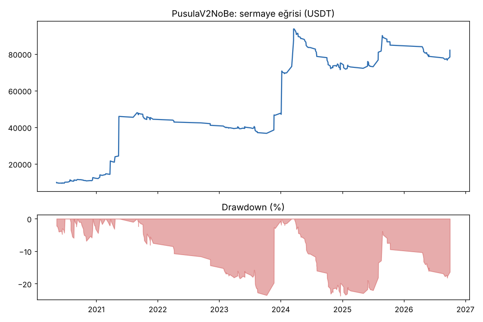
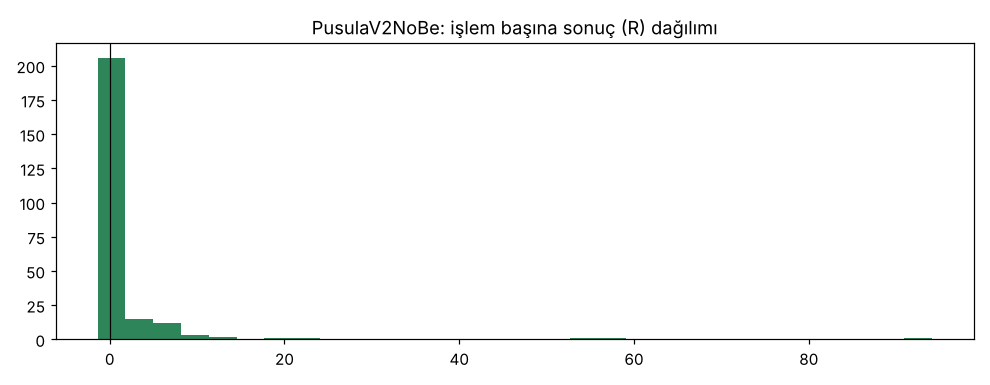
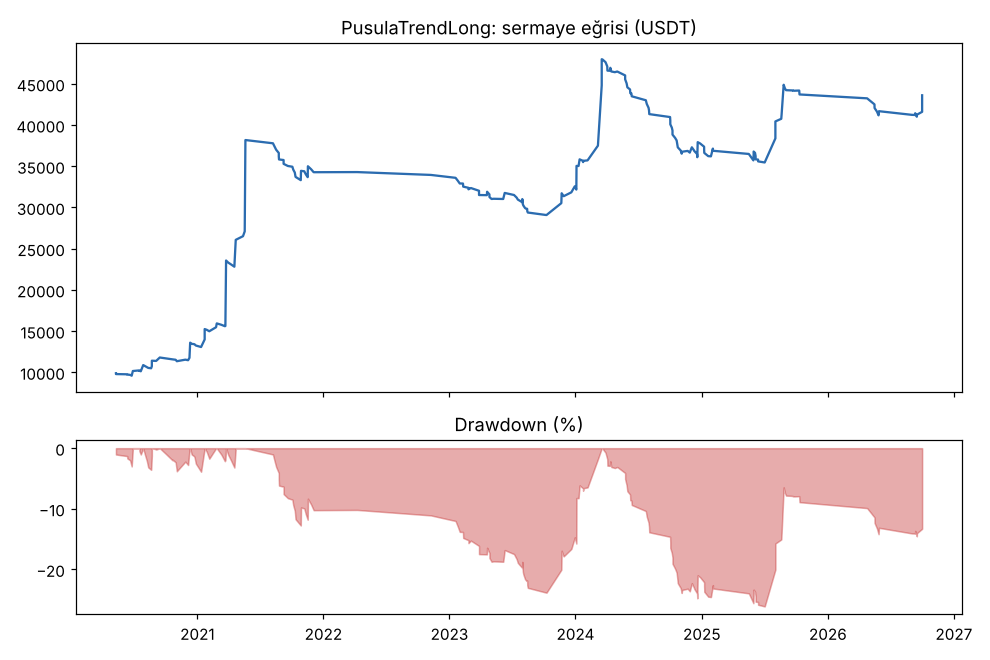
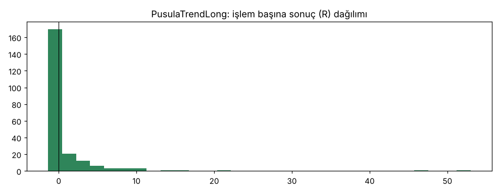

# PusulaV2NoBe vs PusulaTrendLong — batik_wide16_delisted — 2026-10-16

## Özet
- **PusulaV2NoBe**: 243 işlem, işlem başına ortalama **1.22R** (maliyet ve funding dahil), net getiri 720.9%, en büyük düşüş 23.7%.
- **PusulaTrendLong**: 223 işlem, işlem başına ortalama **0.84R** (maliyet ve funding dahil), net getiri 336.1%, en büyük düşüş 26.1%.
- Aynı dönemde coinleri al-tut (eşit ağırlık): getiri 512.9%, ortalama en büyük düşüş 90.2%.

## Ayarlar
- Dönem: 2020-03-07 16:00:00 → 2026-10-01 00:00:00
- Coinler: BTC/USDT:USDT, ETH/USDT:USDT, SOL/USDT:USDT, XRP/USDT:USDT, BNB/USDT:USDT, DOGE/USDT:USDT, ADA/USDT:USDT, LINK/USDT:USDT, LTC/USDT:USDT, DOT/USDT:USDT, AVAX/USDT:USDT, TRX/USDT:USDT, ATOM/USDT:USDT, BCH/USDT:USDT, ETC/USDT:USDT, XLM/USDT:USDT, LUNA/USDT:USDT, FTT/USDT:USDT, SRM/USDT:USDT, HNT/USDT:USDT, BTS/USDT:USDT, TOMO/USDT:USDT, BTT/USDT:USDT, BZRX/USDT:USDT, KEEP/USDT:USDT, YFII/USDT:USDT, WAVES/USDT:USDT, AUDIO/USDT:USDT
- Zaman dilimi: 4h
- Yön: long + short
- Mod: futures / isolated
- Kaldıraç: en fazla 3x, likidasyon stop mesafesinin en az 2 katı uzakta (bölüm 7.6)
- Risk: işlem başına sermayenin %1'i (pozisyon büyüklüğü stop mesafesine göre)
- Maliyet: her emir için %0.05 komisyon + %0.05 kayma (= %0.1), funding geçmiş veriden
- Başlangıç sermayesi: 10000 USDT

## Metrikler
| Metrik | PusulaV2NoBe | PusulaTrendLong | Al-tut |
|---|---|---|---|
| Net getiri | 720.9% | 336.1% | 512.9% |
| Max drawdown | 23.7% | 26.1% | 90.2% |
| Profit factor | 1.96 | 1.84 | — |
| Ortalama R | 1.22 | 0.84 | — |
| İşlem sayısı | 243 | 223 | — |
| Winrate | 30.0% | 28.3% | — |

Winrate tek başına başarı ölçütü değildir; asıl ölçüt ortalama R (expectancy) ve drawdown'dur.

## Long / short ayrımı
| Strateji | Yön | İşlem | Ortalama R | Toplam R | Profit factor |
|---|---|---|---|---|---|
| PusulaV2NoBe | long | 243 | 1.22 | 297.66 | 1.96 |
| PusulaV2NoBe | short | 0 | — | 0.00 | — |
| PusulaTrendLong | long | 223 | 0.84 | 186.74 | 1.84 |
| PusulaTrendLong | short | 0 | — | 0.00 | — |

## Sinyal istatistikleri
| Strateji | Stop | BE | TP1 sonrası BE | TP2 | Diğer | İptal (bölgeye gelmedi / önce stop) | Toplam funding (USDT) |
|---|---|---|---|---|---|---|---|
| PusulaV2NoBe | 44.9% | 0.0% | 0.0% | 0.0% | 55.1% | 5.4% | -13107.82 |
| PusulaTrendLong | 40.8% | 12.1% | 0.0% | 0.0% | 47.1% | 5.9% | -8131.58 |

## Coin bazında
| Strateji | Coin | İşlem | Ortalama R | Toplam R | Al-tut getirisi |
|---|---|---|---|---|---|
| PusulaV2NoBe | BTC/USDT:USDT | 42 | 1.39 | 58.58 | 841.1% |
| PusulaV2NoBe | ETH/USDT:USDT | 32 | 0.58 | 18.52 | 1027.8% |
| PusulaV2NoBe | SOL/USDT:USDT | 11 | 5.50 | 60.53 | 3424.0% |
| PusulaV2NoBe | XRP/USDT:USDT | 11 | 1.00 | 10.98 | 531.4% |
| PusulaV2NoBe | BNB/USDT:USDT | 36 | 0.88 | 31.69 | 3739.0% |
| PusulaV2NoBe | DOGE/USDT:USDT | 2 | -1.05 | -2.10 | 2460.3% |
| PusulaV2NoBe | ADA/USDT:USDT | 7 | 1.04 | 7.29 | 409.9% |
| PusulaV2NoBe | LINK/USDT:USDT | 9 | 0.14 | 1.28 | 224.4% |
| PusulaV2NoBe | LTC/USDT:USDT | 12 | -0.12 | -1.44 | 11.3% |
| PusulaV2NoBe | DOT/USDT:USDT | 2 | -1.07 | -2.14 | -63.4% |
| PusulaV2NoBe | AVAX/USDT:USDT | 4 | 0.42 | 1.67 | 171.8% |
| PusulaV2NoBe | TRX/USDT:USDT | 34 | 0.80 | 27.28 | 1881.6% |
| PusulaV2NoBe | ATOM/USDT:USDT | 6 | -0.20 | -1.23 | -51.5% |
| PusulaV2NoBe | BCH/USDT:USDT | 11 | -0.00 | -0.04 | -7.2% |
| PusulaV2NoBe | ETC/USDT:USDT | 5 | 19.42 | 97.11 | 14.6% |
| PusulaV2NoBe | XLM/USDT:USDT | 5 | -0.53 | -2.66 | 289.8% |
| PusulaV2NoBe | LUNA/USDT:USDT | 0 | — | 0.00 | -99.4% |
| PusulaV2NoBe | FTT/USDT:USDT | 1 | -1.04 | -1.04 | -96.2% |
| PusulaV2NoBe | SRM/USDT:USDT | 0 | — | 0.00 | -90.3% |
| PusulaV2NoBe | HNT/USDT:USDT | 1 | 5.57 | 5.57 | -18.6% |
| PusulaV2NoBe | BTS/USDT:USDT | 1 | -1.25 | -1.25 | -70.3% |
| PusulaV2NoBe | TOMO/USDT:USDT | 5 | -1.04 | -5.19 | 75.1% |
| PusulaV2NoBe | BTT/USDT:USDT | 0 | — | 0.00 | -74.8% |
| PusulaV2NoBe | BZRX/USDT:USDT | 0 | — | 0.00 | -71.2% |
| PusulaV2NoBe | KEEP/USDT:USDT | 0 | — | 0.00 | 100.1% |
| PusulaV2NoBe | YFII/USDT:USDT | 1 | -1.04 | -1.04 | -72.8% |
| PusulaV2NoBe | WAVES/USDT:USDT | 4 | -0.92 | -3.67 | -31.0% |
| PusulaV2NoBe | AUDIO/USDT:USDT | 1 | -1.03 | -1.03 | -94.8% |
| PusulaTrendLong | BTC/USDT:USDT | 36 | 1.47 | 52.88 | 841.1% |
| PusulaTrendLong | ETH/USDT:USDT | 30 | 0.74 | 22.21 | 1027.8% |
| PusulaTrendLong | SOL/USDT:USDT | 7 | -0.28 | -1.94 | 3424.0% |
| PusulaTrendLong | XRP/USDT:USDT | 7 | -0.13 | -0.90 | 531.4% |
| PusulaTrendLong | BNB/USDT:USDT | 41 | 0.92 | 37.63 | 3739.0% |
| PusulaTrendLong | DOGE/USDT:USDT | 4 | -0.04 | -0.17 | 2460.3% |
| PusulaTrendLong | ADA/USDT:USDT | 4 | 3.66 | 14.62 | 409.9% |
| PusulaTrendLong | LINK/USDT:USDT | 7 | 0.49 | 3.42 | 224.4% |
| PusulaTrendLong | LTC/USDT:USDT | 14 | -0.28 | -3.92 | 11.3% |
| PusulaTrendLong | DOT/USDT:USDT | 2 | -0.54 | -1.08 | -63.4% |
| PusulaTrendLong | AVAX/USDT:USDT | 5 | 0.03 | 0.17 | 171.8% |
| PusulaTrendLong | TRX/USDT:USDT | 34 | 0.83 | 28.39 | 1881.6% |
| PusulaTrendLong | ATOM/USDT:USDT | 2 | -1.04 | -2.07 | -51.5% |
| PusulaTrendLong | BCH/USDT:USDT | 8 | 0.35 | 2.80 | -7.2% |
| PusulaTrendLong | ETC/USDT:USDT | 3 | 17.11 | 51.34 | 14.6% |
| PusulaTrendLong | XLM/USDT:USDT | 4 | -0.65 | -2.59 | 289.8% |
| PusulaTrendLong | LUNA/USDT:USDT | 1 | 0.05 | 0.05 | -99.4% |
| PusulaTrendLong | FTT/USDT:USDT | 0 | — | 0.00 | -96.2% |
| PusulaTrendLong | SRM/USDT:USDT | 0 | — | 0.00 | -90.3% |
| PusulaTrendLong | HNT/USDT:USDT | 0 | — | 0.00 | -18.6% |
| PusulaTrendLong | BTS/USDT:USDT | 0 | — | 0.00 | -70.3% |
| PusulaTrendLong | TOMO/USDT:USDT | 7 | -1.04 | -7.29 | 75.1% |
| PusulaTrendLong | BTT/USDT:USDT | 0 | — | 0.00 | -74.8% |
| PusulaTrendLong | BZRX/USDT:USDT | 0 | — | 0.00 | -71.2% |
| PusulaTrendLong | KEEP/USDT:USDT | 0 | — | 0.00 | 100.1% |
| PusulaTrendLong | YFII/USDT:USDT | 1 | -1.04 | -1.04 | -72.8% |
| PusulaTrendLong | WAVES/USDT:USDT | 5 | -0.95 | -4.74 | -31.0% |
| PusulaTrendLong | AUDIO/USDT:USDT | 1 | -1.03 | -1.03 | -94.8% |

## Grafikler

## Yorum: güçlü yanlar / şüpheli noktalar
_(Claude tarafından rakamlara bakılarak yazılır.)_

## Karar: devam / düzelt / emekli
_(Claude tarafından yazılır, gerekçesiyle.)_
