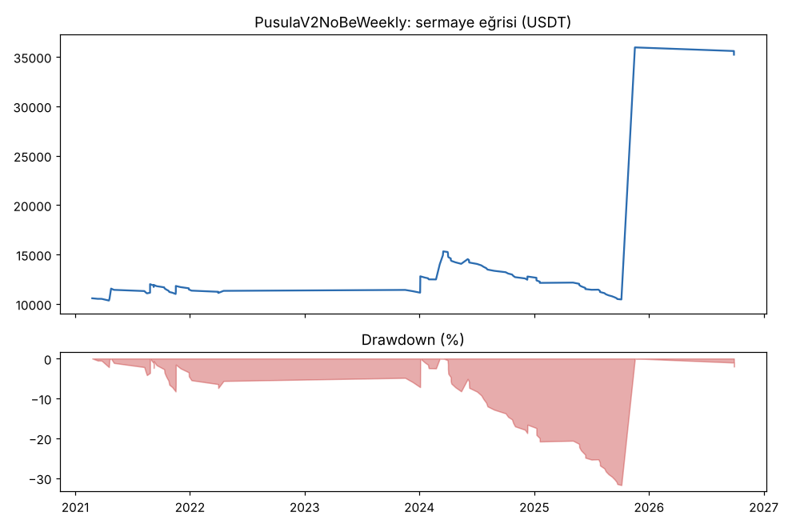
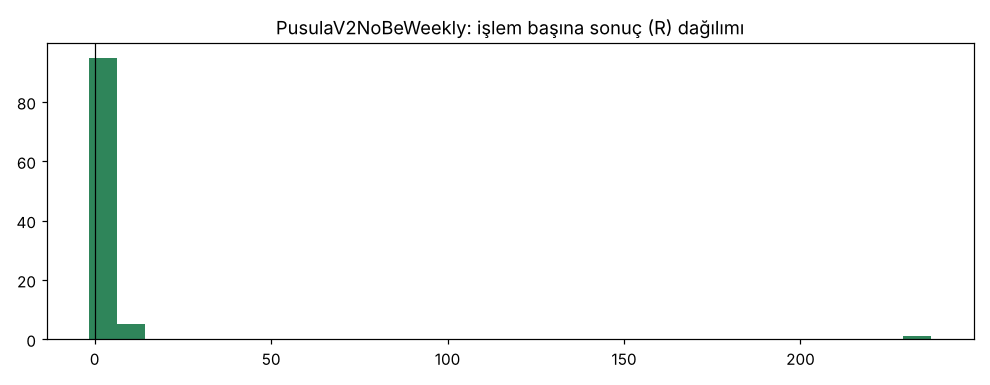

# PusulaV2NoBe vs PusulaV2NoBeWeekly — haftalik_rejim — 2026-10-19

## Özet
- **PusulaV2NoBe**: 193 işlem, işlem başına ortalama **0.61R** (maliyet ve funding dahil), net getiri 134.2%, en büyük düşüş 22.6%.
- **PusulaV2NoBeWeekly**: 101 işlem, işlem başına ortalama **2.41R** (maliyet ve funding dahil), net getiri 252.2%, en büyük düşüş 31.8%.
- Aynı dönemde coinleri al-tut (eşit ağırlık): getiri 194.7%, ortalama en büyük düşüş 97.6%.

## Ayarlar
- Dönem: 2020-04-11 00:00:00 → 2026-09-30 20:00:00
- Coinler: FIL/USDT:USDT, UNI/USDT:USDT, AAVE/USDT:USDT, NEAR/USDT:USDT, ALGO/USDT:USDT, XTZ/USDT:USDT, THETA/USDT:USDT, VET/USDT:USDT, ICP/USDT:USDT, SAND/USDT:USDT, MANA/USDT:USDT, AXS/USDT:USDT, EGLD/USDT:USDT, HBAR/USDT:USDT, CHZ/USDT:USDT, ENJ/USDT:USDT, ZEC/USDT:USDT, DASH/USDT:USDT, NEO/USDT:USDT, IOTA/USDT:USDT
- Zaman dilimi: 4h
- Yön: long + short
- Mod: futures / isolated
- Kaldıraç: en fazla 3x, likidasyon stop mesafesinin en az 2 katı uzakta (bölüm 7.6)
- Risk: işlem başına sermayenin %1'i (pozisyon büyüklüğü stop mesafesine göre)
- Maliyet: her emir için %0.05 komisyon + %0.05 kayma (= %0.1), funding geçmiş veriden
- Başlangıç sermayesi: 10000 USDT

## Metrikler
| Metrik | PusulaV2NoBe | PusulaV2NoBeWeekly | Al-tut |
|---|---|---|---|
| Net getiri | 134.2% | 252.2% | 194.7% |
| Max drawdown | 22.6% | 31.8% | 97.6% |
| Profit factor | 1.53 | 3.61 | — |
| Ortalama R | 0.61 | 2.41 | — |
| İşlem sayısı | 193 | 101 | — |
| Winrate | 23.3% | 21.8% | — |

Winrate tek başına başarı ölçütü değildir; asıl ölçüt ortalama R (expectancy) ve drawdown'dur.

## Long / short ayrımı
| Strateji | Yön | İşlem | Ortalama R | Toplam R | Profit factor |
|---|---|---|---|---|---|
| PusulaV2NoBe | long | 193 | 0.61 | 117.72 | 1.53 |
| PusulaV2NoBe | short | 0 | — | 0.00 | — |
| PusulaV2NoBeWeekly | long | 101 | 2.41 | 243.60 | 3.61 |
| PusulaV2NoBeWeekly | short | 0 | — | 0.00 | — |

## Sinyal istatistikleri
| Strateji | Stop | BE | TP1 sonrası BE | TP2 | Diğer | İptal (bölgeye gelmedi / önce stop) | Toplam funding (USDT) |
|---|---|---|---|---|---|---|---|
| PusulaV2NoBe | 53.9% | 0.5% | 0.0% | 0.0% | 45.6% | 6.3% | -3768.94 |
| PusulaV2NoBeWeekly | 57.4% | 0.0% | 0.0% | 0.0% | 42.6% | 10.6% | -1045.73 |

## Coin bazında
| Strateji | Coin | İşlem | Ortalama R | Toplam R | Al-tut getirisi |
|---|---|---|---|---|---|
| PusulaV2NoBe | FIL/USDT:USDT | 7 | 5.55 | 38.87 | -97.9% |
| PusulaV2NoBe | UNI/USDT:USDT | 20 | 1.06 | 21.22 | 62.4% |
| PusulaV2NoBe | AAVE/USDT:USDT | 17 | -0.75 | -12.83 | 286.5% |
| PusulaV2NoBe | NEAR/USDT:USDT | 9 | -0.19 | -1.72 | 373.4% |
| PusulaV2NoBe | ALGO/USDT:USDT | 12 | 2.92 | 35.04 | -47.9% |
| PusulaV2NoBe | XTZ/USDT:USDT | 16 | 0.25 | 4.04 | -84.3% |
| PusulaV2NoBe | THETA/USDT:USDT | 8 | 2.45 | 19.59 | -48.0% |
| PusulaV2NoBe | VET/USDT:USDT | 13 | 1.47 | 19.17 | 139.2% |
| PusulaV2NoBe | ICP/USDT:USDT | 4 | 0.36 | 1.43 | -99.3% |
| PusulaV2NoBe | SAND/USDT:USDT | 4 | -0.69 | -2.76 | -54.0% |
| PusulaV2NoBe | MANA/USDT:USDT | 7 | -0.55 | -3.84 | -91.4% |
| PusulaV2NoBe | AXS/USDT:USDT | 2 | -0.68 | -1.36 | 136.4% |
| PusulaV2NoBe | EGLD/USDT:USDT | 8 | -0.48 | -3.86 | -65.7% |
| PusulaV2NoBe | HBAR/USDT:USDT | 6 | -0.66 | -3.94 | -68.6% |
| PusulaV2NoBe | CHZ/USDT:USDT | 6 | -0.68 | -4.10 | -26.0% |
| PusulaV2NoBe | ENJ/USDT:USDT | 4 | 0.59 | 2.36 | -83.5% |
| PusulaV2NoBe | ZEC/USDT:USDT | 13 | -0.17 | -2.15 | 3815.4% |
| PusulaV2NoBe | DASH/USDT:USDT | 17 | 0.08 | 1.35 | -19.1% |
| PusulaV2NoBe | NEO/USDT:USDT | 12 | 0.66 | 7.88 | -65.8% |
| PusulaV2NoBe | IOTA/USDT:USDT | 8 | 0.41 | 3.31 | -66.9% |
| PusulaV2NoBeWeekly | FIL/USDT:USDT | 0 | — | 0.00 | -97.9% |
| PusulaV2NoBeWeekly | UNI/USDT:USDT | 12 | -0.67 | -7.99 | 62.4% |
| PusulaV2NoBeWeekly | AAVE/USDT:USDT | 16 | -0.70 | -11.24 | 286.5% |
| PusulaV2NoBeWeekly | NEAR/USDT:USDT | 6 | -0.01 | -0.05 | 373.4% |
| PusulaV2NoBeWeekly | ALGO/USDT:USDT | 5 | -1.00 | -5.01 | -47.9% |
| PusulaV2NoBeWeekly | XTZ/USDT:USDT | 7 | 0.19 | 1.30 | -84.3% |
| PusulaV2NoBeWeekly | THETA/USDT:USDT | 9 | -0.97 | -8.75 | -48.0% |
| PusulaV2NoBeWeekly | VET/USDT:USDT | 6 | 4.70 | 28.23 | 139.2% |
| PusulaV2NoBeWeekly | ICP/USDT:USDT | 3 | -0.59 | -1.78 | -99.3% |
| PusulaV2NoBeWeekly | SAND/USDT:USDT | 0 | — | 0.00 | -54.0% |
| PusulaV2NoBeWeekly | MANA/USDT:USDT | 3 | 0.28 | 0.84 | -91.4% |
| PusulaV2NoBeWeekly | AXS/USDT:USDT | 1 | -0.98 | -0.98 | 136.4% |
| PusulaV2NoBeWeekly | EGLD/USDT:USDT | 3 | 0.68 | 2.05 | -65.7% |
| PusulaV2NoBeWeekly | HBAR/USDT:USDT | 4 | -0.53 | -2.13 | -68.6% |
| PusulaV2NoBeWeekly | CHZ/USDT:USDT | 2 | -1.06 | -2.13 | -26.0% |
| PusulaV2NoBeWeekly | ENJ/USDT:USDT | 0 | — | 0.00 | -83.5% |
| PusulaV2NoBeWeekly | ZEC/USDT:USDT | 9 | 26.41 | 237.68 | 3815.4% |
| PusulaV2NoBeWeekly | DASH/USDT:USDT | 4 | -1.22 | -4.88 | -19.1% |
| PusulaV2NoBeWeekly | NEO/USDT:USDT | 8 | 2.56 | 20.48 | -65.8% |
| PusulaV2NoBeWeekly | IOTA/USDT:USDT | 3 | -0.68 | -2.03 | -66.9% |

## Grafikler

## Yorum: güçlü yanlar / şüpheli noktalar
_(Claude tarafından rakamlara bakılarak yazılır.)_

## Karar: devam / düzelt / emekli
_(Claude tarafından yazılır, gerekçesiyle.)_
