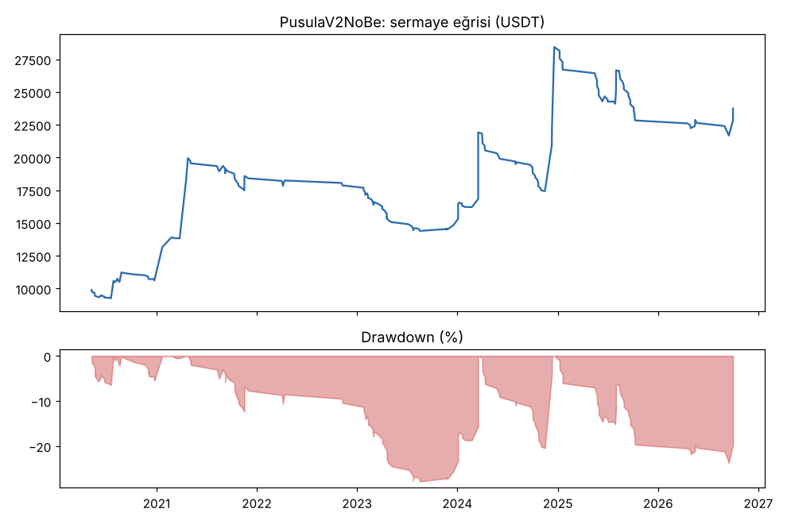
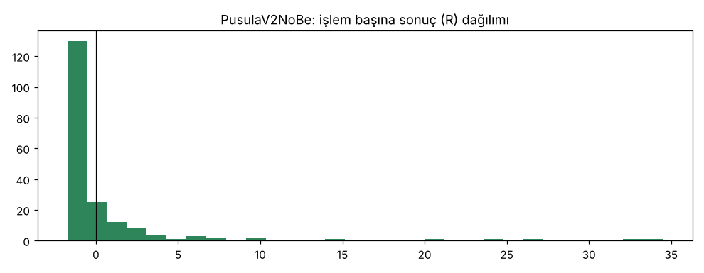

# PusulaV2NoBe — 5yuva — 2026-10-20

## Özet
- **PusulaV2NoBe**: 193 işlem, işlem başına ortalama **0.64R** (maliyet ve funding dahil), net getiri 137.4%, en büyük düşüş 23.8%.
- Aynı dönemde coinleri al-tut (eşit ağırlık): getiri 194.7%, ortalama en büyük düşüş 97.6%.

## Ayarlar
- Dönem: 2020-04-11 00:00:00 → 2026-09-30 20:00:00
- Coinler: IOTA/USDT:USDT, NEO/USDT:USDT, DASH/USDT:USDT, ZEC/USDT:USDT, ENJ/USDT:USDT, CHZ/USDT:USDT, HBAR/USDT:USDT, EGLD/USDT:USDT, AXS/USDT:USDT, MANA/USDT:USDT, SAND/USDT:USDT, ICP/USDT:USDT, VET/USDT:USDT, THETA/USDT:USDT, XTZ/USDT:USDT, ALGO/USDT:USDT, NEAR/USDT:USDT, AAVE/USDT:USDT, UNI/USDT:USDT, FIL/USDT:USDT
- Zaman dilimi: 4h
- Yön: long + short
- Mod: futures / isolated
- Kaldıraç: en fazla 3x, likidasyon stop mesafesinin en az 2 katı uzakta (bölüm 7.6)
- Risk: işlem başına sermayenin %1'i (pozisyon büyüklüğü stop mesafesine göre)
- Maliyet: her emir için %0.05 komisyon + %0.05 kayma (= %0.1), funding geçmiş veriden
- Başlangıç sermayesi: 10000 USDT

## Metrikler
| Metrik | PusulaV2NoBe | Al-tut |
|---|---|---|
| Net getiri | 137.4% | 194.7% |
| Max drawdown | 23.8% | 97.6% |
| Profit factor | 1.53 | — |
| Ortalama R | 0.64 | — |
| İşlem sayısı | 193 | — |
| Winrate | 23.3% | — |

Winrate tek başına başarı ölçütü değildir; asıl ölçüt ortalama R (expectancy) ve drawdown'dur.

## Long / short ayrımı
| Strateji | Yön | İşlem | Ortalama R | Toplam R | Profit factor |
|---|---|---|---|---|---|
| PusulaV2NoBe | long | 193 | 0.64 | 122.57 | 1.53 |
| PusulaV2NoBe | short | 0 | — | 0.00 | — |

## Sinyal istatistikleri
| Strateji | Stop | BE | TP1 sonrası BE | TP2 | Diğer | İptal (bölgeye gelmedi / önce stop) | Toplam funding (USDT) |
|---|---|---|---|---|---|---|---|
| PusulaV2NoBe | 55.4% | 0.5% | 0.0% | 0.0% | 44.0% | 5.9% | -3726.81 |

## Coin bazında
| Strateji | Coin | İşlem | Ortalama R | Toplam R | Al-tut getirisi |
|---|---|---|---|---|---|
| PusulaV2NoBe | IOTA/USDT:USDT | 10 | 0.11 | 1.14 | -66.9% |
| PusulaV2NoBe | NEO/USDT:USDT | 16 | 0.31 | 5.01 | -65.8% |
| PusulaV2NoBe | DASH/USDT:USDT | 17 | 0.08 | 1.35 | -19.1% |
| PusulaV2NoBe | ZEC/USDT:USDT | 12 | -0.11 | -1.35 | 3815.4% |
| PusulaV2NoBe | ENJ/USDT:USDT | 5 | 0.32 | 1.60 | -83.5% |
| PusulaV2NoBe | CHZ/USDT:USDT | 10 | -0.66 | -6.62 | -26.0% |
| PusulaV2NoBe | HBAR/USDT:USDT | 7 | -0.72 | -5.02 | -68.6% |
| PusulaV2NoBe | EGLD/USDT:USDT | 8 | -0.48 | -3.86 | -65.7% |
| PusulaV2NoBe | AXS/USDT:USDT | 3 | 0.29 | 0.87 | 136.4% |
| PusulaV2NoBe | MANA/USDT:USDT | 9 | 1.70 | 15.28 | -91.4% |
| PusulaV2NoBe | SAND/USDT:USDT | 3 | -0.74 | -2.22 | -54.0% |
| PusulaV2NoBe | ICP/USDT:USDT | 3 | 0.47 | 1.42 | -99.3% |
| PusulaV2NoBe | VET/USDT:USDT | 9 | 2.42 | 21.81 | 139.2% |
| PusulaV2NoBe | THETA/USDT:USDT | 8 | 2.45 | 19.59 | -48.0% |
| PusulaV2NoBe | XTZ/USDT:USDT | 15 | 0.31 | 4.61 | -84.3% |
| PusulaV2NoBe | ALGO/USDT:USDT | 10 | 2.93 | 29.31 | -47.9% |
| PusulaV2NoBe | NEAR/USDT:USDT | 8 | -0.15 | -1.16 | 373.4% |
| PusulaV2NoBe | AAVE/USDT:USDT | 15 | -0.74 | -11.08 | 286.5% |
| PusulaV2NoBe | UNI/USDT:USDT | 19 | 1.17 | 22.27 | 62.4% |
| PusulaV2NoBe | FIL/USDT:USDT | 6 | 4.93 | 29.61 | -97.9% |

## Grafikler

## Yorum: güçlü yanlar / şüpheli noktalar
_(Claude tarafından rakamlara bakılarak yazılır.)_

## Karar: devam / düzelt / emekli
_(Claude tarafından yazılır, gerekçesiyle.)_
