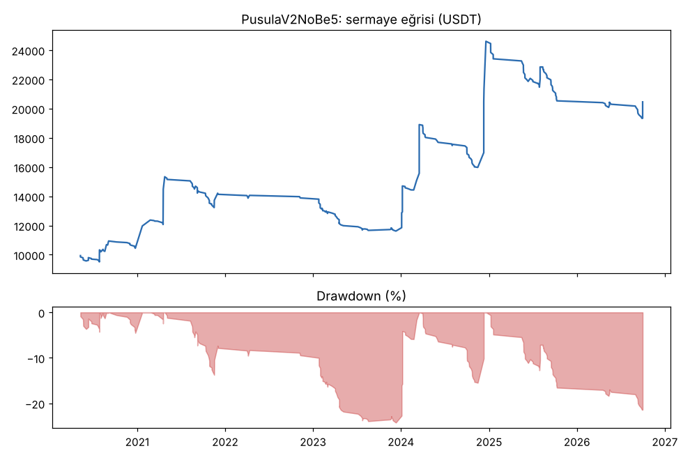
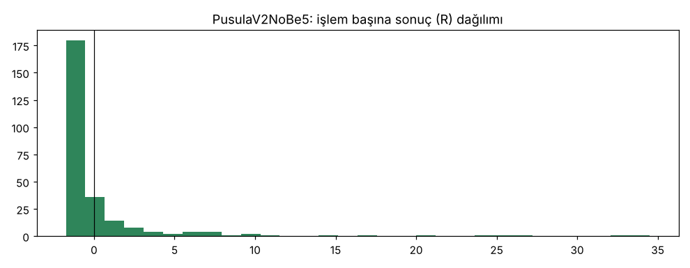

# PusulaV2NoBe5 — 5yuva — 2026-10-20

## Özet
- **PusulaV2NoBe5**: 264 işlem, işlem başına ortalama **0.60R** (maliyet ve funding dahil), net getiri 104.6%, en büyük düşüş 21.4%.
- Aynı dönemde coinleri al-tut (eşit ağırlık): getiri 194.7%, ortalama en büyük düşüş 97.6%.

## Ayarlar
- Dönem: 2020-04-11 00:00:00 → 2026-09-30 20:00:00
- Coinler: FIL/USDT:USDT, UNI/USDT:USDT, AAVE/USDT:USDT, NEAR/USDT:USDT, ALGO/USDT:USDT, XTZ/USDT:USDT, THETA/USDT:USDT, VET/USDT:USDT, ICP/USDT:USDT, SAND/USDT:USDT, MANA/USDT:USDT, AXS/USDT:USDT, EGLD/USDT:USDT, HBAR/USDT:USDT, CHZ/USDT:USDT, ENJ/USDT:USDT, ZEC/USDT:USDT, DASH/USDT:USDT, NEO/USDT:USDT, IOTA/USDT:USDT
- Zaman dilimi: 4h
- Yön: long + short
- Mod: futures / isolated
- Kaldıraç: en fazla 3x, likidasyon stop mesafesinin en az 2 katı uzakta (bölüm 7.6)
- Risk: işlem başına sermayenin %0.6'i (pozisyon büyüklüğü stop mesafesine göre)
- Maliyet: her emir için %0.05 komisyon + %0.05 kayma (= %0.1), funding geçmiş veriden
- Başlangıç sermayesi: 10000 USDT

## Metrikler
| Metrik | PusulaV2NoBe5 | Al-tut |
|---|---|---|
| Net getiri | 104.6% | 194.7% |
| Max drawdown | 21.4% | 97.6% |
| Profit factor | 1.58 | — |
| Ortalama R | 0.60 | — |
| İşlem sayısı | 264 | — |
| Winrate | 22.3% | — |

Winrate tek başına başarı ölçütü değildir; asıl ölçüt ortalama R (expectancy) ve drawdown'dur.

## Long / short ayrımı
| Strateji | Yön | İşlem | Ortalama R | Toplam R | Profit factor |
|---|---|---|---|---|---|
| PusulaV2NoBe5 | long | 264 | 0.60 | 159.06 | 1.58 |
| PusulaV2NoBe5 | short | 0 | — | 0.00 | — |

## Sinyal istatistikleri
| Strateji | Stop | BE | TP1 sonrası BE | TP2 | Diğer | İptal (bölgeye gelmedi / önce stop) | Toplam funding (USDT) |
|---|---|---|---|---|---|---|---|
| PusulaV2NoBe5 | 55.3% | 0.4% | 0.0% | 0.0% | 44.3% | 6.7% | -2655.20 |

## Coin bazında
| Strateji | Coin | İşlem | Ortalama R | Toplam R | Al-tut getirisi |
|---|---|---|---|---|---|
| PusulaV2NoBe5 | FIL/USDT:USDT | 12 | 3.79 | 45.54 | -97.9% |
| PusulaV2NoBe5 | UNI/USDT:USDT | 23 | 0.76 | 17.54 | 62.4% |
| PusulaV2NoBe5 | AAVE/USDT:USDT | 18 | -0.67 | -12.00 | 286.5% |
| PusulaV2NoBe5 | NEAR/USDT:USDT | 12 | 1.90 | 22.80 | 373.4% |
| PusulaV2NoBe5 | ALGO/USDT:USDT | 16 | 2.00 | 31.97 | -47.9% |
| PusulaV2NoBe5 | XTZ/USDT:USDT | 21 | -0.03 | -0.62 | -84.3% |
| PusulaV2NoBe5 | THETA/USDT:USDT | 13 | 1.17 | 15.15 | -48.0% |
| PusulaV2NoBe5 | VET/USDT:USDT | 15 | 1.71 | 25.69 | 139.2% |
| PusulaV2NoBe5 | ICP/USDT:USDT | 6 | -0.11 | -0.67 | -99.3% |
| PusulaV2NoBe5 | SAND/USDT:USDT | 5 | -0.76 | -3.79 | -54.0% |
| PusulaV2NoBe5 | MANA/USDT:USDT | 10 | 1.41 | 14.12 | -91.4% |
| PusulaV2NoBe5 | AXS/USDT:USDT | 5 | -0.91 | -4.56 | 136.4% |
| PusulaV2NoBe5 | EGLD/USDT:USDT | 10 | 0.11 | 1.09 | -65.7% |
| PusulaV2NoBe5 | HBAR/USDT:USDT | 8 | -0.50 | -4.03 | -68.6% |
| PusulaV2NoBe5 | CHZ/USDT:USDT | 12 | -0.70 | -8.46 | -26.0% |
| PusulaV2NoBe5 | ENJ/USDT:USDT | 6 | 3.03 | 18.20 | -83.5% |
| PusulaV2NoBe5 | ZEC/USDT:USDT | 17 | -0.28 | -4.71 | 3815.4% |
| PusulaV2NoBe5 | DASH/USDT:USDT | 20 | -0.12 | -2.41 | -19.1% |
| PusulaV2NoBe5 | NEO/USDT:USDT | 22 | 0.31 | 6.78 | -65.8% |
| PusulaV2NoBe5 | IOTA/USDT:USDT | 13 | 0.11 | 1.42 | -66.9% |

## Grafikler

## Yorum: güçlü yanlar / şüpheli noktalar
_(Claude tarafından rakamlara bakılarak yazılır.)_

## Karar: devam / düzelt / emekli
_(Claude tarafından yazılır, gerekçesiyle.)_
