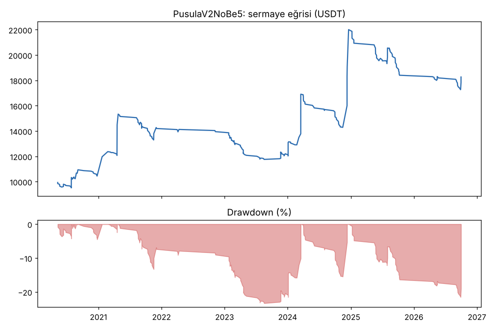
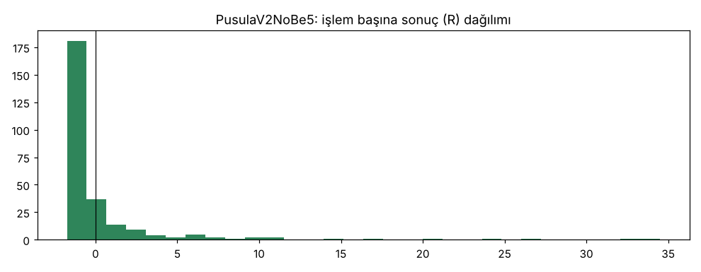

# PusulaV2NoBe5 — 5yuva — 2026-10-20

## Özet
- **PusulaV2NoBe5**: 266 işlem, işlem başına ortalama **0.51R** (maliyet ve funding dahil), net getiri 82.7%, en büyük düşüş 21.6%.
- Aynı dönemde coinleri al-tut (eşit ağırlık): getiri 194.7%, ortalama en büyük düşüş 97.6%.

## Ayarlar
- Dönem: 2020-04-11 00:00:00 → 2026-09-30 20:00:00
- Coinler: IOTA/USDT:USDT, NEO/USDT:USDT, DASH/USDT:USDT, ZEC/USDT:USDT, ENJ/USDT:USDT, CHZ/USDT:USDT, HBAR/USDT:USDT, EGLD/USDT:USDT, AXS/USDT:USDT, MANA/USDT:USDT, SAND/USDT:USDT, ICP/USDT:USDT, VET/USDT:USDT, THETA/USDT:USDT, XTZ/USDT:USDT, ALGO/USDT:USDT, NEAR/USDT:USDT, AAVE/USDT:USDT, UNI/USDT:USDT, FIL/USDT:USDT
- Zaman dilimi: 4h
- Yön: long + short
- Mod: futures / isolated
- Kaldıraç: en fazla 3x, likidasyon stop mesafesinin en az 2 katı uzakta (bölüm 7.6)
- Risk: işlem başına sermayenin %0.6'i (pozisyon büyüklüğü stop mesafesine göre)
- Maliyet: her emir için %0.05 komisyon + %0.05 kayma (= %0.1), funding geçmiş veriden
- Başlangıç sermayesi: 10000 USDT

## Metrikler
| Metrik | PusulaV2NoBe5 | Al-tut |
|---|---|---|
| Net getiri | 82.7% | 194.7% |
| Max drawdown | 21.6% | 97.6% |
| Profit factor | 1.48 | — |
| Ortalama R | 0.51 | — |
| İşlem sayısı | 266 | — |
| Winrate | 22.2% | — |

Winrate tek başına başarı ölçütü değildir; asıl ölçüt ortalama R (expectancy) ve drawdown'dur.

## Long / short ayrımı
| Strateji | Yön | İşlem | Ortalama R | Toplam R | Profit factor |
|---|---|---|---|---|---|
| PusulaV2NoBe5 | long | 266 | 0.51 | 135.98 | 1.48 |
| PusulaV2NoBe5 | short | 0 | — | 0.00 | — |

## Sinyal istatistikleri
| Strateji | Stop | BE | TP1 sonrası BE | TP2 | Diğer | İptal (bölgeye gelmedi / önce stop) | Toplam funding (USDT) |
|---|---|---|---|---|---|---|---|
| PusulaV2NoBe5 | 55.6% | 0.4% | 0.0% | 0.0% | 44.0% | 8.0% | -2488.35 |

## Coin bazında
| Strateji | Coin | İşlem | Ortalama R | Toplam R | Al-tut getirisi |
|---|---|---|---|---|---|
| PusulaV2NoBe5 | IOTA/USDT:USDT | 16 | -0.06 | -1.01 | -66.9% |
| PusulaV2NoBe5 | NEO/USDT:USDT | 24 | 0.19 | 4.58 | -65.8% |
| PusulaV2NoBe5 | DASH/USDT:USDT | 20 | -0.12 | -2.41 | -19.1% |
| PusulaV2NoBe5 | ZEC/USDT:USDT | 18 | -0.32 | -5.82 | 3815.4% |
| PusulaV2NoBe5 | ENJ/USDT:USDT | 7 | 2.45 | 17.16 | -83.5% |
| PusulaV2NoBe5 | CHZ/USDT:USDT | 14 | -0.71 | -9.93 | -26.0% |
| PusulaV2NoBe5 | HBAR/USDT:USDT | 9 | -0.57 | -5.12 | -68.6% |
| PusulaV2NoBe5 | EGLD/USDT:USDT | 11 | 0.63 | 6.96 | -65.7% |
| PusulaV2NoBe5 | AXS/USDT:USDT | 8 | -0.57 | -4.56 | 136.4% |
| PusulaV2NoBe5 | MANA/USDT:USDT | 11 | 1.17 | 12.92 | -91.4% |
| PusulaV2NoBe5 | SAND/USDT:USDT | 5 | -0.76 | -3.81 | -54.0% |
| PusulaV2NoBe5 | ICP/USDT:USDT | 7 | -0.21 | -1.44 | -99.3% |
| PusulaV2NoBe5 | VET/USDT:USDT | 14 | 2.16 | 30.29 | 139.2% |
| PusulaV2NoBe5 | THETA/USDT:USDT | 9 | 2.11 | 18.97 | -48.0% |
| PusulaV2NoBe5 | XTZ/USDT:USDT | 19 | 0.05 | 0.90 | -84.3% |
| PusulaV2NoBe5 | ALGO/USDT:USDT | 14 | 1.86 | 25.98 | -47.9% |
| PusulaV2NoBe5 | NEAR/USDT:USDT | 10 | -0.19 | -1.92 | 373.4% |
| PusulaV2NoBe5 | AAVE/USDT:USDT | 18 | -0.64 | -11.60 | 286.5% |
| PusulaV2NoBe5 | UNI/USDT:USDT | 21 | 0.94 | 19.72 | 62.4% |
| PusulaV2NoBe5 | FIL/USDT:USDT | 11 | 4.19 | 46.11 | -97.9% |

## Grafikler

## Yorum: güçlü yanlar / şüpheli noktalar
_(Claude tarafından rakamlara bakılarak yazılır.)_

## Karar: devam / düzelt / emekli
_(Claude tarafından yazılır, gerekçesiyle.)_
