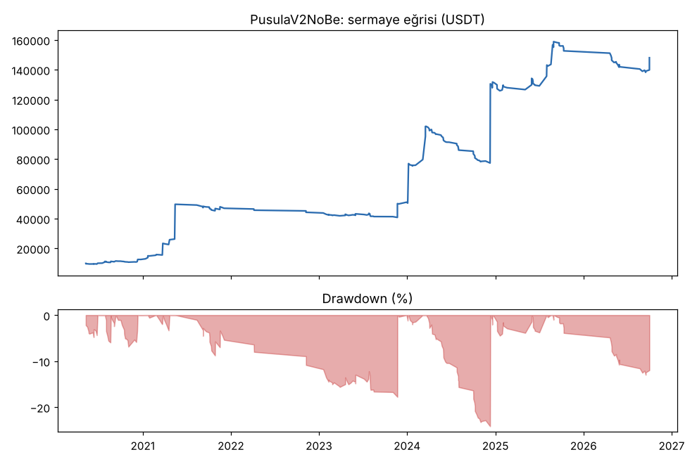
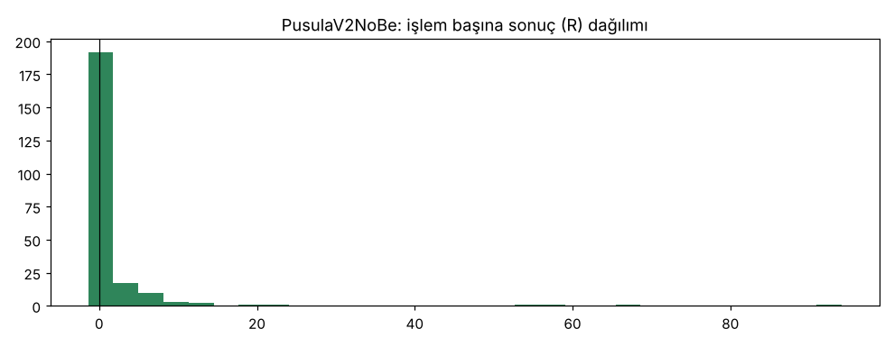

# PusulaV2NoBe — 5yuva — 2026-10-20

## Özet
- **PusulaV2NoBe**: 230 işlem, işlem başına ortalama **1.61R** (maliyet ve funding dahil), net getiri 1380.7%, en büyük düşüş 24.2%.
- Aynı dönemde coinleri al-tut (eşit ağırlık): getiri 931.5%, ortalama en büyük düşüş 89.2%.

## Ayarlar
- Dönem: 2020-03-07 16:00:00 → 2026-10-01 00:00:00
- Coinler: XLM/USDT:USDT, ETC/USDT:USDT, BCH/USDT:USDT, ATOM/USDT:USDT, TRX/USDT:USDT, AVAX/USDT:USDT, DOT/USDT:USDT, LTC/USDT:USDT, LINK/USDT:USDT, ADA/USDT:USDT, DOGE/USDT:USDT, BNB/USDT:USDT, XRP/USDT:USDT, SOL/USDT:USDT, ETH/USDT:USDT, BTC/USDT:USDT
- Zaman dilimi: 4h
- Yön: long + short
- Mod: futures / isolated
- Kaldıraç: en fazla 3x, likidasyon stop mesafesinin en az 2 katı uzakta (bölüm 7.6)
- Risk: işlem başına sermayenin %1'i (pozisyon büyüklüğü stop mesafesine göre)
- Maliyet: her emir için %0.05 komisyon + %0.05 kayma (= %0.1), funding geçmiş veriden
- Başlangıç sermayesi: 10000 USDT

## Metrikler
| Metrik | PusulaV2NoBe | Al-tut |
|---|---|---|
| Net getiri | 1380.7% | 931.5% |
| Max drawdown | 24.2% | 89.2% |
| Profit factor | 2.51 | — |
| Ortalama R | 1.61 | — |
| İşlem sayısı | 230 | — |
| Winrate | 31.3% | — |

Winrate tek başına başarı ölçütü değildir; asıl ölçüt ortalama R (expectancy) ve drawdown'dur.

## Long / short ayrımı
| Strateji | Yön | İşlem | Ortalama R | Toplam R | Profit factor |
|---|---|---|---|---|---|
| PusulaV2NoBe | long | 230 | 1.61 | 371.36 | 2.51 |
| PusulaV2NoBe | short | 0 | — | 0.00 | — |

## Sinyal istatistikleri
| Strateji | Stop | BE | TP1 sonrası BE | TP2 | Diğer | İptal (bölgeye gelmedi / önce stop) | Toplam funding (USDT) |
|---|---|---|---|---|---|---|---|
| PusulaV2NoBe | 41.3% | 0.0% | 0.0% | 0.0% | 58.7% | 5.0% | -16186.68 |

## Coin bazında
| Strateji | Coin | İşlem | Ortalama R | Toplam R | Al-tut getirisi |
|---|---|---|---|---|---|
| PusulaV2NoBe | XLM/USDT:USDT | 8 | -0.61 | -4.86 | 289.8% |
| PusulaV2NoBe | ETC/USDT:USDT | 8 | 11.83 | 94.64 | 14.6% |
| PusulaV2NoBe | BCH/USDT:USDT | 13 | -0.10 | -1.26 | -7.2% |
| PusulaV2NoBe | ATOM/USDT:USDT | 6 | -0.06 | -0.38 | -51.5% |
| PusulaV2NoBe | TRX/USDT:USDT | 33 | 0.69 | 22.74 | 1881.6% |
| PusulaV2NoBe | AVAX/USDT:USDT | 4 | 0.29 | 1.18 | 171.8% |
| PusulaV2NoBe | DOT/USDT:USDT | 3 | -0.71 | -2.12 | -63.4% |
| PusulaV2NoBe | LTC/USDT:USDT | 16 | -0.26 | -4.09 | 11.3% |
| PusulaV2NoBe | LINK/USDT:USDT | 9 | 0.14 | 1.28 | 224.4% |
| PusulaV2NoBe | ADA/USDT:USDT | 6 | 1.39 | 8.34 | 409.9% |
| PusulaV2NoBe | DOGE/USDT:USDT | 4 | 15.89 | 63.58 | 2460.3% |
| PusulaV2NoBe | BNB/USDT:USDT | 39 | 1.09 | 42.43 | 3739.0% |
| PusulaV2NoBe | XRP/USDT:USDT | 9 | 1.46 | 13.13 | 531.4% |
| PusulaV2NoBe | SOL/USDT:USDT | 9 | 6.21 | 55.89 | 3424.0% |
| PusulaV2NoBe | ETH/USDT:USDT | 25 | 0.84 | 21.09 | 1027.8% |
| PusulaV2NoBe | BTC/USDT:USDT | 38 | 1.57 | 59.78 | 841.1% |

## Grafikler

## Yorum: güçlü yanlar / şüpheli noktalar
_(Claude tarafından rakamlara bakılarak yazılır.)_

## Karar: devam / düzelt / emekli
_(Claude tarafından yazılır, gerekçesiyle.)_
