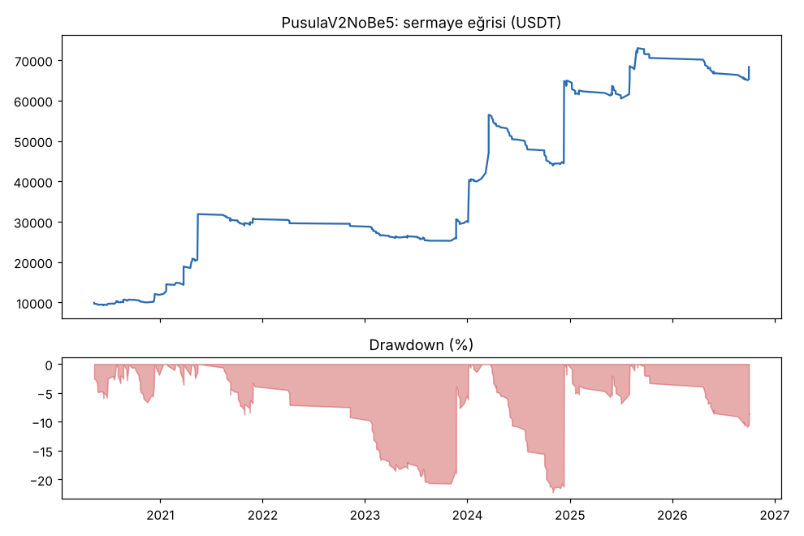
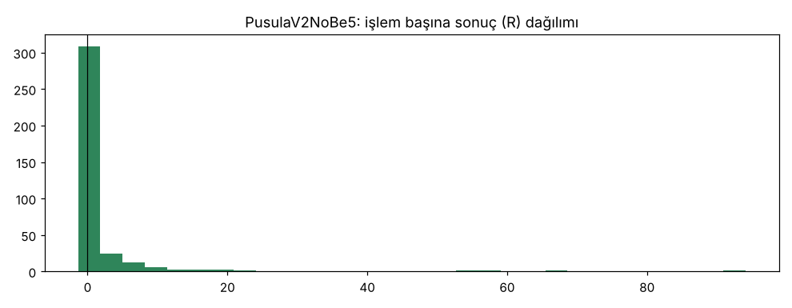

# PusulaV2NoBe5 — 5yuva — 2026-10-20

## Özet
- **PusulaV2NoBe5**: 363 işlem, işlem başına ortalama **1.14R** (maliyet ve funding dahil), net getiri 583.3%, en büyük düşüş 22.2%.
- Aynı dönemde coinleri al-tut (eşit ağırlık): getiri 931.5%, ortalama en büyük düşüş 89.2%.

## Ayarlar
- Dönem: 2020-03-07 16:00:00 → 2026-10-01 00:00:00
- Coinler: XLM/USDT:USDT, ETC/USDT:USDT, BCH/USDT:USDT, ATOM/USDT:USDT, TRX/USDT:USDT, AVAX/USDT:USDT, DOT/USDT:USDT, LTC/USDT:USDT, LINK/USDT:USDT, ADA/USDT:USDT, DOGE/USDT:USDT, BNB/USDT:USDT, XRP/USDT:USDT, SOL/USDT:USDT, ETH/USDT:USDT, BTC/USDT:USDT
- Zaman dilimi: 4h
- Yön: long + short
- Mod: futures / isolated
- Kaldıraç: en fazla 3x, likidasyon stop mesafesinin en az 2 katı uzakta (bölüm 7.6)
- Risk: işlem başına sermayenin %0.6'i (pozisyon büyüklüğü stop mesafesine göre)
- Maliyet: her emir için %0.05 komisyon + %0.05 kayma (= %0.1), funding geçmiş veriden
- Başlangıç sermayesi: 10000 USDT

## Metrikler
| Metrik | PusulaV2NoBe5 | Al-tut |
|---|---|---|
| Net getiri | 583.3% | 931.5% |
| Max drawdown | 22.2% | 89.2% |
| Profit factor | 2.15 | — |
| Ortalama R | 1.14 | — |
| İşlem sayısı | 363 | — |
| Winrate | 27.5% | — |

Winrate tek başına başarı ölçütü değildir; asıl ölçüt ortalama R (expectancy) ve drawdown'dur.

## Long / short ayrımı
| Strateji | Yön | İşlem | Ortalama R | Toplam R | Profit factor |
|---|---|---|---|---|---|
| PusulaV2NoBe5 | long | 363 | 1.14 | 413.92 | 2.15 |
| PusulaV2NoBe5 | short | 0 | — | 0.00 | — |

## Sinyal istatistikleri
| Strateji | Stop | BE | TP1 sonrası BE | TP2 | Diğer | İptal (bölgeye gelmedi / önce stop) | Toplam funding (USDT) |
|---|---|---|---|---|---|---|---|
| PusulaV2NoBe5 | 47.1% | 0.0% | 0.0% | 0.0% | 52.9% | 5.2% | -8606.41 |

## Coin bazında
| Strateji | Coin | İşlem | Ortalama R | Toplam R | Al-tut getirisi |
|---|---|---|---|---|---|
| PusulaV2NoBe5 | XLM/USDT:USDT | 17 | -0.53 | -9.02 | 289.8% |
| PusulaV2NoBe5 | ETC/USDT:USDT | 16 | 5.67 | 90.75 | 14.6% |
| PusulaV2NoBe5 | BCH/USDT:USDT | 18 | 0.89 | 15.94 | -7.2% |
| PusulaV2NoBe5 | ATOM/USDT:USDT | 13 | -0.61 | -7.99 | -51.5% |
| PusulaV2NoBe5 | TRX/USDT:USDT | 46 | 0.40 | 18.46 | 1881.6% |
| PusulaV2NoBe5 | AVAX/USDT:USDT | 15 | 0.66 | 9.86 | 171.8% |
| PusulaV2NoBe5 | DOT/USDT:USDT | 8 | -0.26 | -2.06 | -63.4% |
| PusulaV2NoBe5 | LTC/USDT:USDT | 22 | -0.45 | -9.83 | 11.3% |
| PusulaV2NoBe5 | LINK/USDT:USDT | 14 | 0.87 | 12.20 | 224.4% |
| PusulaV2NoBe5 | ADA/USDT:USDT | 9 | 0.58 | 5.21 | 409.9% |
| PusulaV2NoBe5 | DOGE/USDT:USDT | 11 | 8.76 | 96.39 | 2460.3% |
| PusulaV2NoBe5 | BNB/USDT:USDT | 47 | 0.94 | 44.32 | 3739.0% |
| PusulaV2NoBe5 | XRP/USDT:USDT | 19 | 1.12 | 21.23 | 531.4% |
| PusulaV2NoBe5 | SOL/USDT:USDT | 19 | 2.93 | 55.60 | 3424.0% |
| PusulaV2NoBe5 | ETH/USDT:USDT | 44 | 0.43 | 18.97 | 1027.8% |
| PusulaV2NoBe5 | BTC/USDT:USDT | 45 | 1.20 | 53.89 | 841.1% |

## Grafikler

## Yorum: güçlü yanlar / şüpheli noktalar
_(Claude tarafından rakamlara bakılarak yazılır.)_

## Karar: devam / düzelt / emekli
_(Claude tarafından yazılır, gerekçesiyle.)_
