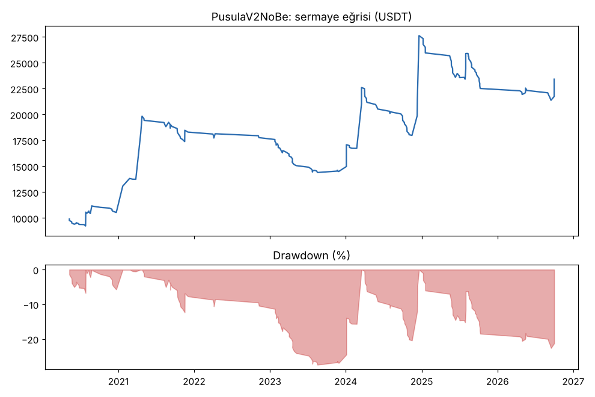
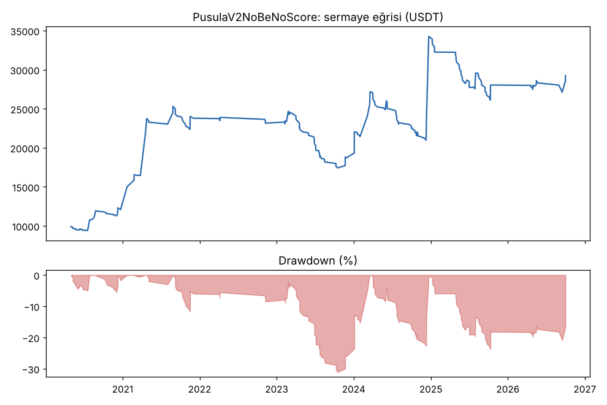
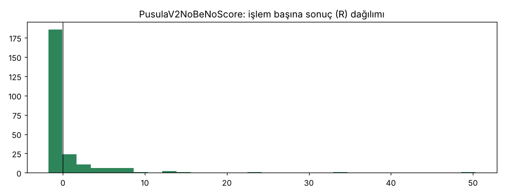

# PusulaV2NoBe vs PusulaV2NoBeNoScore — puansiz — 2026-10-29

## Özet
- **PusulaV2NoBe**: 193 işlem, işlem başına ortalama **0.61R** (maliyet ve funding dahil), net getiri 134.2%, en büyük düşüş 22.6%.
- **PusulaV2NoBeNoScore**: 246 işlem, işlem başına ortalama **0.57R** (maliyet ve funding dahil), net getiri 192.5%, en büyük düşüş 23.8%.
- Aynı dönemde coinleri al-tut (eşit ağırlık): getiri 194.7%, ortalama en büyük düşüş 97.6%.

## Ayarlar
- Dönem: 2020-04-11 00:00:00 → 2026-09-30 20:00:00
- Coinler: FIL/USDT:USDT, UNI/USDT:USDT, AAVE/USDT:USDT, NEAR/USDT:USDT, ALGO/USDT:USDT, XTZ/USDT:USDT, THETA/USDT:USDT, VET/USDT:USDT, ICP/USDT:USDT, SAND/USDT:USDT, MANA/USDT:USDT, AXS/USDT:USDT, EGLD/USDT:USDT, HBAR/USDT:USDT, CHZ/USDT:USDT, ENJ/USDT:USDT, ZEC/USDT:USDT, DASH/USDT:USDT, NEO/USDT:USDT, IOTA/USDT:USDT
- Zaman dilimi: 4h
- Yön: long + short
- Mod: futures / isolated
- Kaldıraç: en fazla 3x, likidasyon stop mesafesinin en az 2 katı uzakta (bölüm 7.6)
- Risk: işlem başına sermayenin %1'i (pozisyon büyüklüğü stop mesafesine göre)
- Maliyet: her emir için %0.05 komisyon + %0.05 kayma (= %0.1), funding geçmiş veriden
- Başlangıç sermayesi: 10000 USDT

## Metrikler
| Metrik | PusulaV2NoBe | PusulaV2NoBeNoScore | Al-tut |
|---|---|---|---|
| Net getiri | 134.2% | 192.5% | 194.7% |
| Max drawdown | 22.6% | 23.8% | 97.6% |
| Profit factor | 1.53 | 1.53 | — |
| Ortalama R | 0.61 | 0.57 | — |
| İşlem sayısı | 193 | 246 | — |
| Winrate | 23.3% | 24.0% | — |

Winrate tek başına başarı ölçütü değildir; asıl ölçüt ortalama R (expectancy) ve drawdown'dur.

## Long / short ayrımı
| Strateji | Yön | İşlem | Ortalama R | Toplam R | Profit factor |
|---|---|---|---|---|---|
| PusulaV2NoBe | long | 193 | 0.61 | 117.72 | 1.53 |
| PusulaV2NoBe | short | 0 | — | 0.00 | — |
| PusulaV2NoBeNoScore | long | 246 | 0.57 | 139.82 | 1.53 |
| PusulaV2NoBeNoScore | short | 0 | — | 0.00 | — |

## Sinyal istatistikleri
| Strateji | Stop | BE | TP1 sonrası BE | TP2 | Diğer | İptal (bölgeye gelmedi / önce stop) | Toplam funding (USDT) |
|---|---|---|---|---|---|---|---|
| PusulaV2NoBe | 53.9% | 0.5% | 0.0% | 0.0% | 45.6% | 6.3% | -3768.94 |
| PusulaV2NoBeNoScore | 47.6% | 0.4% | 0.0% | 0.0% | 52.0% | 6.5% | -5530.98 |

## Coin bazında
| Strateji | Coin | İşlem | Ortalama R | Toplam R | Al-tut getirisi |
|---|---|---|---|---|---|
| PusulaV2NoBe | FIL/USDT:USDT | 7 | 5.55 | 38.87 | -97.9% |
| PusulaV2NoBe | UNI/USDT:USDT | 20 | 1.06 | 21.22 | 62.4% |
| PusulaV2NoBe | AAVE/USDT:USDT | 17 | -0.75 | -12.83 | 286.5% |
| PusulaV2NoBe | NEAR/USDT:USDT | 9 | -0.19 | -1.72 | 373.4% |
| PusulaV2NoBe | ALGO/USDT:USDT | 12 | 2.92 | 35.04 | -47.9% |
| PusulaV2NoBe | XTZ/USDT:USDT | 16 | 0.25 | 4.04 | -84.3% |
| PusulaV2NoBe | THETA/USDT:USDT | 8 | 2.45 | 19.59 | -48.0% |
| PusulaV2NoBe | VET/USDT:USDT | 13 | 1.47 | 19.17 | 139.2% |
| PusulaV2NoBe | ICP/USDT:USDT | 4 | 0.36 | 1.43 | -99.3% |
| PusulaV2NoBe | SAND/USDT:USDT | 4 | -0.69 | -2.76 | -54.0% |
| PusulaV2NoBe | MANA/USDT:USDT | 7 | -0.55 | -3.84 | -91.4% |
| PusulaV2NoBe | AXS/USDT:USDT | 2 | -0.68 | -1.36 | 136.4% |
| PusulaV2NoBe | EGLD/USDT:USDT | 8 | -0.48 | -3.86 | -65.7% |
| PusulaV2NoBe | HBAR/USDT:USDT | 6 | -0.66 | -3.94 | -68.6% |
| PusulaV2NoBe | CHZ/USDT:USDT | 6 | -0.68 | -4.10 | -26.0% |
| PusulaV2NoBe | ENJ/USDT:USDT | 4 | 0.59 | 2.36 | -83.5% |
| PusulaV2NoBe | ZEC/USDT:USDT | 13 | -0.17 | -2.15 | 3815.4% |
| PusulaV2NoBe | DASH/USDT:USDT | 17 | 0.08 | 1.35 | -19.1% |
| PusulaV2NoBe | NEO/USDT:USDT | 12 | 0.66 | 7.88 | -65.8% |
| PusulaV2NoBe | IOTA/USDT:USDT | 8 | 0.41 | 3.31 | -66.9% |
| PusulaV2NoBeNoScore | FIL/USDT:USDT | 13 | 2.16 | 28.13 | -97.9% |
| PusulaV2NoBeNoScore | UNI/USDT:USDT | 20 | -0.13 | -2.52 | 62.4% |
| PusulaV2NoBeNoScore | AAVE/USDT:USDT | 16 | -0.65 | -10.43 | 286.5% |
| PusulaV2NoBeNoScore | NEAR/USDT:USDT | 12 | -0.16 | -1.95 | 373.4% |
| PusulaV2NoBeNoScore | ALGO/USDT:USDT | 13 | 0.55 | 7.16 | -47.9% |
| PusulaV2NoBeNoScore | XTZ/USDT:USDT | 21 | -0.52 | -10.92 | -84.3% |
| PusulaV2NoBeNoScore | THETA/USDT:USDT | 14 | 1.29 | 18.12 | -48.0% |
| PusulaV2NoBeNoScore | VET/USDT:USDT | 18 | 1.95 | 35.03 | 139.2% |
| PusulaV2NoBeNoScore | ICP/USDT:USDT | 7 | -0.11 | -0.80 | -99.3% |
| PusulaV2NoBeNoScore | SAND/USDT:USDT | 7 | -0.25 | -1.78 | -54.0% |
| PusulaV2NoBeNoScore | MANA/USDT:USDT | 9 | 0.29 | 2.65 | -91.4% |
| PusulaV2NoBeNoScore | AXS/USDT:USDT | 4 | -0.81 | -3.24 | 136.4% |
| PusulaV2NoBeNoScore | EGLD/USDT:USDT | 11 | 0.10 | 1.13 | -65.7% |
| PusulaV2NoBeNoScore | HBAR/USDT:USDT | 6 | 8.71 | 52.26 | -68.6% |
| PusulaV2NoBeNoScore | CHZ/USDT:USDT | 13 | -0.54 | -6.96 | -26.0% |
| PusulaV2NoBeNoScore | ENJ/USDT:USDT | 4 | -0.88 | -3.53 | -83.5% |
| PusulaV2NoBeNoScore | ZEC/USDT:USDT | 16 | 0.02 | 0.27 | 3815.4% |
| PusulaV2NoBeNoScore | DASH/USDT:USDT | 16 | 1.52 | 24.38 | -19.1% |
| PusulaV2NoBeNoScore | NEO/USDT:USDT | 9 | 1.28 | 11.51 | -65.8% |
| PusulaV2NoBeNoScore | IOTA/USDT:USDT | 17 | 0.08 | 1.32 | -66.9% |

## Grafikler

## Yorum: güçlü yanlar / şüpheli noktalar
_(Claude tarafından rakamlara bakılarak yazılır.)_

## Karar: devam / düzelt / emekli
_(Claude tarafından yazılır, gerekçesiyle.)_
