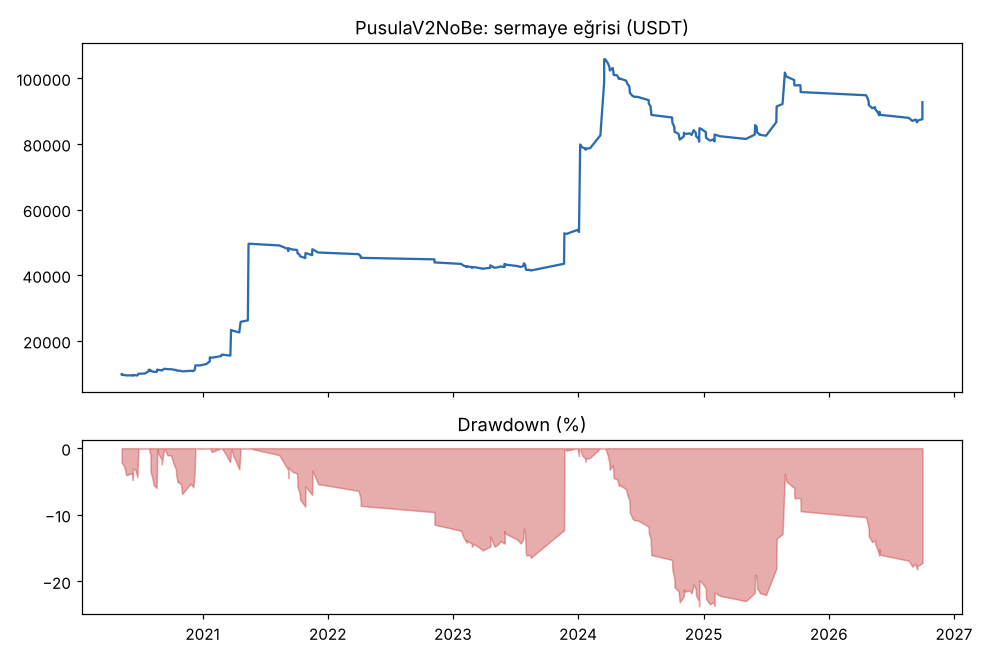
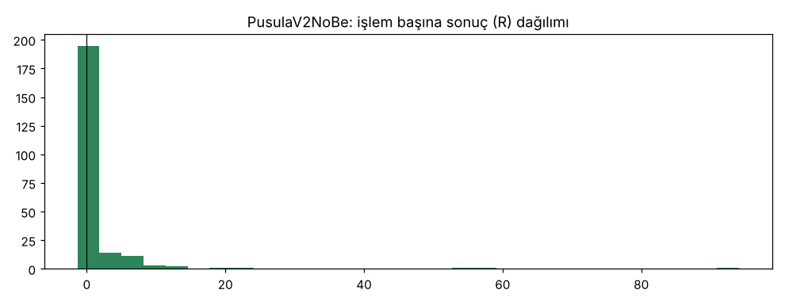
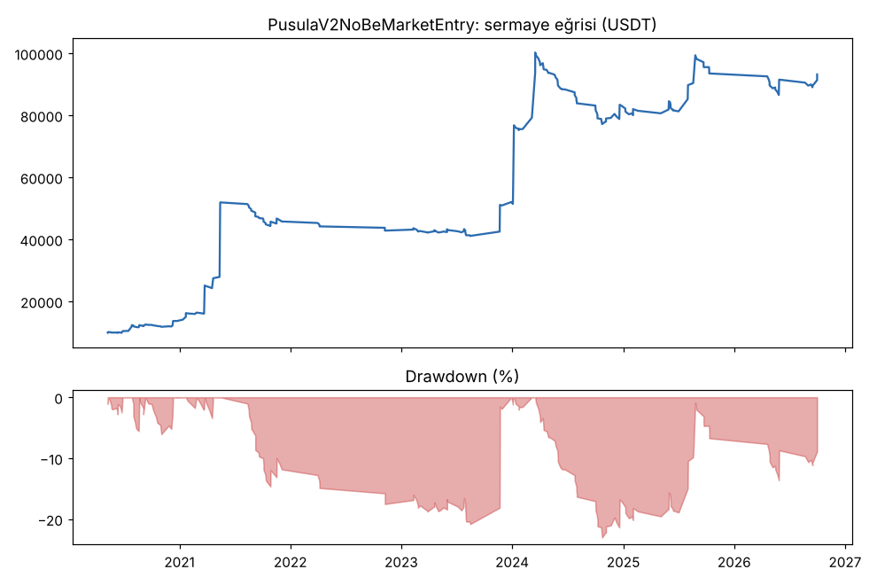
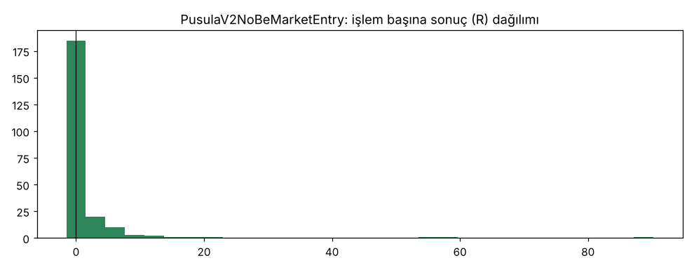

# PusulaV2NoBe vs PusulaV2NoBeMarketEntry — acilista_giris — 2026-11-01

## Özet
- **PusulaV2NoBe**: 230 işlem, işlem başına ortalama **1.35R** (maliyet ve funding dahil), net getiri 827.3%, en büyük düşüş 23.7%.
- **PusulaV2NoBeMarketEntry**: 226 işlem, işlem başına ortalama **1.36R** (maliyet ve funding dahil), net getiri 831.7%, en büyük düşüş 23.0%.
- Aynı dönemde coinleri al-tut (eşit ağırlık): getiri 931.5%, ortalama en büyük düşüş 89.2%.

## Ayarlar
- Dönem: 2020-03-07 16:00:00 → 2026-10-01 00:00:00
- Coinler: BTC/USDT:USDT, ETH/USDT:USDT, SOL/USDT:USDT, XRP/USDT:USDT, BNB/USDT:USDT, DOGE/USDT:USDT, ADA/USDT:USDT, LINK/USDT:USDT, LTC/USDT:USDT, DOT/USDT:USDT, AVAX/USDT:USDT, TRX/USDT:USDT, ATOM/USDT:USDT, BCH/USDT:USDT, ETC/USDT:USDT, XLM/USDT:USDT
- Zaman dilimi: 4h
- Yön: long + short
- Mod: futures / isolated
- Kaldıraç: en fazla 3x, likidasyon stop mesafesinin en az 2 katı uzakta (bölüm 7.6)
- Risk: işlem başına sermayenin %1'i (pozisyon büyüklüğü stop mesafesine göre)
- Maliyet: her emir için %0.05 komisyon + %0.05 kayma (= %0.1), funding geçmiş veriden
- Başlangıç sermayesi: 10000 USDT

## Metrikler
| Metrik | PusulaV2NoBe | PusulaV2NoBeMarketEntry | Al-tut |
|---|---|---|---|
| Net getiri | 827.3% | 831.7% | 931.5% |
| Max drawdown | 23.7% | 23.0% | 89.2% |
| Profit factor | 2.06 | 2.12 | — |
| Ortalama R | 1.35 | 1.36 | — |
| İşlem sayısı | 230 | 226 | — |
| Winrate | 32.2% | 33.2% | — |

Winrate tek başına başarı ölçütü değildir; asıl ölçüt ortalama R (expectancy) ve drawdown'dur.

## Long / short ayrımı
| Strateji | Yön | İşlem | Ortalama R | Toplam R | Profit factor |
|---|---|---|---|---|---|
| PusulaV2NoBe | long | 230 | 1.35 | 311.26 | 2.06 |
| PusulaV2NoBe | short | 0 | — | 0.00 | — |
| PusulaV2NoBeMarketEntry | long | 226 | 1.36 | 307.21 | 2.12 |
| PusulaV2NoBeMarketEntry | short | 0 | — | 0.00 | — |

## Sinyal istatistikleri
| Strateji | Stop | BE | TP1 sonrası BE | TP2 | Diğer | İptal (bölgeye gelmedi / önce stop) | Toplam funding (USDT) |
|---|---|---|---|---|---|---|---|
| PusulaV2NoBe | 41.7% | 0.0% | 0.0% | 0.0% | 58.3% | 5.7% | -14077.15 |
| PusulaV2NoBeMarketEntry | 41.6% | 0.0% | 0.0% | 0.0% | 58.4% | 0.0% | -13739.26 |

## Coin bazında
| Strateji | Coin | İşlem | Ortalama R | Toplam R | Al-tut getirisi |
|---|---|---|---|---|---|
| PusulaV2NoBe | BTC/USDT:USDT | 42 | 1.39 | 58.58 | 841.1% |
| PusulaV2NoBe | ETH/USDT:USDT | 32 | 0.58 | 18.52 | 1027.8% |
| PusulaV2NoBe | SOL/USDT:USDT | 12 | 4.96 | 59.49 | 3424.0% |
| PusulaV2NoBe | XRP/USDT:USDT | 11 | 1.00 | 10.98 | 531.4% |
| PusulaV2NoBe | BNB/USDT:USDT | 37 | 1.02 | 37.62 | 3739.0% |
| PusulaV2NoBe | DOGE/USDT:USDT | 2 | -1.05 | -2.10 | 2460.3% |
| PusulaV2NoBe | ADA/USDT:USDT | 7 | 1.04 | 7.29 | 409.9% |
| PusulaV2NoBe | LINK/USDT:USDT | 9 | 0.14 | 1.28 | 224.4% |
| PusulaV2NoBe | LTC/USDT:USDT | 13 | -0.19 | -2.53 | 11.3% |
| PusulaV2NoBe | DOT/USDT:USDT | 2 | -1.07 | -2.15 | -63.4% |
| PusulaV2NoBe | AVAX/USDT:USDT | 4 | 0.42 | 1.67 | 171.8% |
| PusulaV2NoBe | TRX/USDT:USDT | 33 | 0.86 | 28.32 | 1881.6% |
| PusulaV2NoBe | ATOM/USDT:USDT | 5 | -0.02 | -0.11 | -51.5% |
| PusulaV2NoBe | BCH/USDT:USDT | 11 | -0.00 | -0.04 | -7.2% |
| PusulaV2NoBe | ETC/USDT:USDT | 5 | 19.42 | 97.11 | 14.6% |
| PusulaV2NoBe | XLM/USDT:USDT | 5 | -0.53 | -2.66 | 289.8% |
| PusulaV2NoBeMarketEntry | BTC/USDT:USDT | 42 | 1.41 | 59.20 | 841.1% |
| PusulaV2NoBeMarketEntry | ETH/USDT:USDT | 36 | 0.37 | 13.39 | 1027.8% |
| PusulaV2NoBeMarketEntry | SOL/USDT:USDT | 12 | 4.73 | 56.76 | 3424.0% |
| PusulaV2NoBeMarketEntry | XRP/USDT:USDT | 9 | 1.15 | 10.33 | 531.4% |
| PusulaV2NoBeMarketEntry | BNB/USDT:USDT | 39 | 1.00 | 38.83 | 3739.0% |
| PusulaV2NoBeMarketEntry | DOGE/USDT:USDT | 2 | -1.05 | -2.10 | 2460.3% |
| PusulaV2NoBeMarketEntry | ADA/USDT:USDT | 5 | 1.78 | 8.92 | 409.9% |
| PusulaV2NoBeMarketEntry | LINK/USDT:USDT | 8 | 1.14 | 9.14 | 224.4% |
| PusulaV2NoBeMarketEntry | LTC/USDT:USDT | 11 | -0.09 | -0.96 | 11.3% |
| PusulaV2NoBeMarketEntry | DOT/USDT:USDT | 2 | -1.07 | -2.14 | -63.4% |
| PusulaV2NoBeMarketEntry | AVAX/USDT:USDT | 2 | -0.83 | -1.66 | 171.8% |
| PusulaV2NoBeMarketEntry | TRX/USDT:USDT | 34 | 0.84 | 28.45 | 1881.6% |
| PusulaV2NoBeMarketEntry | ATOM/USDT:USDT | 5 | -0.07 | -0.36 | -51.5% |
| PusulaV2NoBeMarketEntry | BCH/USDT:USDT | 9 | 0.09 | 0.77 | -7.2% |
| PusulaV2NoBeMarketEntry | ETC/USDT:USDT | 4 | 22.44 | 89.77 | 14.6% |
| PusulaV2NoBeMarketEntry | XLM/USDT:USDT | 6 | -0.19 | -1.12 | 289.8% |

## Grafikler

## Yorum: güçlü yanlar / şüpheli noktalar
_(Claude tarafından rakamlara bakılarak yazılır.)_

## Karar: devam / düzelt / emekli
_(Claude tarafından yazılır, gerekçesiyle.)_
