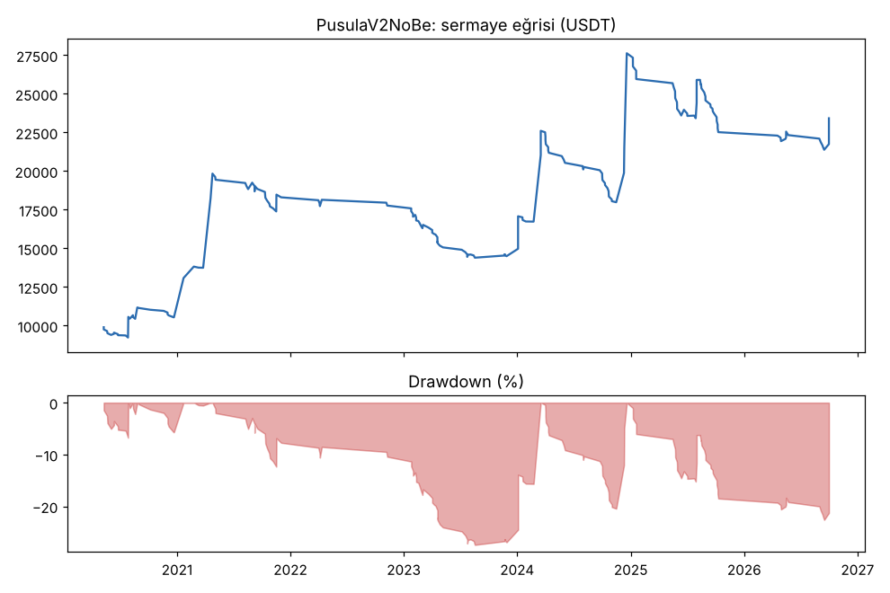
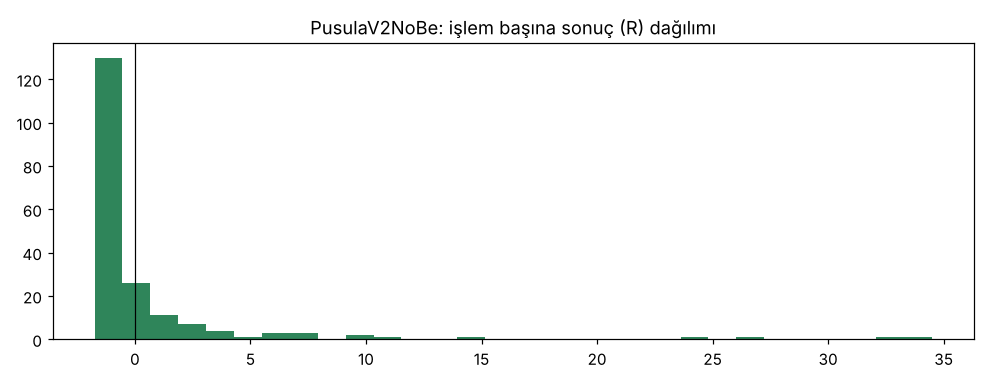
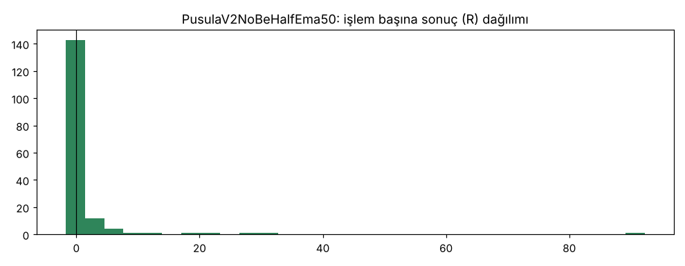
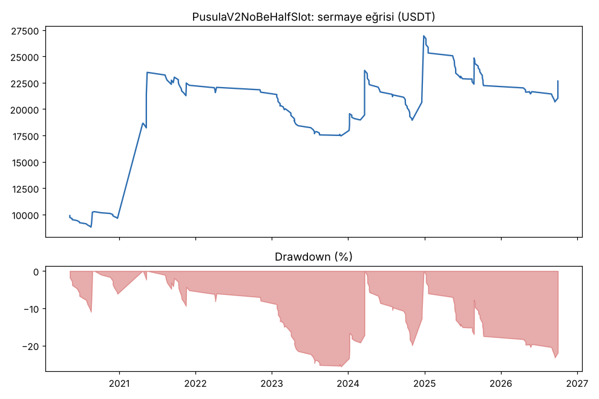
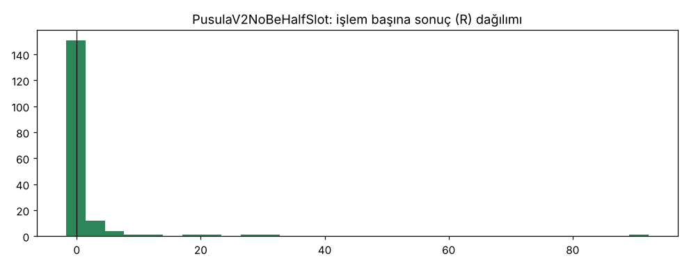

# PusulaV2NoBe vs PusulaV2NoBeHalfEma50 vs PusulaV2NoBeHalfSlot — yarim_yer — 2026-11-03

## Özet
- **PusulaV2NoBe**: 193 işlem, işlem başına ortalama **0.61R** (maliyet ve funding dahil), net getiri 134.2%, en büyük düşüş 22.6%.
- **PusulaV2NoBeHalfEma50**: 166 işlem, işlem başına ortalama **0.91R** (maliyet ve funding dahil), net getiri 139.9%, en büyük düşüş 22.5%.
- **PusulaV2NoBeHalfSlot**: 174 işlem, işlem başına ortalama **0.83R** (maliyet ve funding dahil), net getiri 126.6%, en büyük düşüş 23.2%.
- Aynı dönemde coinleri al-tut (eşit ağırlık): getiri 194.7%, ortalama en büyük düşüş 97.6%.

## Ayarlar
- Dönem: 2020-04-11 00:00:00 → 2026-09-30 20:00:00
- Coinler: FIL/USDT:USDT, UNI/USDT:USDT, AAVE/USDT:USDT, NEAR/USDT:USDT, ALGO/USDT:USDT, XTZ/USDT:USDT, THETA/USDT:USDT, VET/USDT:USDT, ICP/USDT:USDT, SAND/USDT:USDT, MANA/USDT:USDT, AXS/USDT:USDT, EGLD/USDT:USDT, HBAR/USDT:USDT, CHZ/USDT:USDT, ENJ/USDT:USDT, ZEC/USDT:USDT, DASH/USDT:USDT, NEO/USDT:USDT, IOTA/USDT:USDT
- Zaman dilimi: 4h
- Yön: long + short
- Mod: futures / isolated
- Kaldıraç: en fazla 3x, likidasyon stop mesafesinin en az 2 katı uzakta (bölüm 7.6)
- Risk: işlem başına sermayenin %1'i (pozisyon büyüklüğü stop mesafesine göre)
- Maliyet: her emir için %0.05 komisyon + %0.05 kayma (= %0.1), funding geçmiş veriden
- Başlangıç sermayesi: 10000 USDT

## Metrikler
| Metrik | PusulaV2NoBe | PusulaV2NoBeHalfEma50 | PusulaV2NoBeHalfSlot | Al-tut |
|---|---|---|---|---|
| Net getiri | 134.2% | 139.9% | 126.6% | 194.7% |
| Max drawdown | 22.6% | 22.5% | 23.2% | 97.6% |
| Profit factor | 1.53 | 1.53 | 1.49 | — |
| Ortalama R | 0.61 | 0.91 | 0.83 | — |
| İşlem sayısı | 193 | 166 | 174 | — |
| Winrate | 23.3% | 21.1% | 21.3% | — |

Winrate tek başına başarı ölçütü değildir; asıl ölçüt ortalama R (expectancy) ve drawdown'dur.

## Long / short ayrımı
| Strateji | Yön | İşlem | Ortalama R | Toplam R | Profit factor |
|---|---|---|---|---|---|
| PusulaV2NoBe | long | 193 | 0.61 | 117.72 | 1.53 |
| PusulaV2NoBe | short | 0 | — | 0.00 | — |
| PusulaV2NoBeHalfEma50 | long | 166 | 0.91 | 151.18 | 1.53 |
| PusulaV2NoBeHalfEma50 | short | 0 | — | 0.00 | — |
| PusulaV2NoBeHalfSlot | long | 174 | 0.83 | 145.12 | 1.49 |
| PusulaV2NoBeHalfSlot | short | 0 | — | 0.00 | — |

## Sinyal istatistikleri
| Strateji | Stop | BE | TP1 sonrası BE | TP2 | Diğer | İptal (bölgeye gelmedi / önce stop) | Toplam funding (USDT) |
|---|---|---|---|---|---|---|---|
| PusulaV2NoBe | 53.9% | 0.5% | 0.0% | 0.0% | 45.6% | 6.3% | -3768.94 |
| PusulaV2NoBeHalfEma50 | 66.9% | 0.6% | 0.0% | 0.0% | 32.5% | 6.2% | -5928.38 |
| PusulaV2NoBeHalfSlot | 67.2% | 0.6% | 0.0% | 0.0% | 32.2% | 5.9% | -5966.64 |

## Coin bazında
| Strateji | Coin | İşlem | Ortalama R | Toplam R | Al-tut getirisi |
|---|---|---|---|---|---|
| PusulaV2NoBe | FIL/USDT:USDT | 7 | 5.55 | 38.87 | -97.9% |
| PusulaV2NoBe | UNI/USDT:USDT | 20 | 1.06 | 21.22 | 62.4% |
| PusulaV2NoBe | AAVE/USDT:USDT | 17 | -0.75 | -12.83 | 286.5% |
| PusulaV2NoBe | NEAR/USDT:USDT | 9 | -0.19 | -1.72 | 373.4% |
| PusulaV2NoBe | ALGO/USDT:USDT | 12 | 2.92 | 35.04 | -47.9% |
| PusulaV2NoBe | XTZ/USDT:USDT | 16 | 0.25 | 4.04 | -84.3% |
| PusulaV2NoBe | THETA/USDT:USDT | 8 | 2.45 | 19.59 | -48.0% |
| PusulaV2NoBe | VET/USDT:USDT | 13 | 1.47 | 19.17 | 139.2% |
| PusulaV2NoBe | ICP/USDT:USDT | 4 | 0.36 | 1.43 | -99.3% |
| PusulaV2NoBe | SAND/USDT:USDT | 4 | -0.69 | -2.76 | -54.0% |
| PusulaV2NoBe | MANA/USDT:USDT | 7 | -0.55 | -3.84 | -91.4% |
| PusulaV2NoBe | AXS/USDT:USDT | 2 | -0.68 | -1.36 | 136.4% |
| PusulaV2NoBe | EGLD/USDT:USDT | 8 | -0.48 | -3.86 | -65.7% |
| PusulaV2NoBe | HBAR/USDT:USDT | 6 | -0.66 | -3.94 | -68.6% |
| PusulaV2NoBe | CHZ/USDT:USDT | 6 | -0.68 | -4.10 | -26.0% |
| PusulaV2NoBe | ENJ/USDT:USDT | 4 | 0.59 | 2.36 | -83.5% |
| PusulaV2NoBe | ZEC/USDT:USDT | 13 | -0.17 | -2.15 | 3815.4% |
| PusulaV2NoBe | DASH/USDT:USDT | 17 | 0.08 | 1.35 | -19.1% |
| PusulaV2NoBe | NEO/USDT:USDT | 12 | 0.66 | 7.88 | -65.8% |
| PusulaV2NoBe | IOTA/USDT:USDT | 8 | 0.41 | 3.31 | -66.9% |
| PusulaV2NoBeHalfEma50 | FIL/USDT:USDT | 7 | 4.74 | 33.17 | -97.9% |
| PusulaV2NoBeHalfEma50 | UNI/USDT:USDT | 19 | 0.89 | 16.95 | 62.4% |
| PusulaV2NoBeHalfEma50 | AAVE/USDT:USDT | 13 | -0.76 | -9.93 | 286.5% |
| PusulaV2NoBeHalfEma50 | NEAR/USDT:USDT | 9 | -0.27 | -2.40 | 373.4% |
| PusulaV2NoBeHalfEma50 | ALGO/USDT:USDT | 10 | 2.49 | 24.86 | -47.9% |
| PusulaV2NoBeHalfEma50 | XTZ/USDT:USDT | 13 | 0.24 | 3.08 | -84.3% |
| PusulaV2NoBeHalfEma50 | THETA/USDT:USDT | 8 | 10.90 | 87.21 | -48.0% |
| PusulaV2NoBeHalfEma50 | VET/USDT:USDT | 13 | 1.12 | 14.51 | 139.2% |
| PusulaV2NoBeHalfEma50 | ICP/USDT:USDT | 3 | 0.27 | 0.80 | -99.3% |
| PusulaV2NoBeHalfEma50 | SAND/USDT:USDT | 3 | -0.76 | -2.27 | -54.0% |
| PusulaV2NoBeHalfEma50 | MANA/USDT:USDT | 6 | -0.56 | -3.34 | -91.4% |
| PusulaV2NoBeHalfEma50 | AXS/USDT:USDT | 2 | 0.43 | 0.87 | 136.4% |
| PusulaV2NoBeHalfEma50 | EGLD/USDT:USDT | 7 | -0.47 | -3.32 | -65.7% |
| PusulaV2NoBeHalfEma50 | HBAR/USDT:USDT | 6 | -0.35 | -2.10 | -68.6% |
| PusulaV2NoBeHalfEma50 | CHZ/USDT:USDT | 6 | -0.68 | -4.10 | -26.0% |
| PusulaV2NoBeHalfEma50 | ENJ/USDT:USDT | 3 | -1.11 | -3.33 | -83.5% |
| PusulaV2NoBeHalfEma50 | ZEC/USDT:USDT | 10 | -0.04 | -0.38 | 3815.4% |
| PusulaV2NoBeHalfEma50 | DASH/USDT:USDT | 12 | -0.49 | -5.92 | -19.1% |
| PusulaV2NoBeHalfEma50 | NEO/USDT:USDT | 11 | 0.94 | 10.38 | -65.8% |
| PusulaV2NoBeHalfEma50 | IOTA/USDT:USDT | 5 | -0.71 | -3.55 | -66.9% |
| PusulaV2NoBeHalfSlot | FIL/USDT:USDT | 7 | 4.74 | 33.17 | -97.9% |
| PusulaV2NoBeHalfSlot | UNI/USDT:USDT | 19 | 0.89 | 16.95 | 62.4% |
| PusulaV2NoBeHalfSlot | AAVE/USDT:USDT | 14 | -0.78 | -10.97 | 286.5% |
| PusulaV2NoBeHalfSlot | NEAR/USDT:USDT | 9 | -0.27 | -2.40 | 373.4% |
| PusulaV2NoBeHalfSlot | ALGO/USDT:USDT | 10 | 2.49 | 24.86 | -47.9% |
| PusulaV2NoBeHalfSlot | XTZ/USDT:USDT | 14 | 0.13 | 1.88 | -84.3% |
| PusulaV2NoBeHalfSlot | THETA/USDT:USDT | 8 | 10.90 | 87.21 | -48.0% |
| PusulaV2NoBeHalfSlot | VET/USDT:USDT | 13 | 1.12 | 14.51 | 139.2% |
| PusulaV2NoBeHalfSlot | ICP/USDT:USDT | 4 | 0.20 | 0.81 | -99.3% |
| PusulaV2NoBeHalfSlot | SAND/USDT:USDT | 3 | -0.76 | -2.27 | -54.0% |
| PusulaV2NoBeHalfSlot | MANA/USDT:USDT | 6 | -0.56 | -3.34 | -91.4% |
| PusulaV2NoBeHalfSlot | AXS/USDT:USDT | 2 | 0.43 | 0.87 | 136.4% |
| PusulaV2NoBeHalfSlot | EGLD/USDT:USDT | 8 | -0.55 | -4.37 | -65.7% |
| PusulaV2NoBeHalfSlot | HBAR/USDT:USDT | 6 | -0.35 | -2.10 | -68.6% |
| PusulaV2NoBeHalfSlot | CHZ/USDT:USDT | 6 | -0.68 | -4.10 | -26.0% |
| PusulaV2NoBeHalfSlot | ENJ/USDT:USDT | 3 | -1.11 | -3.33 | -83.5% |
| PusulaV2NoBeHalfSlot | ZEC/USDT:USDT | 10 | -0.04 | -0.38 | 3815.4% |
| PusulaV2NoBeHalfSlot | DASH/USDT:USDT | 15 | -0.62 | -9.24 | -19.1% |
| PusulaV2NoBeHalfSlot | NEO/USDT:USDT | 11 | 0.94 | 10.38 | -65.8% |
| PusulaV2NoBeHalfSlot | IOTA/USDT:USDT | 6 | -0.50 | -3.01 | -66.9% |

## Grafikler

## Yorum: güçlü yanlar / şüpheli noktalar
_(Claude tarafından rakamlara bakılarak yazılır.)_

## Karar: devam / düzelt / emekli
_(Claude tarafından yazılır, gerekçesiyle.)_
