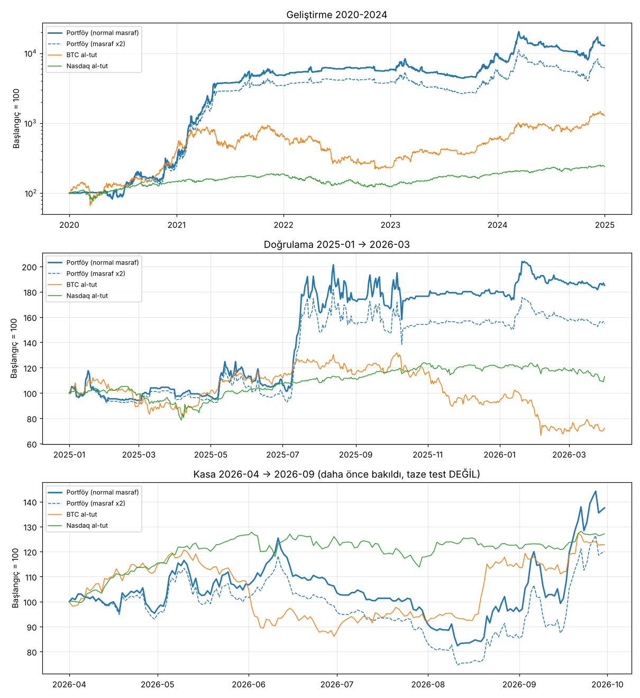
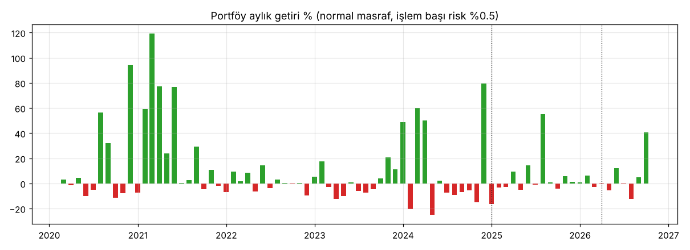
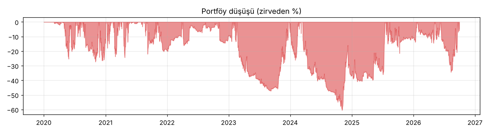

# Portföy testi — geçen 5 strateji tek kasada (2026-11-05)

## GUO'ya not
- Beş stratejiyi (Fitil, Derin Fitil, Dalga, Pusula, Aslan Nasdaq) **kurallarına hiç dokunmadan** tek bir kasada birlikte çalıştırdık.
- **İyi haber:** üç dönemin üçünde de kâr var, masraf iki katına çıkınca da artı kalıyor. Stratejiler birbirine neredeyse hiç benzemiyor (aynı gün beraber kaybetmiyorlar), bu portföy için iyi.
- **Kötü haber:** düşüşler büyük. İşlem başı %0.5 riskle 2024'te kasa zirveden **%60** düştü, 2026 yazında **%34** düştü. Bu, "her işlemde sabit risk" kuralının beş stratejiyi üst üste koyunca riskin de toplanmasından geliyor. Risk yarıya (%0.25) inince düşüş %40 / %12 / %19'a iniyor, kâr da yarıya.
- **Dikkat:** 2026 yazındaki düşüşün sebebi Fitil'in yeni çıkan memecoinlerde (BEAT, COAI, MMT) para kaybetmesi. Demo bot bu coinlerde işlem yapmıyor (Bitget demoda 15 büyük coin var), ama "gerçekçi coin listesi" testinde bu kayıp var ve gizlenmez.
- Sunum için doğru cümle: "Beş bağımsız kaynak, üç dönemde de artı, ama düşüşler büyük; risk ayarı yatırımcının dayanabileceği düşüşe göre seçilmeli." Rakamlar aşağıda.

## Ne yaptık
- **Kurallar donuk:** her stratejinin işlem listesi kendi araştırma kodundan geldi, hiçbir eşik değişmedi.
  - Fitil (PIT evren): `research/scans/wick_catcher_pit.py up`, masraf %0.20 + funding.
  - Derin Fitil (stop %4 + aynı coine 24 saatte 1 giriş): `wick_catcher_pit.py down` (`SL=4 COOLDOWN=24`).
  - Dalga (PIT): Freqtrade `DalgaPIT`, 1h, `config/pairs_top36_yearly_union.json`, 8 yuva.
  - PusulaV2: Freqtrade `PusulaV2`, 4h, `config/pairs_wide16.json`, 3 yuva (demodaki ayarlar).
  - Aslan NAS: `research/aslan_nasdaq/sim.py` ile v2 1h + günlük yön (bias), NAS100 HistData verisi, GitHub sunucusunda üretildi (`research/portfolio/aslan_nas_trades.py`).
- **Tek kasa, sabit risk:** her işlem kasanın **%0.5**'ini riske eder: pozisyon = kasa × %0.5 / stop mesafesi.
  - Fitil'in stopu yok. Risk birimi olarak Derin Fitil'in %4 stopu kullanıldı, yani her Fitil işlemi kasanın %12.5'i büyüklüğünde. (Canlı botta işlem başı kasa/5 = %20.)
  - Yuva sınırları canlı kurallardaki gibi: Fitil + Derin Fitil **ortak 5** (`scripts/bitget_fitil.py`), Dalga 8, Pusula 3, Aslan 1.
- **Korelasyon hesabın içinde:** beş stratejinin işlemleri aynı anda aynı kasada açık. Aynı gün gelen kayıplar toplanıyor. Dalga ve Pusula (çok günlük işlemler) her gün kapanış fiyatıyla değerleniyor; Fitil (3 saat) ve Aslan (gün içi) kapanışta yazılıyor.
- Masraf x2: her işlemin gidiş-dönüş masrafı bir kez daha düşüldü (kripto %0.20 → %0.40, Nasdaq %0.01 → %0.02).
- Sharpe: günlük getiriden, yıllık (√365). Al-tut Sharpe'ı aynı yöntemle.
- Kod: `research/portfolio/` (`build_trades.py`, `portfolio.py`, `report.py`). Ham çıktılar bu klasörde (`summary.json`, `equity_*.csv`, `monthly_*.csv`, `correlation_*.csv`, `trades_taken_*.csv`).

## Kasa dönemi (2026-04 → 2026-09) taze test DEĞİL
| Strateji | Kasa durumu |
|---|---|
| Fitil, Derin Fitil | Kasa Ekim 2026.da eski listelerle (36 coin + 45 yeni coin) bir kez kullanıldı. PIT listesiyle kasa rakamı ilk kez burada görüldü, ama dönem daha önce görüldü. |
| PusulaV2 | Kasa 2026-10-10'da kullanıldı (16 coin, sonuç düz). |
| Aslan NAS | Kasa 2026-11-05'te kullanıldı (PR #54/#55). |
| Dalga | Kasa daha önce resmi olarak kullanılmamıştı. **Bu testle harcandı.** |

Yani kasa satırı "kurallar donukken bu 6 ay ne olurdu" bilgisidir; bağımsız bir sınav değildir.

## Ana sonuçlar (işlem başı risk %0.5)
| Dönem | Getiri | Yıllık | En büyük düşüş | Sharpe | En kötü ay | Artı ay | İşlem (gün) | En yüksek toplam pozisyon |
|---|---|---|---|---|---|---|---|---|
| Geliştirme 2020-24 | +%12.709 | +%164 | **-%60.4** | 1.93 | -%25.2 (2024-04) | 32/60 | 3778 (2.1) | 6.0x |
| Doğrulama 2025-01 → 2026-03 | +%85.3 | +%64 | -%21.5 | 1.28 | -%5.1 (2025-04) | 8/15 | 744 (1.6) | 4.8x |
| Kasa 2026-04 → 09 (görülmüş) | +%36.0 | +%85 | **-%34.4** | 1.40 | -%12.4 (2026-07) | 3/6 | 607 (3.3) | 3.2x |

### Masraf x2
| Dönem | Getiri | Yıllık | Düşüş | Sharpe | En kötü ay |
|---|---|---|---|---|---|
| Geliştirme | +%6.080 | +%128 | -%64.3 | 1.68 | -%26.3 |
| Doğrulama | +%55.3 | +%42 | -%23.9 | 0.98 | -%5.6 |
| Kasa | +%18.7 | +%41 | -%36.9 | 0.89 | -%13.3 |

### Al-tut kıyası
| Dönem | BTC getiri / düşüş / Sharpe | Nasdaq getiri / düşüş / Sharpe |
|---|---|---|
| Geliştirme | +%1.200 / -%76.7 / 1.12 | +%140 / -%35.7 / 0.82 |
| Doğrulama | -%27.8 / -%49.6 / -0.35 | +%12.9 / -%25.5 / 0.52 |
| Kasa | +%22.8 / -%28.7 / 1.27 | +%27.1 / -%10.9 / 2.36 |

Kasa döneminde portföy Nasdaq al-tutun gerisinde (Sharpe 1.40'a karşı 2.36, düşüş -%34'e karşı -%11).

### Risk seviyesine göre (aynı işlemler, normal masraf)
| Risk / işlem | Geliştirme yıllık / düşüş | Doğrulama getiri / düşüş | Kasa getiri / düşüş | En yüksek toplam pozisyon |
|---|---|---|---|---|
| %0.25 | +%82 / -%39.6 | +%41.8 / -%12.0 | +%20.2 / -%18.8 | 3.0x |
| **%0.5 (ana)** | +%164 / -%60.4 | +%85.3 / -%21.5 | +%36.0 / -%34.4 | 6.0x |
| %1 | +%315 / -%82.1 | +%170 / -%36.2 | +%54.2 / -%57.7 | 12.0x |

Geliştirme dönemindeki dev rakamlar (binlerce %) 2020-21 boğasında bileşik büyümeden geliyor; yıllık getiri ve düşüş daha anlamlı. Gerçek hayatta bu büyüklükte pozisyonlar (özellikle küçük coinlerde) aynı fiyattan dolmaz.

## Long / short katkısı (kasa yüzdesi, işlem anındaki kasaya göre toplanmış)
Sadece Aslan short açıyor; diğer dört strateji sadece long.
| Dönem | Long: işlem / ort. R / katkı | Short: işlem / ort. R / katkı |
|---|---|---|
| Geliştirme | 3630 / +0.45R / +%825 | 146 / -0.13R / -%9.6 |
| Doğrulama | 690 / +0.21R / +%73.2 | 56 / +0.25R / +%7.0 |
| Kasa | 587 / +0.13R / +%36.6 | 19 / +0.24R / +%2.3 |

## Strateji katkısı (normal masraf, işlem / ort. R / kazanan % / kasa katkısı)
| Strateji | Geliştirme | Doğrulama | Kasa (görülmüş) |
|---|---|---|---|
| Fitil | 2204 / +0.25R / %61 / +%279 | 337 / +0.11R / %58 / +%18.7 | 397 / **-0.03R** / %54 / **-%5.8** |
| Derin Fitil | 188 / +0.27R / %57 / +%25.8 | 123 / +0.26R / %53 / +%15.8 | 64 / +0.32R / %55 / +%10.2 |
| Dalga | 853 / +0.91R / %19 / +%388 | 146 / +0.40R / %21 / +%28.9 | 84 / +0.74R / %21 / +%31.0 |
| PusulaV2 | 163 / +1.35R / %29 / +%110 | 33 / +0.53R / %27 / +%8.8 | 15 / -0.02R / %40 / -%0.2 |
| Aslan NAS long | 222 / +0.20R / %41 / +%21.8 | 51 / +0.04R / %35 / +%1.0 | 27 / +0.10R / %37 / +%1.3 |
| Aslan NAS short | 146 / -0.13R / %30 / -%9.6 | 56 / +0.25R / %43 / +%7.0 | 19 / +0.24R / %42 / +%2.3 |

Masraf x2'de kasa döneminde Fitil -0.08R (katkı -%15.7), diğerleri artı kalıyor.

## Korelasyon (günlük sonuçlar, ana çalışma)
| Çift | Geliştirme | Doğrulama | Kasa |
|---|---|---|---|
| Dalga – Pusula | 0.54 | 0.54 | 0.69 |
| Diğer tüm strateji çiftleri | -0.02 … +0.04 | -0.05 … +0.04 | -0.05 … +0.06 |
| Stratejiler – BTC | -0.01 … +0.08 | -0.08 … +0.06 | 0.00 … +0.10 |
| Stratejiler – Nasdaq | 0.00 … +0.01 | -0.10 … +0.03 | -0.09 … +0.07 |
| BTC – Nasdaq | 0.41 | 0.53 | 0.39 |

Tam tablolar: `correlation_dev.csv`, `correlation_val.csv`, `correlation_holdout.csv`. Dalga ile Pusula aynı aileden (günlük trendde kırılım, trend bozulunca çık) ve birlikte hareket ediyor; diğerleri neredeyse bağımsız. En az iki stratejinin aynı gün zararda olduğu gün sayısı: geliştirme 178, doğrulama 38, kasa 29.

## Çeşitlendirme: tek başına / portföyden çıkarınca (risk %0.5, getiri / düşüş / Sharpe)
| | Geliştirme | Doğrulama | Kasa |
|---|---|---|---|
| Sadece Fitil | +%1.415 / -%6.9 / 3.50 | +%21.8 / -%6.4 / 1.31 | **-%6.4 / -%35.7** / -0.35 |
| Sadece Derin Fitil | +%32 / -%5.8 / 0.93 | +%18.4 / -%7.5 / 1.10 | +%10.5 / -%3.7 / 2.21 |
| Sadece Dalga | +%794 / **-%56.1** / 1.11 | +%22.3 / -%25.5 / 0.61 | +%32.1 / -%14.0 / 1.55 |
| Sadece PusulaV2 | +%157 / -%19.0 / 1.08 | +%8.7 / -%5.0 / 0.81 | -%0.2 / -%3.9 / -0.03 |
| Sadece Aslan NAS | +%11.8 / -%16.3 / 0.39 | +%8.1 / -%4.1 / 0.95 | +%3.5 / -%3.6 / 0.99 |
| Dalga hariç | +%4.120 / -%25.1 / 3.08 | +%61.1 / -%11.9 / 1.93 | +%6.0 / -%34.4 / 0.53 |
| Fitil hariç | +%1.844 / -%64.6 / 1.31 | +%63.2 / -%23.9 / 1.08 | +%49.2 / -%17.6 / 1.93 |
| Hepsi (ana) | +%12.709 / -%60.4 / 1.93 | +%85.3 / -%21.5 / 1.28 | +%36.0 / -%34.4 / 1.40 |

Okuma: geliştirmedeki büyük düşüşün kaynağı **Dalga** (sabit %0.5 riskle tek başına -%56; 2021-09 → 2023-10 ayı piyasası ve 2024-04 → 2024-10). Kasa dönemindeki düşüşün kaynağı **Fitil** (2026 Haziran-Ağustos, 158 işlem, kasanın -%34'ü). Bu tablo bir teşhistir; hiçbir strateji bu tabloya bakarak çıkarılmadı ya da değiştirilmedi.

### Dalga kendi risk kuralıyla (bilgi)
Dalga'nın donuk kuralı sabit risk değil: puan +3'te %0.75, +1'de %0.35, kasa %10 düşükse yarıya, %20 düşükse dörtte bire iner. Bu kural ortak kasanın düşüşüne bağlanınca:
geliştirme +%13.456 / düşüş -%50.6, doğrulama +%81.8 / -%26.1, kasa +%12.5 / -%34.4 (masraf x2: +%6.963 / +%48.2 / +%2.3). Fitil'in yaz kaybı ortak kasayı düşürdüğü için Dalga'nın Eylül 2026 kazancı küçük pozisyonla geldi.

## Aylık getiri % (ana çalışma, risk %0.5)
| Yıl | Oca | Şub | Mar | Nis | May | Haz | Tem | Ağu | Eyl | Eki | Kas | Ara |
|---|---|---|---|---|---|---|---|---|---|---|---|---|
| 2020 | +0.0 | +3.0 | -1.5 | +4.5 | -10.1 | -5.1 | +56.5 | +32.2 | -11.4 | -7.9 | +94.4 | -7.1 |
| 2021 | +59.2 | +119.1 | +77.1 | +24.1 | +76.6 | +0.5 | +2.5 | +29.5 | -4.5 | +10.7 | -1.8 | -6.8 |
| 2022 | +9.6 | +1.5 | +8.4 | -6.3 | +14.2 | -4.0 | +3.2 | +0.5 | -0.6 | +0.1 | -9.7 | +5.4 |
| 2023 | +17.6 | -2.7 | -12.3 | -10.3 | +0.9 | -5.8 | -7.5 | -4.5 | +4.1 | +20.8 | +11.4 | +48.8 |
| 2024 | -20.3 | +60.2 | +50.2 | -25.2 | +2.2 | -7.4 | -9.0 | -6.7 | -5.5 | -15.2 | +79.5 | -16.2 |
| 2025 | -3.1 | -2.6 | +9.3 | -5.2 | +14.4 | -0.8 | +55.3 | +0.9 | -4.0 | +5.9 | +1.1 | +0.8 |
| 2026 | +6.1 | -2.7 | -0.4 | -5.7 | +12.2 | -0.8 | -12.4 | +5.0 | +40.7 |  |  |  |

Masraf x2:

| Yıl | Oca | Şub | Mar | Nis | May | Haz | Tem | Ağu | Eyl | Eki | Kas | Ara |
|---|---|---|---|---|---|---|---|---|---|---|---|---|
| 2020 | +0.0 | +3.0 | -1.6 | +4.3 | -11.8 | -6.4 | +54.8 | +29.8 | -12.5 | -9.2 | +92.2 | -8.5 |
| 2021 | +52.8 | +112.3 | +73.9 | +20.6 | +71.9 | +0.3 | +2.4 | +27.4 | -7.2 | +9.4 | -3.1 | -7.2 |
| 2022 | +8.8 | +1.2 | +8.1 | -7.2 | +13.3 | -4.2 | +2.9 | -0.1 | -0.9 | -0.3 | -10.9 | +5.0 |
| 2023 | +15.9 | -4.9 | -13.5 | -11.6 | +0.2 | -6.3 | -9.1 | -5.6 | +3.8 | +20.0 | +9.8 | +47.8 |
| 2024 | -22.3 | +58.2 | +46.2 | -26.3 | +0.7 | -8.7 | -9.9 | -7.1 | -6.1 | -17.0 | +76.2 | -17.6 |
| 2025 | -4.5 | -3.5 | +8.8 | -5.6 | +10.1 | -1.8 | +52.8 | -0.4 | -5.5 | +5.0 | +0.8 | +0.4 |
| 2026 | +4.3 | -3.6 | -1.2 | -8.1 | +9.8 | -3.7 | -13.3 | +1.9 | +38.2 |  |  |  |

## Zayıf yanlar (gizlenmez)
- **Düşüş büyük.** Sabit %0.5 risk beş stratejide toplanınca aynı anda 15-20 işlem açık olabiliyor; geliştirmede -%60, kasada -%34. Yatırımcıya gösterilecek risk seviyesi düşüş toleransına göre seçilmeli (%0.25'te -%40 / -%12 / -%19).
- **Aylar dengesiz:** geliştirmede 60 ayın 32'si, doğrulamada 15 ayın 8'i artı. Kâr birkaç büyük aydan geliyor (ör. 2025-07 +%55, 2026-09 +%41), çoğu Dalga/Pusula'nın açık trend işlemlerinden.
- **Fitil 2026'da bozuldu:** gerçekçi listede (her Ocak en çok işlem gören 36 coin) 2026 listesi yeni memecoinlerle doldu ve Fitil Haziran-Ağustos'ta kaybetti. 2026 Q1 zaten -%0.3'tü. Canlı demo 15 büyük coinde çalıştığı için bu kayıp demoda görülmez; ama Fitil'i daha çok coine açmak bu riski getirir.
- **Pusula hayatta kalan coinlerde test edildi** (`pairs_wide16`, bugün hâlâ işlem gören coinler); PIT kontrolü yapılmadı. Pusula'nın son 18 ayı zaten zayıf (doğrulama +0.53R ama 33 işlem, kasa -0.02R).
- **Aslan NAS büyük ihtimalle şans:** 18 ayardan sadece biri artıydı ve aynı kural S&P, DAX, FTSE, Nikkei'de tuttu (PR #57). Stopu çok dar olduğu için pozisyonu büyük (bir işlemde kasanın 5.7 katına kadar Nasdaq). Portföyde katkısı küçük ama düşüşü bağımsız; short tarafının tek kaynağı o.
- **Derin Fitil'in 24 saat kuralı** LUNA görüldükten sonra eklendi; geliştirme dönemi bu açıdan tam bağımsız değil.
- **Geliştirme dönemi araştırmada çok kullanıldı:** bu stratejiler 2020-24 bilinerek seçildi. En dürüst rakamlar doğrulama ve (görülmüş) kasa satırları.
- **Dolum gerçekçiliği:** bileşik büyüyen kasada pozisyonlar çok büyüyor; küçük coinlerde limit emirlerin bu büyüklükte aynı fiyattan dolması beklenmez. Kayma modeli büyüklüğe göre artmıyor.
- Fitil'e "%4 stop varmış gibi" risk birimi verildi (stopu yok); gerçek kaybı bunun 9 katına kadar çıktı (COAI -%37 tek işlem).

## Sonuç
- Kurallara dokunmadan, beş strateji tek kasada **üç dönemde de artı**, masraf x2'de de artı. Stratejiler birbiriyle neredeyse ilişkisiz (Dalga–Pusula hariç), bu gerçek bir çeşitlendirme.
- Ama **sabit %0.5 risk bu beşli için fazla**: düşüşler -%21 ile -%60 arası. Doğrulama ve kasa dönemlerinde Sharpe 1.3-1.4, yani Nasdaq al-tutun 2026'daki 2.4'ünün altında.
- Sunumda: "bağımsız kaynaklardan oluşan, iki yıl görmeden test edilmiş, masraf x2'de artı" denebilir. "Garantili kâr" ya da geliştirme dönemindeki binlerce yüzde gösterilmemeli; doğrulama satırı ve düşüşler öne konmalı.
- Botlara ve kurallara dokunulmadı.
