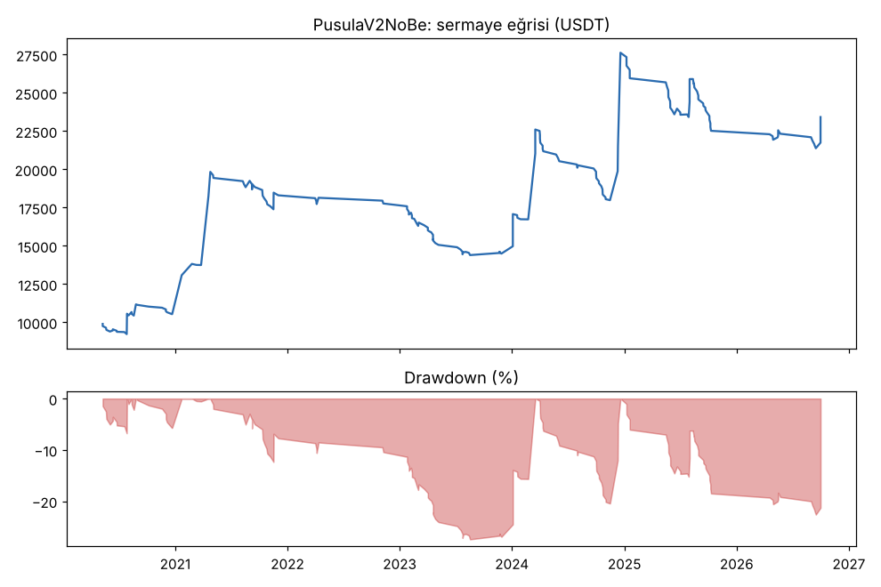
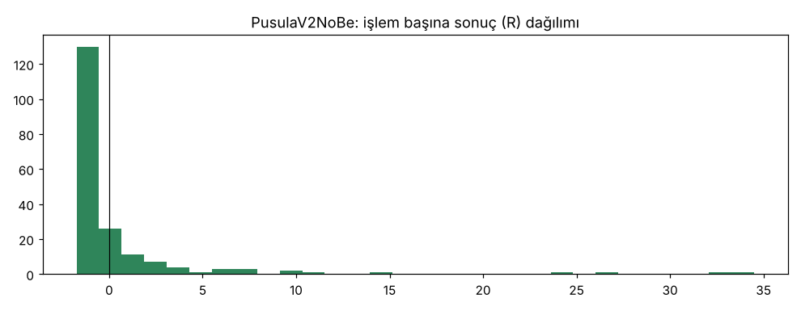
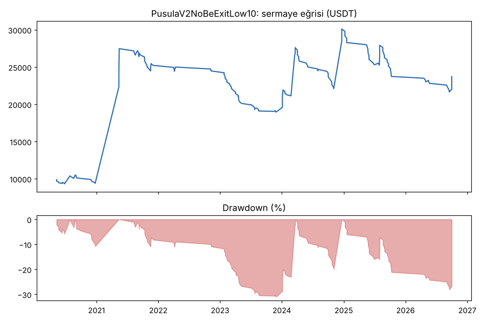
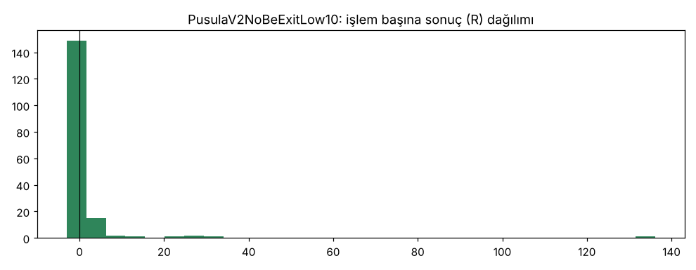

# PusulaV2NoBe vs PusulaV2NoBeExitLow10 — dip10_cikis — 2026-11-07

## Özet
- **PusulaV2NoBe**: 193 işlem, işlem başına ortalama **0.61R** (maliyet ve funding dahil), net getiri 134.2%, en büyük düşüş 22.6%.
- **PusulaV2NoBeExitLow10**: 172 işlem, işlem başına ortalama **1.07R** (maliyet ve funding dahil), net getiri 137.2%, en büyük düşüş 31.0%.
- Aynı dönemde coinleri al-tut (eşit ağırlık): getiri 194.7%, ortalama en büyük düşüş 97.6%.

## Ayarlar
- Dönem: 2020-04-11 00:00:00 → 2026-09-30 20:00:00
- Coinler: FIL/USDT:USDT, UNI/USDT:USDT, AAVE/USDT:USDT, NEAR/USDT:USDT, ALGO/USDT:USDT, XTZ/USDT:USDT, THETA/USDT:USDT, VET/USDT:USDT, ICP/USDT:USDT, SAND/USDT:USDT, MANA/USDT:USDT, AXS/USDT:USDT, EGLD/USDT:USDT, HBAR/USDT:USDT, CHZ/USDT:USDT, ENJ/USDT:USDT, ZEC/USDT:USDT, DASH/USDT:USDT, NEO/USDT:USDT, IOTA/USDT:USDT
- Zaman dilimi: 4h
- Yön: long + short
- Mod: futures / isolated
- Kaldıraç: en fazla 3x, likidasyon stop mesafesinin en az 2 katı uzakta (bölüm 7.6)
- Risk: işlem başına sermayenin %1'i (pozisyon büyüklüğü stop mesafesine göre)
- Maliyet: her emir için %0.05 komisyon + %0.05 kayma (= %0.1), funding geçmiş veriden
- Başlangıç sermayesi: 10000 USDT

## Metrikler
| Metrik | PusulaV2NoBe | PusulaV2NoBeExitLow10 | Al-tut |
|---|---|---|---|
| Net getiri | 134.2% | 137.2% | 194.7% |
| Max drawdown | 22.6% | 31.0% | 97.6% |
| Profit factor | 1.53 | 1.43 | — |
| Ortalama R | 0.61 | 1.07 | — |
| İşlem sayısı | 193 | 172 | — |
| Winrate | 23.3% | 19.2% | — |

Winrate tek başına başarı ölçütü değildir; asıl ölçüt ortalama R (expectancy) ve drawdown'dur.

## Long / short ayrımı
| Strateji | Yön | İşlem | Ortalama R | Toplam R | Profit factor |
|---|---|---|---|---|---|
| PusulaV2NoBe | long | 193 | 0.61 | 117.72 | 1.53 |
| PusulaV2NoBe | short | 0 | — | 0.00 | — |
| PusulaV2NoBeExitLow10 | long | 172 | 1.07 | 184.35 | 1.43 |
| PusulaV2NoBeExitLow10 | short | 0 | — | 0.00 | — |

## Sinyal istatistikleri
| Strateji | Stop | BE | TP1 sonrası BE | TP2 | Diğer | İptal (bölgeye gelmedi / önce stop) | Toplam funding (USDT) |
|---|---|---|---|---|---|---|---|
| PusulaV2NoBe | 53.9% | 0.5% | 0.0% | 0.0% | 45.6% | 6.3% | -3768.94 |
| PusulaV2NoBeExitLow10 | 74.4% | 0.6% | 0.0% | 0.0% | 25.0% | 5.5% | -9181.45 |

## Coin bazında
| Strateji | Coin | İşlem | Ortalama R | Toplam R | Al-tut getirisi |
|---|---|---|---|---|---|
| PusulaV2NoBe | FIL/USDT:USDT | 7 | 5.55 | 38.87 | -97.9% |
| PusulaV2NoBe | UNI/USDT:USDT | 20 | 1.06 | 21.22 | 62.4% |
| PusulaV2NoBe | AAVE/USDT:USDT | 17 | -0.75 | -12.83 | 286.5% |
| PusulaV2NoBe | NEAR/USDT:USDT | 9 | -0.19 | -1.72 | 373.4% |
| PusulaV2NoBe | ALGO/USDT:USDT | 12 | 2.92 | 35.04 | -47.9% |
| PusulaV2NoBe | XTZ/USDT:USDT | 16 | 0.25 | 4.04 | -84.3% |
| PusulaV2NoBe | THETA/USDT:USDT | 8 | 2.45 | 19.59 | -48.0% |
| PusulaV2NoBe | VET/USDT:USDT | 13 | 1.47 | 19.17 | 139.2% |
| PusulaV2NoBe | ICP/USDT:USDT | 4 | 0.36 | 1.43 | -99.3% |
| PusulaV2NoBe | SAND/USDT:USDT | 4 | -0.69 | -2.76 | -54.0% |
| PusulaV2NoBe | MANA/USDT:USDT | 7 | -0.55 | -3.84 | -91.4% |
| PusulaV2NoBe | AXS/USDT:USDT | 2 | -0.68 | -1.36 | 136.4% |
| PusulaV2NoBe | EGLD/USDT:USDT | 8 | -0.48 | -3.86 | -65.7% |
| PusulaV2NoBe | HBAR/USDT:USDT | 6 | -0.66 | -3.94 | -68.6% |
| PusulaV2NoBe | CHZ/USDT:USDT | 6 | -0.68 | -4.10 | -26.0% |
| PusulaV2NoBe | ENJ/USDT:USDT | 4 | 0.59 | 2.36 | -83.5% |
| PusulaV2NoBe | ZEC/USDT:USDT | 13 | -0.17 | -2.15 | 3815.4% |
| PusulaV2NoBe | DASH/USDT:USDT | 17 | 0.08 | 1.35 | -19.1% |
| PusulaV2NoBe | NEO/USDT:USDT | 12 | 0.66 | 7.88 | -65.8% |
| PusulaV2NoBe | IOTA/USDT:USDT | 8 | 0.41 | 3.31 | -66.9% |
| PusulaV2NoBeExitLow10 | FIL/USDT:USDT | 7 | 3.15 | 22.03 | -97.9% |
| PusulaV2NoBeExitLow10 | UNI/USDT:USDT | 18 | 0.96 | 17.33 | 62.4% |
| PusulaV2NoBeExitLow10 | AAVE/USDT:USDT | 13 | -0.73 | -9.54 | 286.5% |
| PusulaV2NoBeExitLow10 | NEAR/USDT:USDT | 9 | -0.29 | -2.62 | 373.4% |
| PusulaV2NoBeExitLow10 | ALGO/USDT:USDT | 10 | 2.05 | 20.49 | -47.9% |
| PusulaV2NoBeExitLow10 | XTZ/USDT:USDT | 13 | 0.04 | 0.47 | -84.3% |
| PusulaV2NoBeExitLow10 | THETA/USDT:USDT | 8 | 16.18 | 129.43 | -48.0% |
| PusulaV2NoBeExitLow10 | VET/USDT:USDT | 11 | 1.54 | 16.94 | 139.2% |
| PusulaV2NoBeExitLow10 | ICP/USDT:USDT | 4 | -0.01 | -0.05 | -99.3% |
| PusulaV2NoBeExitLow10 | SAND/USDT:USDT | 4 | -1.07 | -4.26 | -54.0% |
| PusulaV2NoBeExitLow10 | MANA/USDT:USDT | 7 | -0.67 | -4.70 | -91.4% |
| PusulaV2NoBeExitLow10 | AXS/USDT:USDT | 2 | 0.77 | 1.54 | 136.4% |
| PusulaV2NoBeExitLow10 | EGLD/USDT:USDT | 7 | -0.42 | -2.95 | -65.7% |
| PusulaV2NoBeExitLow10 | HBAR/USDT:USDT | 6 | -0.10 | -0.62 | -68.6% |
| PusulaV2NoBeExitLow10 | CHZ/USDT:USDT | 6 | -0.73 | -4.38 | -26.0% |
| PusulaV2NoBeExitLow10 | ENJ/USDT:USDT | 4 | -0.07 | -0.28 | -83.5% |
| PusulaV2NoBeExitLow10 | ZEC/USDT:USDT | 12 | -0.82 | -9.82 | 3815.4% |
| PusulaV2NoBeExitLow10 | DASH/USDT:USDT | 15 | -0.70 | -10.56 | -19.1% |
| PusulaV2NoBeExitLow10 | NEO/USDT:USDT | 10 | 2.59 | 25.94 | -65.8% |
| PusulaV2NoBeExitLow10 | IOTA/USDT:USDT | 6 | -0.01 | -0.04 | -66.9% |

## Grafikler

## Yorum: güçlü yanlar / şüpheli noktalar
_(Claude tarafından rakamlara bakılarak yazılır.)_

## Karar: devam / düzelt / emekli
_(Claude tarafından yazılır, gerekçesiyle.)_
