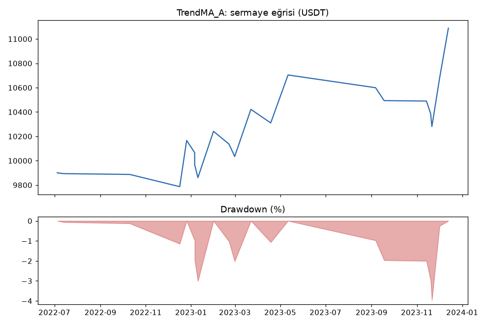
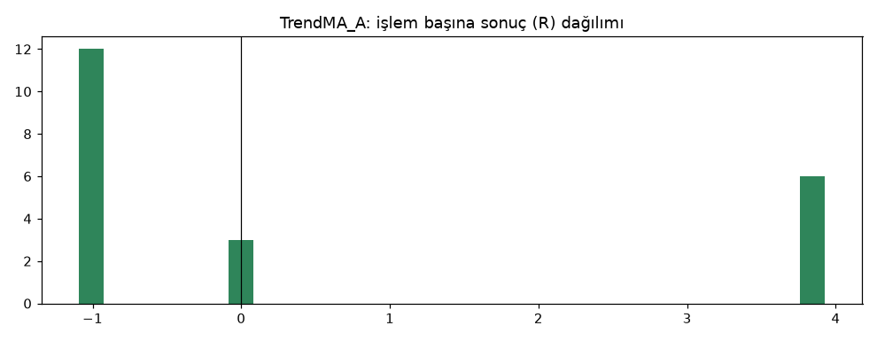
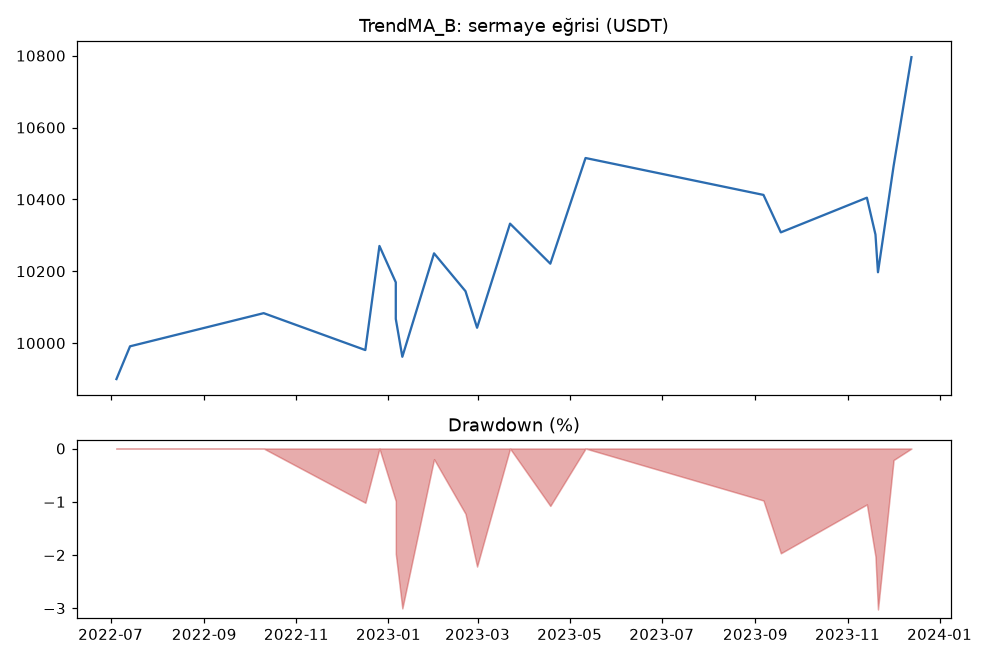
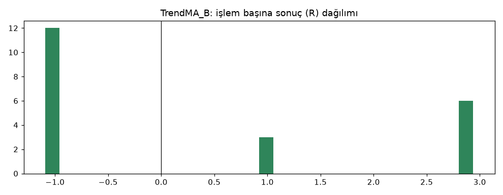

# TrendMA_A vs TrendMA_B — boru_hatti_testi — 2026-10-04

> ⚠️ **SENTETİK VERİ.** Bu rapor gerçek piyasa verisiyle değil, rastgele üretilmiş veriyle yapılmış bir **boru hattı testidir**. Rakamların hiçbir anlamı yoktur; sadece sistemin uçtan uca çalıştığını gösterir.

## Özet
- **TrendMA_A**: 21 işlem, işlem başına ortalama **0.52R** (maliyet ve funding dahil), net getiri 10.9%, en büyük düşüş 4.0%.
- **TrendMA_B**: 21 işlem, işlem başına ortalama **0.39R** (maliyet ve funding dahil), net getiri 8.0%, en büyük düşüş 3.0%.
- Aynı dönemde coinleri al-tut (eşit ağırlık): getiri -69.9%, ortalama en büyük düşüş 89.3%.

## Ayarlar
- Dönem: 2022-06-16 16:00:00 → 2023-12-31 20:00:00
- Coinler: BTC/USDT:USDT, ETH/USDT:USDT
- Zaman dilimi: 4h
- Yön: long + short
- Mod: futures / isolated
- Kaldıraç: en fazla 3x, likidasyon stop mesafesinin en az 2 katı uzakta (bölüm 7.6)
- Risk: işlem başına sermayenin %1'i (pozisyon büyüklüğü stop mesafesine göre)
- Maliyet: her emir için %0.05 komisyon + %0.05 kayma (= %0.1), funding geçmiş veriden
- Başlangıç sermayesi: 10000 USDT

## Metrikler
| Metrik | TrendMA_A | TrendMA_B | Al-tut |
|---|---|---|---|
| Net getiri | 10.9% | 8.0% | -69.9% |
| Max drawdown | 4.0% | 3.0% | 89.3% |
| Profit factor | 1.86 | 1.64 | — |
| Ortalama R | 0.52 | 0.39 | — |
| İşlem sayısı | 21 | 21 | — |
| Winrate | 28.6% | 42.9% | — |

Winrate tek başına başarı ölçütü değildir; asıl ölçüt ortalama R (expectancy) ve drawdown'dur.

## Long / short ayrımı
| Strateji | Yön | İşlem | Ortalama R | Toplam R | Profit factor |
|---|---|---|---|---|---|
| TrendMA_A | long | 12 | 1.67 | 20.07 | 7.07 |
| TrendMA_A | short | 9 | -1.01 | -9.11 | 0.00 |
| TrendMA_B | long | 12 | 1.43 | 17.19 | 6.44 |
| TrendMA_B | short | 9 | -1.01 | -9.11 | 0.00 |

## Sinyal istatistikleri
| Strateji | Stop | BE | TP1 sonrası BE | TP2 | Diğer | İptal (bölgeye gelmedi / önce stop) | Toplam funding (USDT) |
|---|---|---|---|---|---|---|---|
| TrendMA_A | 57.1% | 14.3% | 0.0% | 28.6% | 0.0% | 4.5% | -36.59 |
| TrendMA_B | 57.1% | 0.0% | 14.3% | 28.6% | 0.0% | 4.5% | -22.51 |

## Coin bazında
| Strateji | Coin | İşlem | Ortalama R | Toplam R | Al-tut getirisi |
|---|---|---|---|---|---|
| TrendMA_A | BTC/USDT:USDT | 8 | 1.43 | 11.47 | -66.0% |
| TrendMA_A | ETH/USDT:USDT | 13 | -0.04 | -0.50 | -73.8% |
| TrendMA_B | BTC/USDT:USDT | 8 | 0.95 | 7.57 | -66.0% |
| TrendMA_B | ETH/USDT:USDT | 13 | 0.04 | 0.51 | -73.8% |

## Grafikler

## Yorum: güçlü yanlar / şüpheli noktalar
_(Claude tarafından rakamlara bakılarak yazılır.)_

## Karar: devam / düzelt / emekli
_(Claude tarafından yazılır, gerekçesiyle.)_
